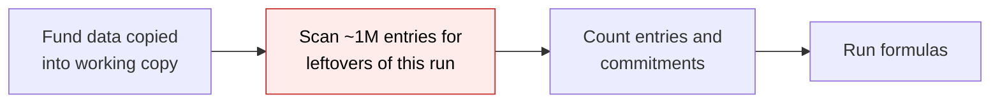
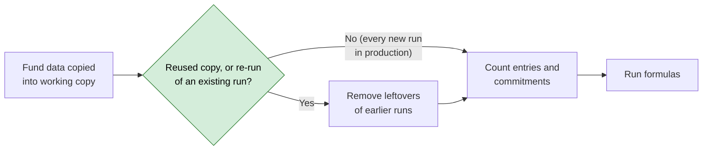

# Skip Redundant Cleanup in Allocation Data Load — Proposal

> **Audience:** Business team, product, QA, support — non-technical.
> **Companion document:** [Design](design.md)

> **Planning phase — no code changes.** This document proposes and explains the change. Do not
> edit application code while writing it; implementation happens later, in the tasks phase.

---

## Why

On 2026-10-05 a large fund's allocation run made the background-job service (Sidekiq) stop responding for over two minutes, so the server's health monitor killed and restarted it, interrupting every job that was running. The trigger was a "clean up leftovers from this run" step that runs right after the fund's data is copied into the allocation working copy; for a freshly copied working copy there is normally nothing to clean up, but the step still reads through about 1 million account entries.

## What Changes

- After the fund's data is copied into a **fresh** allocation working copy, the system no longer runs the "remove leftovers from this run" step. A fresh copy cannot contain anything from the run that is just starting.
- The step is kept where leftovers can genuinely exist: a **reused** working copy (development only) and a **re-run of an existing allocation run** (support re-running the same run, which replaces the period). Only brand-new runs skip it, which is the normal case.
- The job service's health monitor waits **10 minutes** instead of 2 before deciding the service is frozen and restarting it.
- Nothing changes in what users see: allocation results, notifications and run reports are identical.

### Flow Diagram

**Before:** every run scans the whole working copy for leftovers, even a brand-new one.

**After:** the scan only happens when the working copy is reused, or the run is a re-run of an existing run (the main database already holds rows for it, a quick lookup).

---

## User Stories

### US-1: Large fund allocation completes without restarting background jobs

**As a** fund operations user running an allocation for a large fund,
**I want** the allocation to continue past the data-loading phase without freezing the job service,
**So that** my run and everyone else's background jobs (reports, notifications, imports) are not interrupted.

**Acceptance criteria:**
- After "Loaded N account entries and M commitments for fund …" the run proceeds to the formulas as before.
- The job service is not restarted by its health monitor during this phase.
- Allocation entries generated are identical to before the change for the same inputs.

---

## UI Behavior

No screens change. The same progress messages appear in the same order:

1. "Loading data for fund … Could take a few minutes..."
2. "Loaded N account entries and M commitments for fund …"
3. Formula progress and the final "Done running N formulas …" message.

---

## What This Feature Does NOT Cover

| Excluded | Covered In |
|---|---|
| Adding a database index on the "allocation run" column of the working copy | Considered and rejected, see Resolved Design Decisions #2 |
| Running allocation jobs in their own dedicated job service so a stall cannot affect other jobs | Possible future follow-up (not scheduled) |
| Running allocation jobs in their own job service | Not now, see Resolved Design Decisions #4 |
| Speeding up the 30+ minute copy of fund data into the working copy | Not part of this change |

---

## Validation Rules

No input fields or validations change.

---

## Behavior Rules

| Scenario | What User Sees |
|---|---|
| Production allocation, fresh working copy | Same messages as today; the cleanup scan no longer happens, so the run moves straight on to the formulas |
| Development allocation reusing an earlier working copy | Same as today; leftovers of earlier runs are still removed before formulas run |
| Re-run of an existing allocation run ("Re-run" on the run), including after a formula was disabled or deleted | Same as today: the period is replaced and totals do not change; no duplicated entries |
| Allocation for a fund with zero commitments | Same warning as today: "No capital commitments were loaded for fund …" |
| Allocation load script fails | Same failure message as today |

---

## Resolved Design Decisions

| # | Decision | Resolution |
|---|---|---|
| 1 | Is the cleanup ever needed on a fresh copy? | For a brand-new run, no: it gets a new run identifier, so a freshly copied working copy holds nothing under it. **For a re-run of an existing run, yes.** Re-running replaces the period, but only entries of formulas still in scope are cleared before the copy; entries of a formula that has since been disabled or deleted keep the run identifier, get copied into the new working copy, and would be saved a second time (duplicated totals). The system therefore checks whether the main database already holds rows for the run, using an existing index, and runs the cleanup only then (or for a reused development copy). |
| 2 | Add a database index on the run identifier so the scan is fast? | **No.** Once the cleanup is skipped on fresh copies, nothing on a fresh copy looks entries up by run identifier alone. The other lookup that uses it (moving generated entries back to the main database) already narrows by fund and "generated" through an existing index, so it only looks at entries this run produced. The remaining user of the run identifier is a link in the UI, which does not touch the working copy. An extra index would slow the already 30+ minute copy and enlarge working-copy files on a disk that is 81% full, to speed up a step we are removing. Revisit only if timing logs show the move-back step is slow. |
| 3 | Raise the health monitor's time limit as well? | **Yes, from 2 minutes to 10 minutes (600s), in addition to the fix.** The fix removes the known cause; the longer limit is a safety margin so a similar long pause in future does not kill every running job. The trade-off: a job service that is genuinely frozen now stays down for up to 10 minutes before the monitor restarts it, instead of 2. |
| 4 | Move allocation jobs to their own job service? | **Not now.** Useful for containing any future stall, but a bigger operational change. Noted as a possible follow-up. |

---

## Capabilities

### New Capabilities

None.

### Modified Capabilities

None. No requirement changes: allocation behaviour and results are the same, only an unnecessary internal step is skipped. This change should opt out of delta specs (`skip_specs: true`) when the planning artifacts are finalised.

---

## Impact

- The allocation run's "load data" phase (fund allocation / account entry allocation).
- The job service's server configuration (health-monitor time limit), applied on the next deploy, which restarts the job service as usual.
- Large funds benefit most; small funds see no visible difference.
- No changes to data, screens, notifications or reports.

---

## Benefits

1. Large-fund allocations no longer risk freezing and restarting the job service.
2. Other jobs running at the same time (reports, imports, notifications) are no longer interrupted by an allocation run.
3. Runs get slightly faster, since a full pass over the working copy is removed.

---

## FAQ

| Question | Answer |
|---|---|
| Will allocation results change? | No. The skipped step could not remove anything on a fresh working copy. |
| Do users need to do anything? | No. |
| What about the run that was interrupted on 2026-10-05? | It was restarted automatically by the system and re-ran the data load. No data fix is needed from this change. |
| Is this the only possible cause of the restart? | It is the best match for the evidence (the log goes silent right after the data load, in the very next step). If restarts continue after this change, we investigate further before adding anything else. See [design.md](design.md). |
| Does this affect billing, notifications or access? | No. |
| What is the downside of the 10-minute limit? | If the job service truly freezes, it is restarted after up to 10 minutes instead of 2, so queued jobs wait longer in that rare case. |

---

## Design Principle for the Next Phase

Keep it to a single condition around the existing cleanup step. No new classes, no new settings, no schema or index changes. Nothing in this proposal risks a complex design.
