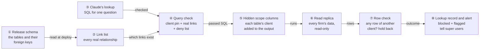
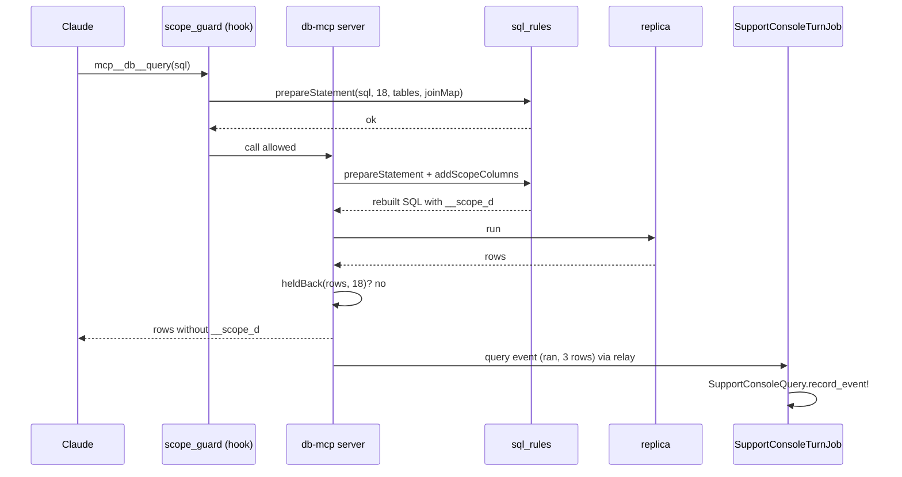
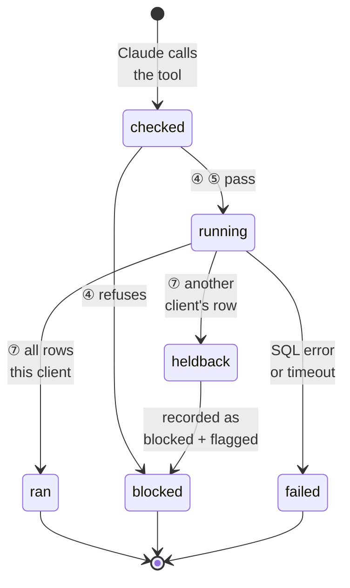
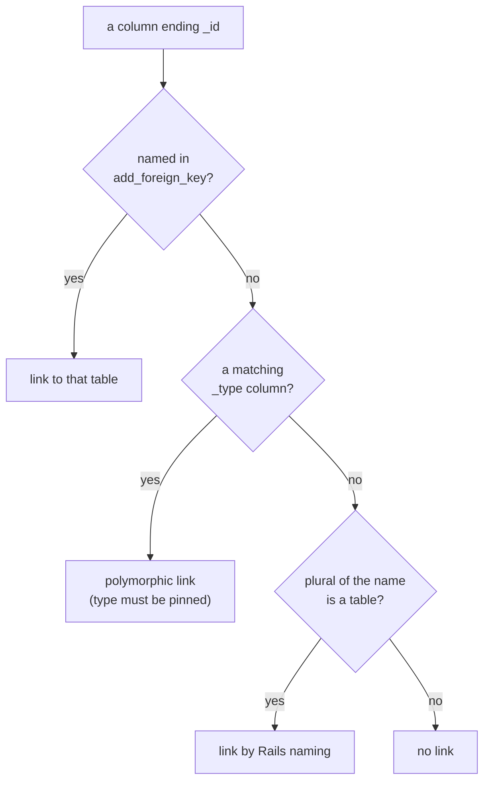
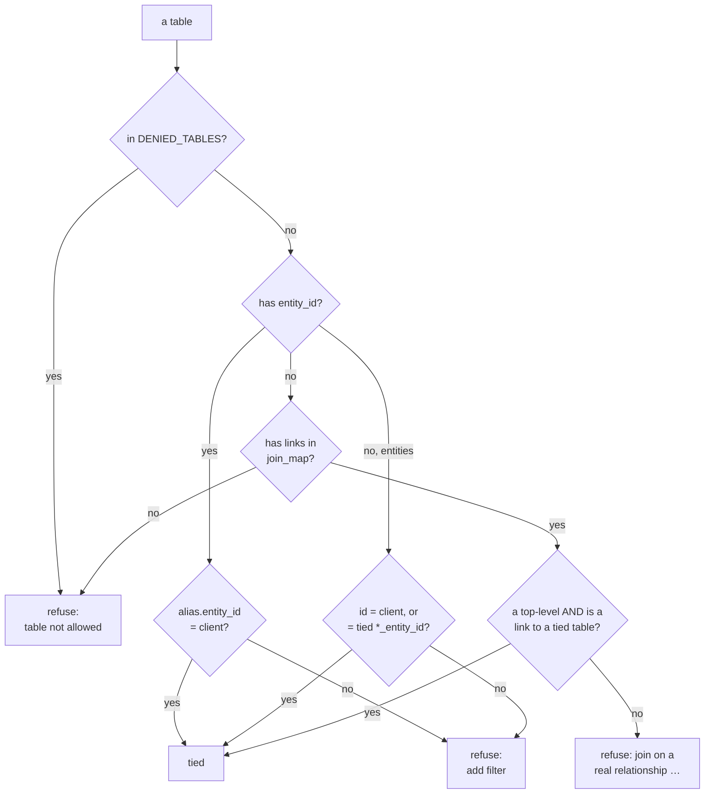
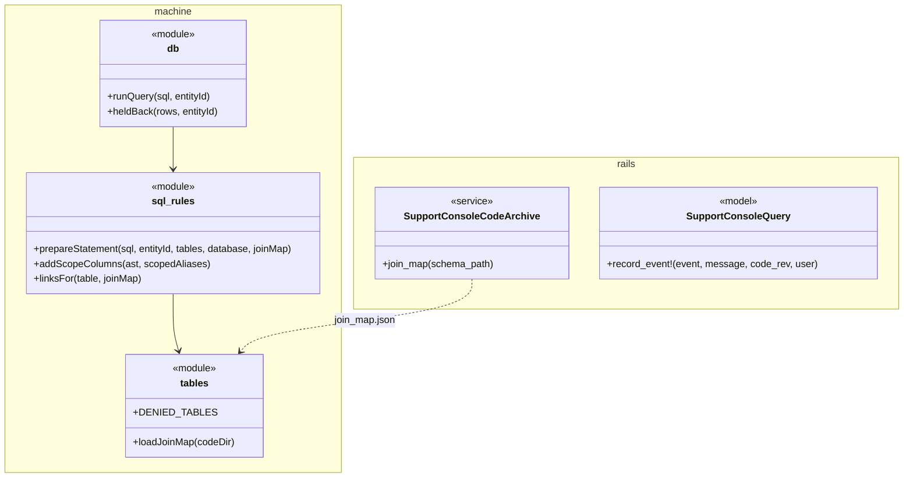

# Support Console tenant scope — Design

> **Audience:** Engineering team.
> **Companion documents:** [Proposal](proposal.md) · [Spec](specs/) · [LLD](lld.md) · [QA checklist](qa-checklist.md)

> **Planning phase — no code changes.** This document explains HOW the proposal will be built.

> **Zoom one picture.** Part 1 draws it in plain words, Part 2 redraws it with real names, Part 3
> has one card per box, Part 4 is reference. ①–⑧ mean the same box everywhere.

## Contents

- [1. The idea](#1-the-idea)
  - [What this adds](#what-this-adds)
  - [The idea in one picture](#the-idea-in-one-picture)
  - [Walkthrough: one example, start to finish](#walkthrough-one-example-start-to-finish)
  - [Key ideas](#key-ideas)
- [2. The same picture with real names](#2-the-same-picture-with-real-names)
  - [Picture](#picture)
  - [What each box does](#what-each-box-does)
  - [One run, end to end](#one-run-end-to-end)
  - [Lifecycles](#lifecycles)
  - [What users see](#what-users-see)
  - [Design decisions](#design-decisions)
- [3. One card per box](#3-one-card-per-box)
  - [① Release schema](#①-release-schema)
  - [② Link list](#②-link-list)
  - [③ Claude's lookup](#③-claudes-lookup)
  - [④ Query check](#④-query-check)
  - [⑤ Hidden scope columns](#⑤-hidden-scope-columns)
  - [⑥ Read replica](#⑥-read-replica)
  - [⑦ Row check](#⑦-row-check)
  - [⑧ Lookup record and alert](#⑧-lookup-record-and-alert)
- [4. Reference](#4-reference)
  - [Class diagram](#class-diagram)
  - [Data model and schema changes](#data-model-and-schema-changes)
  - [Component contracts](#component-contracts)
  - [Notifications](#notifications)
  - [Cross-cutting concerns](#cross-cutting-concerns)
  - [Worked examples](#worked-examples)
  - [Testing](#testing)
  - [Risks and open questions](#risks-and-open-questions)

---

## 1. The idea

### What this adds

The Support Console's SQL check (`prepareStatement`, built in change `support-console`) already pins
every table that has `entity_id` to the conversation's client. This change makes tables **without**
`entity_id` follow the same discipline — they may only be joined along a real relationship, taken
from a link list built from `db/schema.rb` on every deploy, exactly as `tables_with_entity_id.json`
is today — and adds a check on every returned row, so a gap in the SQL check holds the answer back
instead of handing it to Claude.

### The idea in one picture



### Walkthrough: one example, start to finish

**Setup.** Golden Angels is entity **18**. Meera, a support user mapped to it, asks "Who has the Q3
report been shared with?". `documents` has `entity_id`; `doc_shares` doesn't — it has
`document_id`, `email`, `viewed_at`. Beta Capital is entity **31**.

Legend: ✓ passed · ✗ refused or held back.

| # | When | What happens | Behind the scenes | Result |
|---|---|---|---|---|
| 1 | Deploy | The release is published | ① `db/schema.rb` has `add_foreign_key "doc_shares", "documents"`; ② writes `doc_shares.document_id → documents.id` into `join_map.json` | Link list ready |
| 2 | Meera asks | Claude joins shares to documents on `s.id = d.id` | ③ → ④: `documents d` pinned by `d.entity_id = 18` ✓; `doc_shares s` joined on `s.id = d.id`, which is not in ② | **✗ refused**: "join on a real relationship: doc_shares can be joined by doc_shares.document_id = documents.id" |
| 3 | Claude retries | `… JOIN doc_shares s ON s.document_id = d.id WHERE d.entity_id = 18` | ④ ✓ (a link from ②); ⑤ adds `d.entity_id AS __scope_d`; ⑥ returns 3 rows | 3 rows |
| 4 | Row check | Every `__scope_d` is 18 | ⑦ drops `__scope_d`; ⑧ records `ran`, 3 rows | **✓ 3 shares** go to Claude; Meera gets the answer |
| 5 | (stall) A bug lets `OR 1=1` through ④ | ⑥ returns 9 rows, one with `__scope_d = 31` | ⑦ finds 31 ≠ 18 | **✗ held back**: Claude gets no rows; ⑧ records `blocked`, flagged; super users alerted |

Snapshot of row 5, the moment ⑦ decides:

```
d.name                     s.email        __scope_d
Golden Angels Q3 report    lp1@ravi.in    18
Beta Capital side letter   lp7@beta.in    31   ← not 18 → hold back all 9 rows
```

What to notice:
- The refusal in row 2 names the right link, so Claude fixes its own query.
- The hidden column comes from `documents.entity_id`, the table `doc_shares` is linked to — that is
  how ⑦ covers tables without `entity_id`.
- Nothing in rows 1–4 is visible to Meera beyond one retried "Looking up data" step.

### Key ideas

| # | Idea | In one line | Card |
|---|---|---|---|
| 1 | Real links only | A table without `entity_id` is tied to the client only through a relationship in the link list | [④](#④-query-check) |
| 2 | Link list from the schema | Built from the release's `db/schema.rb` at `publish_code`, never by hand | [②](#②-link-list) |
| 3 | Deny list for linked secrets | Tokens, OTPs, history, AI chat logs stay refused even when linked | [④](#④-query-check) |
| 4 | Judge the answer too | Hidden `__scope_*` columns; any other client's row holds back the whole lookup | [⑤](#⑤-hidden-scope-columns), [⑦](#⑦-row-check) |
| 5 | References are not owners | `investor_entity_id` and friends are never filtered or checked | [④](#④-query-check), [⑦](#⑦-row-check) |

| Question | Answer |
|---|---|
| Why not database-enforced views? | Dropped by the product owner: ~230 views to keep in step with every migration, and admin GRANT rights we don't have on staging. |
| Why not a separate allow list of tables? | ④'s real-link rule already refuses a table with no link to client data; a second list would say the same thing. |
| Does Meera see anything new? | No new screens. A refused lookup is one more "Looking up data" step; a held-back one is mentioned in Claude's answer. |

---

## 2. The same picture with real names

### Picture

```mermaid
flowchart LR
    s1["① db/schema.rb<br/><i>the release's tables<br/>and foreign keys</i>"] -->|"File.read"| s2["② SupportConsoleCodeArchive<br/>.join_map → join_map.json<br/><i>links per table</i>"]
    s3["③ mcp__db__query<br/><i>Claude's SQL</i>"] -->|"PreToolUse +<br/>MCP call"| s4["④ sql_rules.prepareStatement<br/>tables.js DENIED_TABLES<br/><i>pin, links, deny</i>"]
    s2 -->|"tables.loadJoinMap"| s4
    s4 -->|"checked AST"| s5["⑤ sql_rules.addScopeColumns<br/><i>__scope_alias</i>"]
    s5 -->|"rebuilt SQL"| s6["⑥ replica as support_ro<br/><i>mysql2 query</i>"]
    s6 -->|"rows"| s7["⑦ db.js heldBack<br/><i>replaces flagRows</i>"]
    s7 -->|"query event"| s8["⑧ SupportConsoleQuery<br/>FlaggedNotifier<br/><i>blocked + flagged</i>"]
    click s1 "#①-release-schema"
    click s2 "#②-link-list"
    click s3 "#③-claudes-lookup"
    click s4 "#④-query-check"
    click s5 "#⑤-hidden-scope-columns"
    click s6 "#⑥-read-replica"
    click s7 "#⑦-row-check"
    click s8 "#⑧-lookup-record-and-alert"
    classDef new fill:#d4edda,stroke:#2e7d32,color:#000
    classDef mod fill:#fff3cd,stroke:#d39e00,color:#000
    classDef reuse fill:#eeeeee,stroke:#777,color:#000
    class s5 new
    class s2,s4,s7 mod
    class s1,s3,s6,s8 reuse
```



### What each box does

| # | Box | Real parts | What it does | When it runs | What it decides | Details |
|---|---|---|---|---|---|---|
| ① | Release schema | `db/schema.rb` in the code archive | Source of tables, columns, `add_foreign_key` | — | — | [card ①](#①-release-schema) |
| ② | Link list | `SupportConsoleCodeArchive.join_map` → `join_map.json` | Lists every real link per table | `publish_code` (every deploy) | Which joins count as real | [card ②](#②-link-list) |
| ③ | Claude's lookup | `mcp__db__query` tool call | SQL for one question | each lookup | — | [card ③](#③-claudes-lookup) |
| ④ | Query check | `sql_rules.prepareStatement`, `tables.js` (`DENIED_TABLES`, `loadJoinMap`), `hooks/scope_guard.js`, `db-mcp/server.js` | Pins `entity_id` tables, ties the rest by links, refuses denied tables | hook, then MCP, per lookup | Run or refuse (with reason) | [card ④](#④-query-check) |
| ⑤ | Hidden scope columns | `sql_rules.addScopeColumns` | Adds `__scope_<alias>` per `entity_id` table to the outer SELECT | after ④ passes | Rewrite or refuse "unreadable" | [card ⑤](#⑤-hidden-scope-columns) |
| ⑥ | Read replica | `db.js` connection as `support_ro` | Runs the rebuilt SQL | per lookup | — | [card ⑥](#⑥-read-replica) |
| ⑦ | Row check | `db.js` `heldBack` | Every `__scope_*` must be the client; strips them | after ⑥ | Return rows or hold back | [card ⑦](#⑦-row-check) |
| ⑧ | Lookup record and alert | `SupportConsoleQuery.record_event!`, `SupportConsoleQueryFlaggedNotifier` | Records outcome; alerts super users when flagged | turn job, per query event | — | [card ⑧](#⑧-lookup-record-and-alert) |

### One run, end to end



### Lifecycles

One derived outcome per lookup, stored on `SupportConsoleQuery.outcome` (values unchanged:
`ran | blocked | failed`; `flagged` boolean).



### What users see

| At a glance | Change |
|---|---|
| Support Console answer | No UI change; a refused lookup is one more "Looking up data" step |
| Admin › Support Console queries | Held-back lookups appear as **blocked**, flagged, reason "rows from another client" |
| Bell (super users) | Existing "Support Console lookup flagged…" alert, now also for held-back lookups |

Messages are in the [proposal's Behavior Rules](proposal.md#behavior-rules).

### Design decisions

| Choice | Alternative | Why the alternative was rejected |
|---|---|---|
| Links from `db/schema.rb` at `publish_code` | Rails model reflections | `publish_code` loads the deployer's working tree, not the published revision; schema.rb in the archive is the revision's own |
| Polymorphic links need `<alias>.<name>_type = '<Class>'` | Accept `record_id = x.id` alone | `record_id` matches records of every class, so every firm |
| Hold back the whole lookup | Drop only the bad rows | A partial answer hides that the check failed and may still mislead |
| Hidden columns only from `entity_id` of tables in `tables_with_entity_id.json` | Also check `*_entity_id` columns | Those are references, not owners (LP firm, co-investor) — checking them would block legitimate answers |
| Refuse shapes ⑤ cannot rewrite | Run them unchecked | Fail closed: an unchecked shape is exactly where a leak would hide |
| Missing `join_map.json` refuses unscoped tables | Fall back to today's weak rule | Fail closed; `machine_check` reports the missing file |

| Question | Answer |
|---|---|
| Why rebuild the SQL rather than check the text? | Already the rule since X16 in `support-console`: the SQL that runs is rebuilt from the checked AST. ⑤ adds columns to that same AST. |
| Does ⑤ change what Claude sees? | No: ⑦ strips every `__scope_*` column before rows are returned. |
| Why is `blocked` reused for held-back lookups? | It already means "nothing ran for Claude"; `flagged` says why it matters. No migration. |

---

## 3. One card per box

> Same order and numbers as the picture.

### ① Release schema

The `db/schema.rb` of the revision being published, already copied into the code archive by
`SupportConsoleCodeArchive` (it is in `INCLUDED`).

| Owns | Reads / receives | Produces |
|---|---|---|
| Nothing new | the revision's tree | `create_table` blocks and `add_foreign_key` lines for ② |

**Worked examples:** H7, E6.

| Question | Answer |
|---|---|
| Why schema.rb and not the live database? | It is the exact layout of the code Claude reads, and it is already in the archive. |

### ② Link list

`SupportConsoleCodeArchive.join_map(schema_path)` writes `join_map.json` next to
`tables_with_entity_id.json`.

| Owns | Reads / receives | Produces |
|---|---|---|
| `join_map.json` | ① schema.rb | `{ table: [{column, to}] \| [{column, polymorphic}] }` |

How a link is found, per table without `entity_id`:



Links are recorded in both directions' use: child `fk → parent.id`; ④ accepts the condition written
either way round (`s.document_id = d.id` or `d.id = s.document_id`) and parent ← child
(`b.id = a.blob_id`).

**Worked examples:** H7, E6.

| Question | Answer |
|---|---|
| What about a foreign key to a table that has `entity_id`? | That is the normal case: it links an unscoped child to a scoped parent. |
| What if naming guesses a wrong table? | The guess only allows a join that is a real `x_id = xs.id` pair; a wrong guess can only refuse, never widen, because the parent must still be tied to 18. |

### ③ Claude's lookup

Unchanged: Claude calls `mcp__db__query` with one SELECT.

| Owns | Reads / receives | Produces |
|---|---|---|
| — | the question, the code | SQL |

**Worked examples:** every row.

| Question | Answer |
|---|---|
| Does Claude need new instructions? | The brief gains one line: join tables without `entity_id` by their real foreign key; a refusal names it. |

### ④ Query check

`prepareStatement(sql, entityId, tablesWithEntityId, database, joinMap)` — same function, a fifth
argument. Runs in the hook and again in the MCP server.

| Owns | Reads / receives | Produces |
|---|---|---|
| The tie rules; `DENIED_TABLES` (+ `agent_chat_sessions`, `agent_chat_messages`) | SQL, client id, `tables_with_entity_id.json`, `join_map.json` | checked AST, or a reason |

Per table in each SELECT (UNION arm, subquery, CTE), repeated until nothing new is tied:



A link condition is one of:

| Shape | Example |
|---|---|
| child fk = tied parent id | `s.document_id = d.id` (either side order) |
| parent id = tied child fk | `b.id = a.blob_id` |
| polymorphic: both in the same top-level AND | `r.record_type = 'Investor' AND r.record_id = i.id` (class = Rails classify of the tied table) |
| `fk IN (SELECT id FROM <tied parent> …)` | `s.document_id IN (SELECT id FROM documents WHERE entity_id = 18)` — the subquery must return the link's other column |

`*_entity_id` columns: unchanged — `entities` may be tied through any `*_entity_id` of a tied row;
scoped tables still need `entity_id = client` (so an LP's own funds stay closed).

Identifiers starting `__scope_` are refused ("unreadable"): they are reserved for ⑤.

**Worked examples:** H1–H4, E1–E3, E7, E8, E10, X1–X6, X8, X9.

| Question | Answer |
|---|---|
| Why does the refusal list links? | Claude corrects itself on the next try, as it already does for "add filter". |
| What about LEFT JOIN? | A LEFT-joined unscoped table must still be tied by its ON; unchanged rule for which conditions count. |
| Why keep `DENIED_TABLES`? | Tokens and OTPs link to `users` (which has `entity_id`), so ④ alone would allow them. |

### ⑤ Hidden scope columns

`addScopeColumns(ast, scopedAliases)` on the checked AST, before `sqlify`.

| Owns | Reads / receives | Produces |
|---|---|---|
| The rewrite shapes | checked AST from ④ | AST with `__scope_<alias>` columns |

| Shape | Added | Note |
|---|---|---|
| Plain SELECT | `alias.entity_id AS __scope_alias` | per `entity_id` table in the outer FROM |
| GROUP BY or aggregate | `MIN(alias.entity_id) AS __scope_alias_min, MAX(…) AS __scope_alias_max` | valid under ONLY_FULL_GROUP_BY |
| DISTINCT | `alias.entity_id AS __scope_alias` | constant for correct data, so distinct rows unchanged |
| UNION | same columns in every arm, `NULL AS __scope_x` where absent | equal column counts |
| Outer SELECT with only unscoped tables / derived tables | nothing added | covered by ④ alone (documented gap) |
| Anything ⑤ cannot place (e.g. `SELECT … INTO`, window frames over the outer list) | — | refuse "unreadable" |

**Worked examples:** H1, H5, E4, E5, E12–E14, X9, X10.

| Question | Answer |
|---|---|
| Why only the outer SELECT? | Inner SELECTs never return rows to Claude directly, and ④ pins them literally. |
| Does LIMIT still mean what Claude wrote? | Yes; added columns don't change row count or order. |

### ⑥ Read replica

Unchanged: `db.js` runs the rebuilt SQL as `support_ro`, capped at 200 rows.

| Owns | Reads / receives | Produces |
|---|---|---|
| — | rebuilt SQL | rows incl. `__scope_*` |

**Worked examples:** every H/E row.

| Question | Answer |
|---|---|
| Does the 200-row cap apply before ⑦? | ⑦ checks every row fetched, then the cap is applied to what is returned. |

### ⑦ Row check

`heldBack(rows, entityId)` in `db.js` replaces `flagRows`.

| Owns | Reads / receives | Produces |
|---|---|---|
| hold-back decision | rows with `__scope_*` | rows without them, or "blocked: rows from another client" |

- Every non-NULL `__scope_*` value must equal the client id (string compare). NULL is skipped
  (UNION padding, LEFT JOIN misses, aggregates over zero rows).
- On a mismatch: return no rows; query event `outcome: "blocked"`, `flagged: true`,
  `reason: "rows from another client"`.
- Columns Claude names `entity_id` are no longer looked at (today's `flagRows` false alarm on
  `investor_entity_id AS entity_id` goes away).

**Worked examples:** H1, H4, H5, E9, E13, X7, X11.

| Question | Answer |
|---|---|
| Why not keep `flagRows` as well? | It reads Claude-chosen column names; ⑦ reads only its own columns. |

### ⑧ Lookup record and alert

Unchanged code path: the relay forwards the query event; `SupportConsoleTurnJob` calls
`SupportConsoleQuery.record_event!`; a flagged row fires `SupportConsoleQueryFlaggedNotifier`
after commit.

| Owns | Reads / receives | Produces |
|---|---|---|
| — | query event | `SupportConsoleQuery` row (`blocked`, `flagged`), bell alert |

**Worked examples:** X7.

| Question | Answer |
|---|---|
| Does Rails change? | No code change required: `OUTCOMES` already has `blocked`, and the alert already fires on `flagged`. |

---

## 4. Reference

### Class diagram



### Data model and schema changes

N/A — no tables or columns change. `join_map.json` is a file in the published code bundle;
`SupportConsoleQuery.outcome` keeps its values.

### Component contracts

| From → To | Contract | Direction rule |
|---|---|---|
| ① → ② | `db/schema.rb` text | read-only |
| ② → ④ | `join_map.json`: `{ "<table>": [{"column","to"} \| {"column","polymorphic"}] }` | machine reads; missing file = no links (fail closed) |
| ③ → ④ | SQL string | — |
| ④ → ⑤ | checked AST + scoped aliases of the outer SELECT | ⑤ never runs on a refused statement |
| ⑤ → ⑥ | rebuilt SQL (`sqlify`) | — |
| ⑥ → ⑦ | rows incl. `__scope_*` | — |
| ⑦ → ⑧ | query event `{seq, sql, outcome, reason, row_count, flagged}` | unchanged shape |

### Notifications

| Notification | Trigger | Recipients | Channel | Customisable | Default | Sent once? |
|---|---|---|---|---|---|---|
| "Support Console lookup flagged: … read another client's rows" (`SupportConsoleQueryFlaggedNotifier`, existing) | a `SupportConsoleQuery` row created with `flagged = true` — now also when ⑦ holds a lookup back | CapHive super users (`User.with_role(:super)`) | in-app bell only | No (internal alert) | On | Yes: one per `SupportConsoleQuery` row (`after_create_commit`; rows are write-once) |

Investors and client users receive nothing: the change is internal to CapHive support, and no client
data leaves the console.

### Cross-cutting concerns

#### Transactions and queries

N/A — no new database writes; ⑥ is one read per lookup.

#### Exception handling and monitoring

A held-back lookup is monitored through the existing flagged alert; a missing `join_map.json` is
reported by `support_console:machine_check` as a ✗ line.

#### Performance and security

- ④ and ⑤ are in-memory AST work (sub-millisecond); ⑤ adds 1–4 small columns.
- Security: fail closed everywhere — missing link list, unknown shape, reserved identifier.

### Worked examples

Shared setup:

| Record | Name | Key data |
|---|---|---|
| Entity | Golden Angels | id 18 (the client) |
| Entity | Beta Capital | id 31 |
| Entity | Ravi Family Office | id 55 (LP of Golden Angels) |
| Investor | Ravi Family Office in Golden Angels | `investors.entity_id` 18, `investor_entity_id` 55 |
| Document | Q3 report | `documents.entity_id` 18, id 501 |
| Doc shares | 3 shares of document 501 | `doc_shares.document_id` 501 |

#### Happy Path

| # | Scenario | Given | When | Then | Spec scenario | Feature |
|---|---|---|---|---|---|---|
| H1 | Real-link join | setup | `SELECT d.name, s.email FROM documents d JOIN doc_shares s ON s.document_id = d.id WHERE d.entity_id = 18` | 3 rows, no `__scope_*` columns in them | Real-relationship join runs | `support_console/tenant_scope.feature` |
| H2 | Two-step chain | an investor attachment | `investors → active_storage_attachments (record_type='Investor') → active_storage_blobs (b.id = a.blob_id)` | runs; file names returned | Real-relationship join runs | `support_console/tenant_scope.feature` |
| H3 | Polymorphic with type | a note on investor | `JOIN action_text_rich_texts r ON r.record_type = 'Investor' AND r.record_id = i.id WHERE i.entity_id = 18` | runs | Type-and-id relationship needs its type | `support_console/tenant_scope.feature` |
| H4 | Investor and LP firm | setup | `investors i JOIN entities e ON e.id = i.investor_entity_id WHERE i.entity_id = 18` | rows with `investor_entity_id` 55, LP name and PAN; not flagged | An investor's LP firm is shown | `support_console/tenant_scope.feature` |
| H5 | Grouped totals | remittances and payments of 18 | `SUM(p.amount_cents) … GROUP BY r.capital_call_id` | totals returned (MIN/MAX scope = 18) | Grouped totals are checked | `support_console/tenant_scope.feature` |
| H6 | Normal lookup unchanged for the user | setup | Meera asks; the lookup passes | the answer arrives as today; one `ran` record | Real-relationship join runs | `support_console/tenant_scope.feature` |
| H7 | Link list published | a release | `publish_code` builds the archive | `join_map.json` has `doc_shares.document_id → documents` and a polymorphic `record_id/record_type` for `action_text_rich_texts` | Real-relationship join runs | `support_console/tenant_scope.feature` |

#### Edge Cases

| # | Scenario | Given | When | Then | Spec scenario | Feature |
|---|---|---|---|---|---|---|
| E1 | Link written the other way round | setup | `… ON d.id = s.document_id` | runs | Real-relationship join runs | `support_console/tenant_scope.feature` |
| E2 | IN with the right column | setup | `doc_shares WHERE document_id IN (SELECT id FROM documents WHERE entity_id = 18)` | runs (no hidden column: outer has no scoped table) | Real-relationship join runs | `support_console/tenant_scope.feature` |
| E3 | Commitments by LP firm | commitments of 18 | `capital_commitments → investors → entities` grouped by LP name | totals per LP firm | An investor's LP firm is shown | `support_console/tenant_scope.feature` |
| E4 | UNION with different tables | — | arm 1 reads `documents`, arm 2 reads `folders`, both pinned | runs; padded `NULL` scope columns skipped | Real-relationship join runs | `support_console/tenant_scope.feature` |
| E5 | DISTINCT | setup | `SELECT DISTINCT s.email … JOIN documents …` | same distinct rows as without the hidden column | Real-relationship join runs | `support_console/tenant_scope.feature` |
| E6 | New table after a migration | schema gains `doc_comments.document_id` with `add_foreign_key` | next `publish_code` | `doc_comments` readable via `document_id`; before that publish it is "table not allowed" | Unlinked table is refused | `support_console/tenant_scope.feature` |
| E7 | Linked table used without its link | setup | `SELECT * FROM doc_shares WHERE id = 5` | refused: "join on a real relationship: doc_shares can be joined by doc_shares.document_id = documents.id" | Wrong-column join is refused | `support_console/tenant_scope.feature` |
| E8 | Polymorphic type of the wrong class | setup | `r.record_type = 'Deal' AND r.record_id = i.id` (i = investors) | refused | Type-and-id relationship needs its type | `support_console/tenant_scope.feature` |
| E9 | Claude names a column `entity_id` | setup | `SELECT i.investor_entity_id AS entity_id … WHERE i.entity_id = 18` | rows returned; not flagged | An investor's LP firm is shown | `support_console/tenant_scope.feature` |
| E10 | Tags through taggings | a tagged investor | `taggings (taggable_type='Investor') → tags (t.id = g.tag_id)` | runs; tag names shown | Real-relationship join runs | `support_console/tenant_scope.feature` |
| E11 | LP firm through a co-investor reference | an investment with `investor_entity_id` | `entities` joined by any `*_entity_id` of a tied row | runs | An investor's LP firm is shown | `support_console/tenant_scope.feature` |
| E12 | LEFT JOIN miss | a document with no shares | `documents d LEFT JOIN doc_shares s ON s.document_id = d.id WHERE d.entity_id = 18` | the share-less document returned; `__scope_d` = 18 | Real-relationship join runs | `support_console/tenant_scope.feature` |
| E13 | Aggregate over zero rows | no payments | `SELECT COUNT(*) FROM capital_remittance_payments p WHERE p.entity_id = 18 AND p.id < 0` | one row, count 0; NULL scope skipped | Grouped totals are checked | `support_console/tenant_scope.feature` |
| E14 | LIMIT unchanged | 300 shares | `… LIMIT 5` | exactly 5 rows, same order | Real-relationship join runs | `support_console/tenant_scope.feature` |

#### Error Cases

| # | Scenario | Given | When | Then (what the user sees, who is alerted) | Spec scenario | Feature |
|---|---|---|---|---|---|---|
| X1 | Wrong-column join | setup | `JOIN doc_shares s ON s.id = d.id WHERE d.entity_id = 18` | refused before running, naming `doc_shares.document_id = documents.id`; record `blocked` | Wrong-column join is refused | `support_console/tenant_scope.feature` |
| X2 | IN with the wrong column | setup | `document_id IN (SELECT folder_id FROM documents WHERE entity_id = 18)` | refused | Subquery returning the wrong column is refused | `support_console/tenant_scope.feature` |
| X3 | Polymorphic without type | setup | `JOIN action_text_rich_texts r ON r.record_id = i.id` | refused | Type-and-id relationship needs its type | `support_console/tenant_scope.feature` |
| X4 | Unlinked table | — | `SELECT * FROM website_leads` | "table not allowed" | Unlinked table is refused | `support_console/tenant_scope.feature` |
| X5 | AI chat logs | — | `agent_chat_messages → agent_chat_sessions → users WHERE u.entity_id = 18` | "table not allowed" | AI chat logs are refused | `support_console/tenant_scope.feature` |
| X6 | LP firm's own funds | setup | `funds f ON f.entity_id = i.investor_entity_id WHERE i.entity_id = 18` | "add filter" | The LP firm's own funds are refused | `support_console/tenant_scope.feature` |
| X7 | Held-back lookup recorded and alerted | a turn | the relay sends a query event `blocked`, `flagged`, reason "rows from another client" | `SupportConsoleQuery` blocked + flagged; super users get the bell alert; the answer goes on | A row from another client is held back | `support_console/tenant_scope.feature` |
| X8 | Link list missing on the machine | an old bundle without `join_map.json` | a lookup reads `doc_shares` through its link | "table not allowed" (fail closed); `machine_check` shows ✗ link list | Unlinked table is refused | `support_console/tenant_scope.feature` |
| X9 | Reserved identifier | — | `SELECT d.id AS __scope_d FROM documents d WHERE d.entity_id = 18` | refused "unreadable" | Wrong-column join is refused | `support_console/tenant_scope.feature` |
| X10 | Shape ⑤ cannot rewrite | — | a statement whose outer list ⑤ cannot extend | refused "unreadable" | A row from another client is held back | `support_console/tenant_scope.feature` |
| X11 | Another client's row comes back | a fixture query forced past ④ returning `__scope_d` 31 | ⑦ runs | no rows to Claude; event `blocked`, flagged, reason "rows from another client" | A row from another client is held back | `support_console/tenant_scope.feature` |

### Testing

Cucumber only: `features/support_console/tenant_scope.feature`. The SQL and row-check rows run the
machine's node tests through the existing step "the support machine tests matching {string} run" /
"they pass" (as in `relay.feature`); node tests in `support_console/machine/test/sql_rules.test.js`
and `db.test.js` are named `tenant-scope <ID> — …` so the pattern never matches the
`support-console` change's own H/E/X tests. H6 and X7 use the existing Rails steps
(`support_console_ask_steps.rb`, `support_console_record_steps.rb`); H7, E6 and X8 run
`SupportConsoleCodeArchive` against fixture schemas. Every scenario carries an `# <ID> — …` comment
and code comments name the IDs they implement.

### Risks and open questions

- Naming guesses a wrong link → mitigation: a guess can only refuse (the parent must still be tied).
- ⑤ meets a shape nobody tested → mitigation: refuse "unreadable" (X10) rather than run unchecked.
- Claude retries more often at first → mitigation: refusals name the link; the brief gains one line.

| # | Open question | Current thinking | Status |
|---|---|---|---|
| 1 | Require joins instead of `IN (SELECT …)` so ⑦ always has a scope column | Not now: ④'s IN-column rule covers it | Deferred |

| Question | Answer |
|---|---|
| Where do I start reviewing? | Card ④ (the rule change), then ⑤/⑦ (the rewrite and the hold-back). |
| What is the riskiest part? | ⑤'s rewrite of grouped and UNION queries — see its shape table and E4, E13, X10. |
