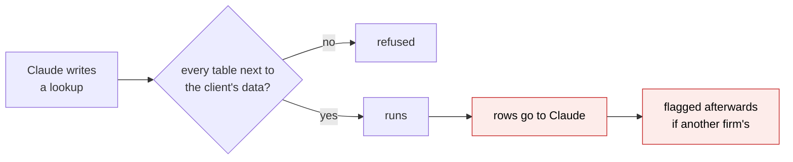
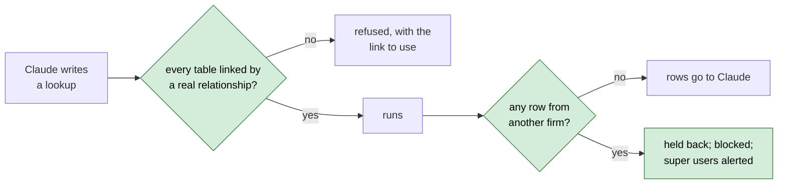
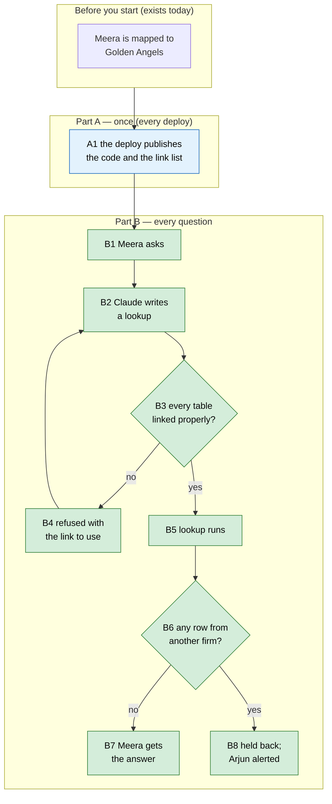

# Support Console tenant scope — Proposal

> **Audience:** Business team, product, QA, support — non-technical.
> **Companion document:** [Design](design.md)
> **New to this? Start with the [Workflow Journey](#workflow-journey)** — every action, in order, from start to the outcome.

> **Planning phase — no code changes.** This document proposes and explains the change. Do not
> edit application code while writing it; implementation happens later, in the tasks phase.

---

## Why

The Support Console lets a CapHive support user ask Claude about one client's data. Claude looks
things up with SQL on a read-only copy of the database that holds **every** firm's data, and a
check on each query keeps Claude inside the chosen client. That check is solid for the 161 tables
that carry a client marker (`entity_id`), but weak for the 71 that don't: a join on the wrong column
can return another firm's rows (for example other firms' LP email addresses), and rows that do slip
through reach Claude before anyone is told. We want the console to be unable to show another
firm's data, even by mistake.

## What Changes

Think of the client marker as a name tag on every row. Today a row without a name tag is let in if
it is standing next to someone with the right tag. After this change it is let in only if it is
**holding that person's hand** — linked by a real relationship — and every answer is checked
for the wrong name tag before Claude sees it.

- **Joins only along real relationships.** A table without the client marker can only be read
  through a real link to the client's data (a document's shares through the document, a note
  through the investor it belongs to). A wrong join is refused, and Claude is told which link to
  use, so it corrects itself.
- **Tables with no link to client data cannot be read at all**, including tables added in future.
- **The list of always-refused tables stays**, and the AI chat logs are added to it.
- **Answers from another client are held back.** If a lookup ever returns a row belonging to
  another firm, Claude gets nothing, the lookup is recorded as blocked, and super users are
  alerted — instead of today, where the rows reach Claude and are flagged afterwards.
- **Links to other firms stay readable.** An investor's LP firm, a co-investor or a portfolio
  company referenced from the client's own records is still shown (its name, PAN and so on).

No screen changes. Support users only notice that a rare wrong lookup is refused and retried.

### Flow Diagram

How a lookup is checked — before:



After:



---

## Workflow Journey

### Who is involved

| Person | Role | What they do in the journey |
|---|---|---|
| Meera | CapHive support user, mapped to Golden Angels | Asks questions in the Support Console |
| Claude | The assistant on the support machine | Writes the lookups that answer them |
| Arjun | CapHive super user | Receives the alert if a lookup is ever held back; reviews the lookup record |

### The journey on one page



### Before you start

| Needed | Why | Where it comes from |
|---|---|---|
| A support mapping to the client | Only mapped clients can be asked about | Admin › Support mappings (exists today) |
| The Support Console running | Answers questions | Exists today |

### Part A — once (every deploy)

| Step | Who | Where | Action | What the system does | What you see |
|---|---|---|---|---|---|
| A1 | Whoever deploys | the usual deploy | Deploy | Publishes the code Claude reads together with the list of real links between tables, built from the database layout of that release | Nothing — the next question uses the new list |

### Part B — every question

| Step | Who | Where | Action | What the system does | What you see |
|---|---|---|---|---|---|
| B1 | Meera | Support Console › Golden Angels | Asks "Who has the Q3 report been shared with?" | Starts an answer | "Working…" |
| B2 | Claude | — | Writes a lookup joining shares to documents | — | A step "Looking up data" |
| B3–B4 | — | — | The lookup joins shares on the wrong column | Refused: "join on a real relationship: doc_shares can be joined by doc_shares.document_id = documents.id" | Another "Looking up data" step as Claude retries |
| B5 | — | — | Claude retries with the real link | The lookup runs on the read-only copy | — |
| B6–B7 | — | — | Every row belongs to Golden Angels | Rows go to Claude | The answer, listing the 3 people the report was shared with |
| B8 | Arjun | Notifications bell | (only if a row ever belonged to another firm) | Nothing goes to Claude; the lookup is recorded as blocked | Meera: the answer says a lookup was blocked. Arjun: "Support Console lookup flagged: Meera asking about Golden Angels read another client's rows" |

### What you see

```
Golden Angels  › Who has the Q3 report been shared with?
  ○ Looking up data                         (refused: wrong link — retried)
  ○ Looking up data                         (3 rows)
  The Q3 report was shared with 3 people: lp1@ravi.in (viewed 2×),
  lp2@ravi.in (not viewed), cfo@ga.in (viewed 1×).
```

### What goes wrong

A lookup that passes the check still returns a row from another firm — this should never happen,
and would mean a bug in the check. What is shown: the answer says the lookup was blocked; Arjun gets
the alert; the lookup record on Admin › Support Console queries shows **blocked** and **flagged**.
Fix: an engineer reads the recorded SQL and corrects the check; Meera asks again.

### Summary: the minimum actions

| # | Action | Who | How often |
|---|---|---|---|
| 1 | Deploy as usual | Whoever deploys | Every release (nothing extra) |
| 2 | Ask questions | Support user | Every time |
| 3 | Review a held-back lookup | Super user | Only if alerted |

---

## User Stories

### US-1: Never see another firm's data

**As a** CapHive support user,
**I want** the console to be unable to read another firm's records,
**So that** I can use it on a client without risking a confidentiality breach.

**Acceptance criteria:**
- A lookup that joins a table without the client marker on the wrong column is refused before it runs.
- A table with no link to the client's data cannot be read.
- A lookup that returns any row of another firm gives Claude no rows and is recorded as blocked.

### US-2: Still see who the client deals with

**As a** CapHive support user,
**I want** to see the LP firm, co-investor or company referenced from the client's records,
**So that** answers can name them.

**Acceptance criteria:**
- An investor's LP firm (name, PAN) is shown through the investor record.
- Opening that LP firm's own funds or investors is refused.

### US-3: Know when the check was bypassed

**As a** CapHive super user,
**I want** an alert when a lookup is held back,
**So that** a gap in the check is fixed quickly.

**Acceptance criteria:**
- The alert is the existing "Support Console lookup flagged" bell notification.
- The lookup record shows outcome **blocked** and **flagged**, with the SQL.

---

## UI Behavior

### Support Console answer

No new screens or controls. A refused lookup appears as one more "Looking up data" step while
Claude retries. A held-back lookup is reported in the answer in Claude's words, e.g. "One lookup
was blocked because it returned rows from another client."

### Admin › Support Console queries

Unchanged page. A held-back lookup is a row with outcome **blocked**, **flagged** = yes, and the
reason "rows from another client".

---

## What This Feature Does NOT Cover

| Excluded | Covered In |
|---|---|
| Database-enforced per-client views (option 4) | Dropped — too cumbersome to maintain |
| Hiding sensitive columns of the client's own data (PAN, bank details) | A possible later change |
| Who may use the console and for which clients | Unchanged — support mappings |

---

## Validation Rules

| Field | Rule | Default |
|---|---|---|
| A table with the client marker | must be limited to the client | — |
| A table without it | must be joined by a real link to the client's data; a link to "any record" must also name the record type | — |
| Always-refused tables | login codes, tokens, admin data, history, AI chat logs | — |

---

## Behavior Rules

| Scenario | What User Sees |
|---|---|
| Wrong-column join | Refused; Claude is told "join on a real relationship: doc_shares can be joined by doc_shares.document_id = documents.id" and retries |
| Table with no link to client data | Refused: "table not allowed" |
| AI chat logs | Refused: "table not allowed" |
| A row from another firm comes back | No rows to Claude; outcome **blocked**; super users get "Support Console lookup flagged: … read another client's rows" |
| An investor's LP firm | Shown normally |
| The LP firm's own funds | Refused: "add filter" |

---

## Resolved Design Decisions

| # | Decision | Resolution |
|---|---|---|
| 1 | Database-enforced views | Dropped: too cumbersome |
| 2 | Allow list of tables vs deny list | No separate allow list: real-link joins already refuse unlinked tables; the deny list stays for secrets that are linked |
| 3 | `investor_entity_id` and similar links | Never blocked: a row is judged by the client it belongs to, not by what it points at |
| 4 | When a cross-firm row is found | Hold back the whole lookup, not just the bad rows |

---

## Capabilities

### New Capabilities

None.

### Modified Capabilities

- `support-console`: adds requirements for real-link joins, the deny list (with AI chat logs),
  holding back cross-client rows, and never blocking links to other entities. The capability is
  still in flight (change `support-console`), so this change's delta adds requirements to it.

---

## Impact

- The query check on the support machine (stricter joins, held-back rows).
- The code bundle published on each deploy (gains the list of real links).
- The lookup record and the existing super-user alert (one more reason for **blocked**).
- No database migration, no new screens, no new notifications.

---

## Benefits

1. Another firm's data cannot be shown through a mistaken join.
2. New tables are closed until they are linked to client data.
3. A gap in the check is caught before data reaches Claude, not after.
4. Answers can still name the LP firms and companies the client deals with.

---

## FAQ

| Question | Answer |
|---|---|
| Will support users notice anything? | Only that a rare wrong lookup is retried; answers are the same. |
| Can the console still show an investor's LP firm? | Yes — its name, PAN and details, through the client's investor record. |
| What happens to past lookups? | Nothing; they stay in the record as they are. |
| Who is alerted when a lookup is held back? | CapHive super users, through the existing bell alert. No client or investor is notified. |
| Does a new table need someone to allow it? | No. If its foreign key links to client data it is readable from the next deploy; if not, it stays closed. |
| Does this slow answers down? | No noticeable change: the check runs before the lookup and on its result. |

---

## Design Principle for the Next Phase

Reuse the existing check (`prepareStatement`), the deploy's code bundle, the lookup record's
**blocked** outcome and the existing flagged alert. The risk of complexity is in rewriting queries
to add hidden columns (grouped queries, UNIONs) — the design must keep that to a small, well-tested
set of shapes and refuse anything else rather than guess.
