# Xero Pull Sync (Phase I) — Design

> **Audience:** Engineering team.
> **Companion documents:** [Proposal](proposal.md) · [Spec](specs/) · [LLD](lld.md) · [QA checklist](qa-checklist.md)

> **Planning phase — no code changes.** This document explains HOW the proposal will be built.
> Do not edit application code while writing it; implementation happens later, in the tasks phase.

---

## Contents

- [Overview](#overview)
- [Architecture](#architecture)
  - [Component Boundaries](#component-boundaries)
  - [Class Diagram](#class-diagram)
  - [Change Footprint](#change-footprint)
- [Data Model and States](#data-model-and-states)
  - [Data Model](#data-model)
  - [State Transitions](#state-transitions)
- [Behaviour](#behaviour)
  - [Pipeline / Flow](#pipeline--flow)
  - [Sequence Diagrams](#sequence-diagrams)
  - [Worked Examples](#worked-examples)
- [Key Components](#key-components)
  - [Decision Flows](#decision-flows)
- [Controllers and Routes](#controllers-and-routes)
- [Policy](#policy)
- [UI Changes](#ui-changes)
  - [At a glance](#at-a-glance)
  - [Journey 1: A fund admin connects and maps a fund](#journey-1-a-fund-admin-connects-and-maps-a-fund)
  - [Journey 2: A fund admin reviews held changes](#journey-2-a-fund-admin-reviews-held-changes)
  - [Journey 3: A portfolio company gets connected](#journey-3-a-portfolio-company-gets-connected)
  - [Journey 4: The connection breaks](#journey-4-the-connection-breaks)
  - [Build notes (for implementers)](#build-notes-for-implementers)
- [Cross-cutting Concerns](#cross-cutting-concerns)
  - [Transactions and Queries](#transactions-and-queries)
  - [Exception Handling and Monitoring](#exception-handling-and-monitoring)
  - [Performance and Security](#performance-and-security)
- [Design Decisions](#design-decisions)
- [Testing](#testing)
- [Risks and Open Questions](#risks-and-open-questions)

---

## Overview

A new `core/xero` pack holds one polymorphic `XeroConnection` (owner = `Fund` or a portfolio
company `Investor`), an OAuth client, and two pullers: `XeroFundLedgerSync` writes fund-level
`AccountEntry` rows keyed by a new `account_entries.external_sync_id`, and `XeroPortcoKpiSync`
stages `Kpi` rows through a `KpiValueStager` extracted from `KpiWorkbookReader#save_kpi_entry`.
Connection lifecycle, nightly cron, single-flight claim and failure notifications follow the
`granola-notes-sync` connection pattern; fund entries look exactly like uploaded fund-level
rows from `ImportAccountEntry`, so allocation runs are unchanged.

---

## Architecture

### Component Boundaries

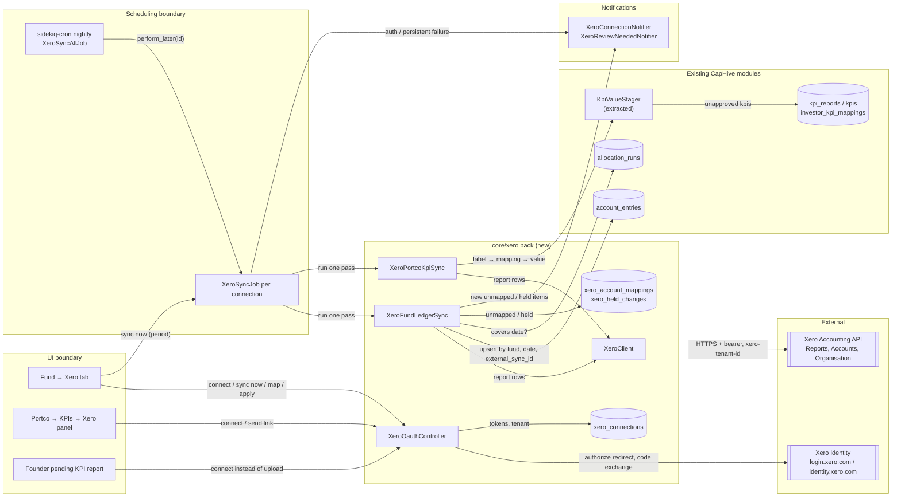

| From → To | Contract | Direction rule |
|---|---|---|
| UI → `XeroOauthController` | Owner GlobalID in a signed `state`; tenant choice | UI never stores tokens or calls Xero directly |
| UI → `XeroSyncJob` | `(connection_id, period_end)` | Sync never runs inline in a request |
| `XeroSyncJob` → sync services | One `XeroConnection`, one or two period ends | One pass at a time per connection (claim) |
| Sync services → `XeroClient` | `profit_and_loss(from, to)`, `balance_sheet(date)`, `accounts`, `organisation` | Only `XeroClient` knows HTTP, tokens and rate limits |
| `XeroFundLedgerSync` → `account_entries` | Fund-level rows with `external_sync_id`, `generated: false`, no commitment | Only touches rows with `external_sync_id` present |
| `XeroPortcoKpiSync` → `KpiValueStager` | `(kpi_report, mapping, value, source: "Xero", notes)` | Never writes approved KPIs |
| Sync / job → Notifications | Connection transitions; digest of newly added review items | At most one notification per transition / per pass |

### Class Diagram

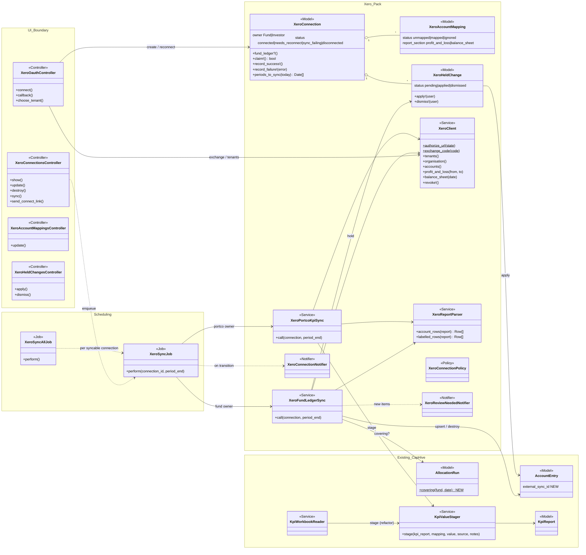

### Change Footprint

New code lives in a new `app/packs/core/xero` pack; the KPI refactor stays in
`app/packs/startups/kpis`.

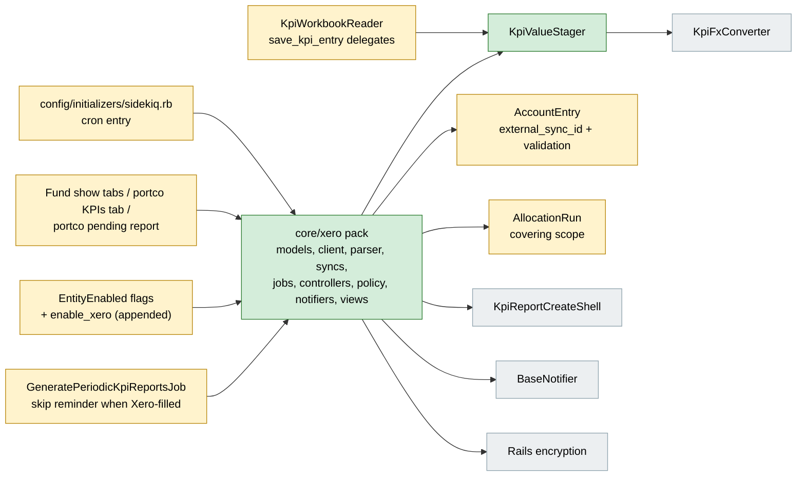

---

## Data Model and States

### Data Model

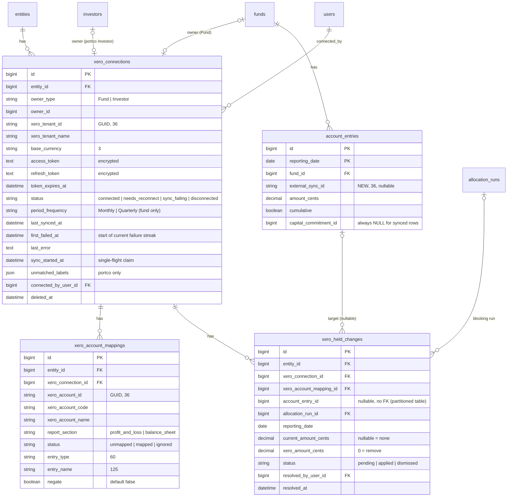

**Indexes:** unique `xero_connections[owner_type, owner_id, deleted_at]`;
`xero_connections[entity_id, xero_tenant_id, owner_type, deleted_at]` (non-unique; "one fund per
org per entity" is a model validation for Fund owners only); unique
`xero_account_mappings[xero_connection_id, xero_account_id]`; unique
`xero_held_changes[xero_connection_id, xero_account_mapping_id, reporting_date, xero_amount_cents]`;
`account_entries[fund_id, reporting_date, external_sync_id]`.

| Column | Why |
|---|---|
| `account_entries.external_sync_id` | Holds only the Xero `AccountID`. Period = `reporting_date`, org = the fund's single connection, so the triple `(fund_id, reporting_date, external_sync_id)` is the identity. NULL for every non-synced row, so hand/uploaded entries are never matched |
| `xero_connections.owner_type/owner_id` | One table for both flows; `fund_ledger?` = `owner_type == "Fund"` |
| `xero_connections.first_failed_at` | Drives the 24-hour "Sync failing" rule without a failure-log table |
| `xero_connections.unmatched_labels` | Last portco pull's labels with no KPI mapping, for the panel. Overwritten each pass |
| `xero_held_changes.xero_amount_cents` in the unique key | "Dismissed" is remembered per Xero figure: the same figure never re-raises, a new figure does |
| `xero_held_changes.account_entry_id` without FK | `account_entries` has a composite PK and is partitioned; MySQL does not allow FKs to it |

**Changes to existing models:**
- `AccountEntry`: `external_sync_id` column; `scope :xero_synced` (`where.not(external_sync_id: nil)`);
  uniqueness of `external_sync_id` scoped to `fund_id, reporting_date, deleted_at` when present.
  Existing uniqueness validation and ransackable attributes unchanged.
- `AllocationRun`: `scope :covering(fund, date)` = same fund, `start_date <= date <= end_date`
  (any `locked` value).
- `Fund`, `Investor`: `has_one :xero_connection, as: :owner`.
- `EntityEnabled`: `enable_xero` appended as the **last** `permissions` flag (flag bit order is
  positional).
- `KpiWorkbookReader#save_kpi_entry`: body moves to `KpiValueStager#stage`; the reader keeps
  its FX-missing warning via the stager's return value. Behaviour unchanged.

### State Transitions

#### Connection status (stored: `xero_connections.status`)

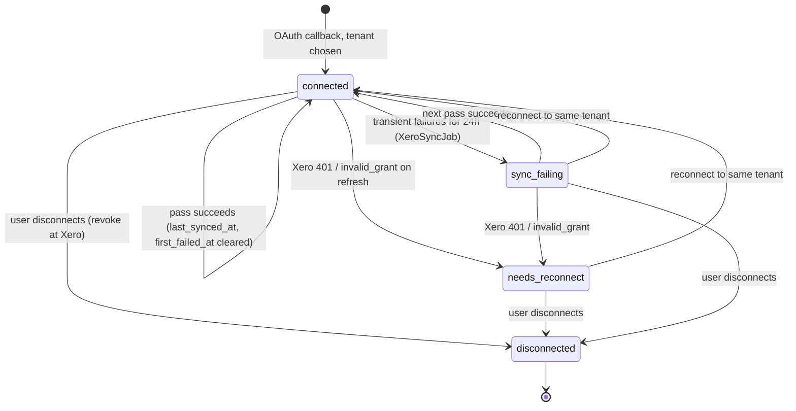

Syncable = `connected` or `sync_failing`. `disconnected` soft-deletes the row, so a later connect
creates a fresh connection (fresh mappings).

#### Account mapping (stored: `xero_account_mappings.status`)

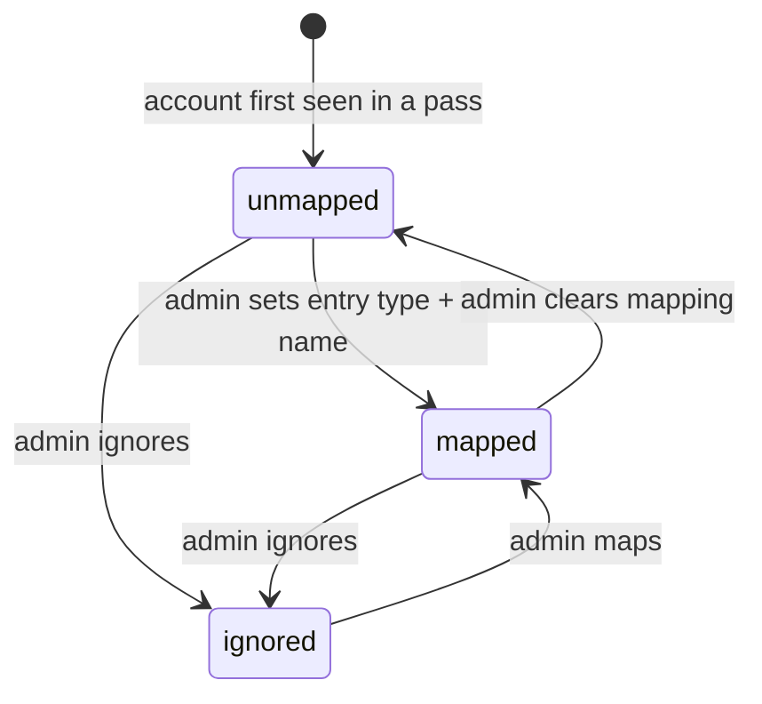

#### Held change (stored: `xero_held_changes.status`)

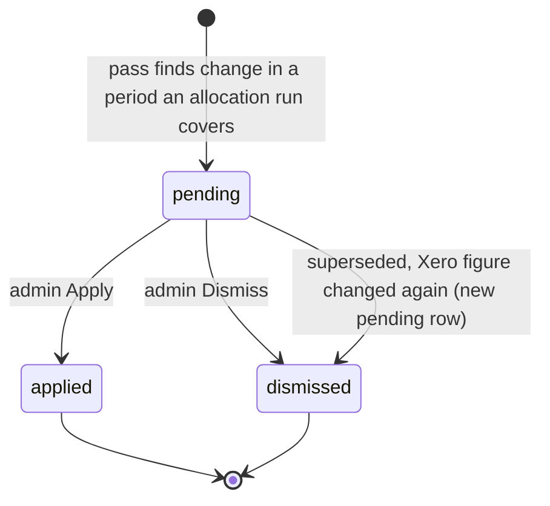

---

## Behaviour

### Pipeline / Flow

One `XeroFundLedgerSync#call` for one period end:

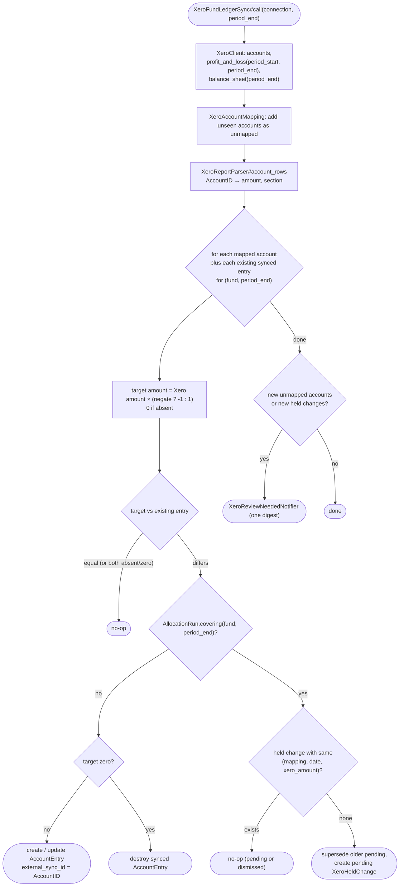

### Sequence Diagrams

#### Connect (fund)

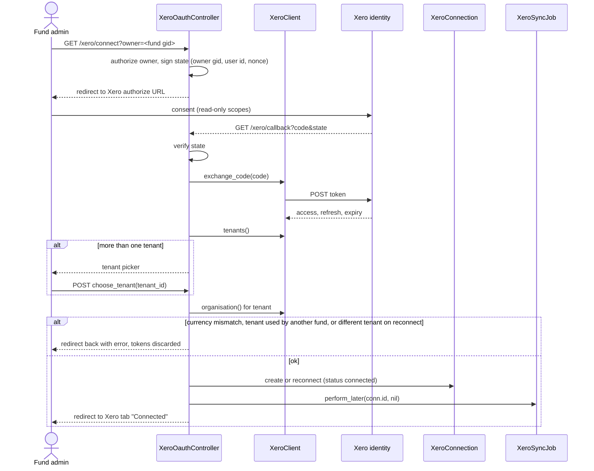

#### Nightly pass (fund ledger)

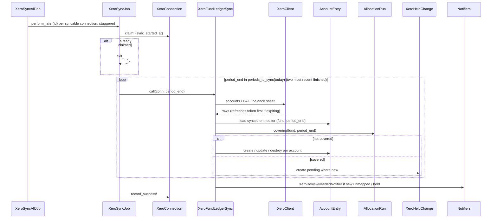

#### Failure handling

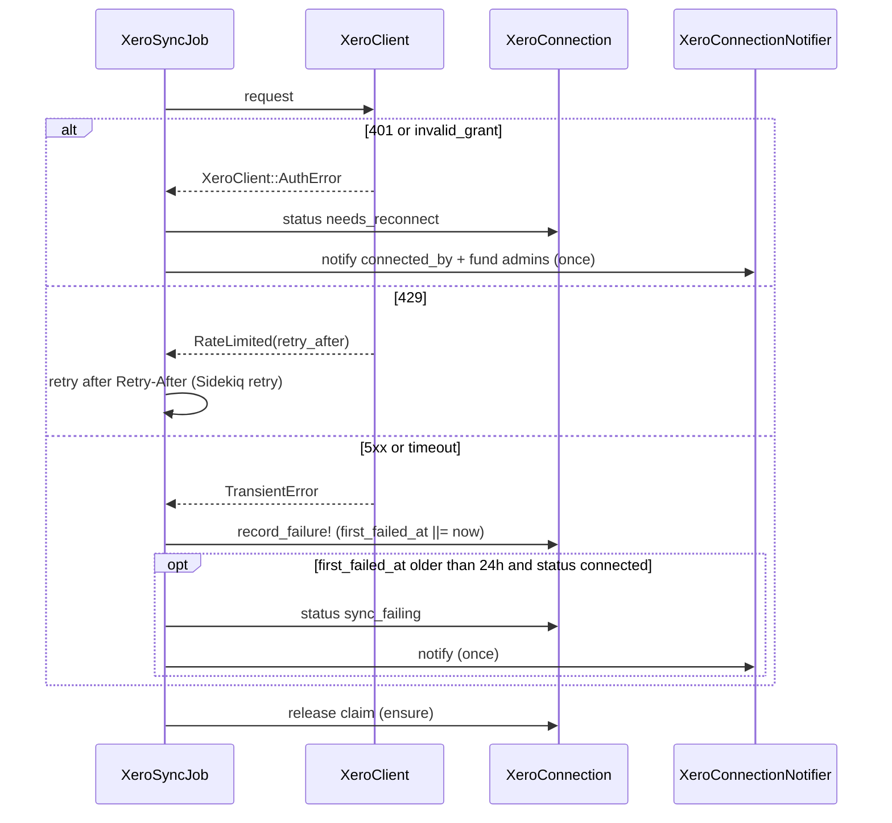

#### Portco KPI pass

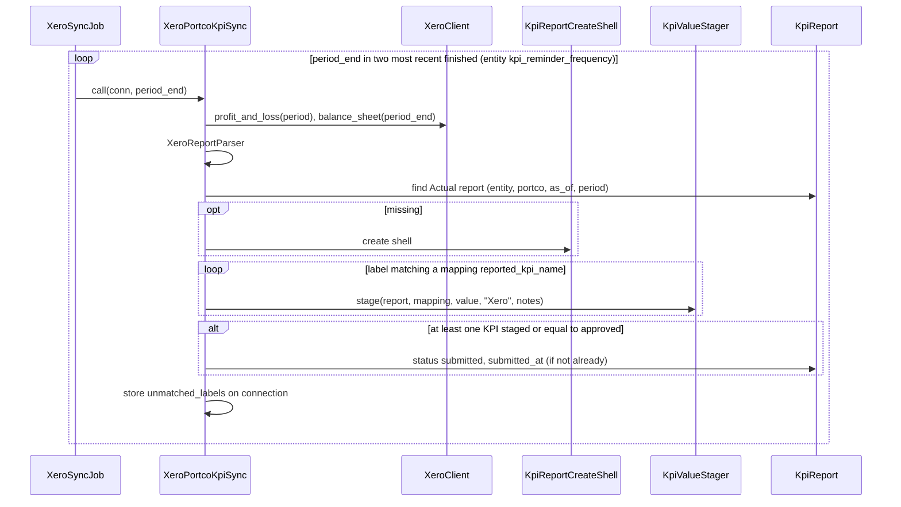

#### Held change applied

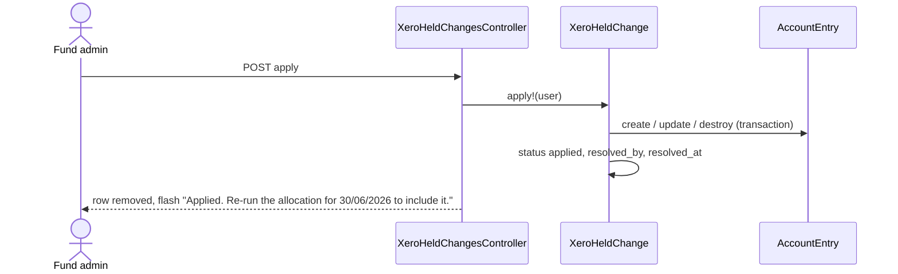

### Worked Examples

**ID legend:** **H** = Happy path · **E** = Edge case · **X** = Error (exception) case. IDs are
referenced from tasks.md and Cucumber scenario names.

**Shared setup:**

| Record | Name | Key data |
|---|---|---|
| Entity | Alpha Capital | `enable_xero`, `enable_kpis` on; `kpi_reminder_frequency` Monthly |
| Fund | Alpha Growth Fund I | AUD, Xero connected, Quarterly |
| Xero org (fund) | Alpha Growth Fund I Pty Ltd | AUD; accounts 6100 Audit Fees (P&L), 6150 Legal Fees (P&L), 4000 Interest Income (P&L), 2100 Accrued Expenses (BS), 1000 Bank (BS) |
| Mappings | — | 6100 → Expense / "Audit Fees"; 4000 → Income / "Interest", negate; 2100 → Liability / "Accrued Expenses"; 1000 ignored; 6150 unmapped |
| Allocation run | Q2 run | Alpha Growth Fund I, 01/04/2026–30/06/2026, unlocked |
| Portco | Acme Robotics Ltd | Investor (portfolio company) of Alpha Capital; Xero org GBP |
| KPI mappings | Acme | "Total Income" → Revenue; "Gross Profit" → Gross Profit; "Total Bank" → Cash |
| Users | Asha (fund admin), Ben (KPI user), Chen (Acme founder), Ivy (investor) | |

#### Happy Path

| # | Scenario | Given | When | Then | Spec scenario | Feature |
|---|---|---|---|---|---|---|
| H1 | Connect fund, single org | Fund not connected | Asha connects; consent covers one AUD org | Tab shows org, "Connected"; five accounts listed Unmapped; no entries | Single organisation; First connection; Feature on | core/xero/connections.feature |
| H2 | Connect, pick org | Consent covers three orgs | Asha picks the fund's org | Only that org connected | Several organisations | core/xero/connections.feature |
| H3 | Map an account | 6150 unmapped | Asha maps it to Expense / "Legal Fees" | Next sync imports Legal Fees | Map an account | core/xero/fund_ledger_sync.feature |
| H4 | Nightly quarterly pull | Today 15/10/2026 | XeroSyncAllJob runs | Q3 (30/09/2026) and Q2 (30/06/2026) pulled | Nightly quarterly pull | core/xero/fund_ledger_sync.feature |
| H5 | P&L account → entry | 6100 shows 12,000.00 for Q3 | Pass for 30/09/2026 | One fund-level "Audit Fees" 12,000.00, not cumulative, no folio, `external_sync_id` = 6100's AccountID | Profit-and-loss account | core/xero/fund_ledger_sync.feature |
| H6 | BS account → cumulative entry | 2100 shows 3,400.00 at 30/09/2026 | Same pass | Cumulative "Accrued Expenses" 3,400.00 | Balance-sheet account | core/xero/fund_ledger_sync.feature |
| H7 | Sign flip | 4000 shows 500.00 | Same pass | "Interest" entry -500.00 | Sign flip | core/xero/fund_ledger_sync.feature |
| H8 | Correction, unallocated | Audit Fees Q3 entry 12,000.00; no Q3 run | Xero shows 14,500.00; pass | Same entry now 14,500.00; count 1 | Correction in Xero | core/xero/fund_ledger_sync.feature |
| H9 | Sync now older period | Connected | Asha Sync now 31/03/2026 | Only Q1 pulled; tab showed "Sync queued" | Sync now for an older period | core/xero/fund_ledger_sync.feature |
| H10 | Held change applied | Q2 Audit Fees 12,000.00; Q2 run exists; Xero shows 14,500.00 | Pass, then Asha applies | Entry 12,000.00 until apply, then 14,500.00; flash tells her to re-run allocation | Change in an allocated period; Apply | core/xero/fund_ledger_sync.feature |
| H11 | Portco connect by fund user | Acme not connected | Ben connects from Acme's KPIs tab | Panel: "Acme Robotics Ltd (GBP) Connected" | Single organisation | core/xero/portco_kpi_sync.feature |
| H12 | Founder connects from report | Acme pending August report shared with Chen | Chen chooses "Connect Xero instead of uploading" | Acme connected for Alpha Capital | Founder connects from a pending report | core/xero/portco_kpi_sync.feature |
| H13 | Monthly KPI pull | Today 02/09/2026; Acme connected | Nightly pass | August and July Actual reports filled | Month finished | core/xero/portco_kpi_sync.feature |
| H14 | Matched label → KPI awaiting approval | Total Income 250,000.00; no approved Revenue | Pass for August | Revenue 250,000.00 unapproved, source "Xero", not on dashboard | Matched label; New figure | core/xero/portco_kpi_sync.feature |
| H15 | Approve Xero KPIs | H14 done | Ben approves August | Revenue approved; dashboard shows it | Approval | core/xero/portco_kpi_sync.feature |
| H16 | Reminder skipped | August report filled from Xero | GeneratePeriodicKpiReportsJob reminder run | No email to Acme for August | Reminder skipped | core/xero/portco_kpi_sync.feature |
| H17 | Disconnect fund | Fund connected, entries imported | Asha disconnects | "Not connected"; no further syncs; entries unchanged; token revoked at Xero | Disconnect a fund | core/xero/connections.feature |

#### Edge Cases

| # | Scenario | Given | When | Then | Spec scenario | Feature |
|---|---|---|---|---|---|---|
| E1 | New Xero account | Connected, mapped | Accountant adds 6200 Admin Fees; pass | 6200 listed Unmapped; one "items to review" notification | New account in Xero | core/xero/fund_ledger_sync.feature |
| E2 | Zero / unmapped / ignored | 6150 unmapped, 1000 ignored, 6100 = 0.00 | Pass | No entries for any of them | Zero and unmapped accounts | core/xero/fund_ledger_sync.feature |
| E3 | Repeat pull unchanged | H5 done | Pass again | No inserts, updates or deletes | Repeat pull unchanged | core/xero/fund_ledger_sync.feature |
| E4 | Figure removed, unallocated | Legal Fees Q3 entry exists; no Q3 run | Posting deleted in Xero; pass | Legal Fees Q3 entry removed | Figure removed in Xero | core/xero/fund_ledger_sync.feature |
| E5 | Hand entry untouched | Uploaded fund-level "Audit Fees" Q3 12,000.00 | Pass | Uploaded entry unchanged; synced one alongside | Hand-entered entry untouched | core/xero/fund_ledger_sync.feature |
| E6 | New account in allocated period | 6150 newly mapped; Q2 run; Xero 2,000.00 for Q2 | Pass | No entry; held "none → 2,000.00" | New account figure in an allocated period | core/xero/fund_ledger_sync.feature |
| E7 | Dismiss, same then new figure | Held 12,000.00 → 14,500.00 | Asha dismisses; pass sees 14,500.00; later 15,000.00 | No item after first pass; new item "12,000.00 → 15,000.00" after second | Dismiss and later change | core/xero/fund_ledger_sync.feature |
| E8 | Pending, unchanged figure | Held pending | Pass sees same figure | Still one pending item | Unchanged figure while held | core/xero/fund_ledger_sync.feature |
| E9 | Reconnect same org | Status needs_reconnect | Asha reconnects to same org | "Connected"; mappings kept | Reconnect to the same organisation | core/xero/connections.feature |
| E10 | Transient failure recovers | Xero 503 once | Retry succeeds | No notification; "Connected" | Temporary failure recovers | core/xero/connections.feature |
| E11 | Unmatched label | Xero shows "Total Cost of Sales" | Portco pass | No KPI; label listed on panel | Unmatched label | core/xero/portco_kpi_sync.feature |
| E12 | Report missing | No August Actual report | Portco pass | Report created and filled | Report missing | core/xero/portco_kpi_sync.feature |
| E13 | Same as approved | Approved Revenue 250,000.00 | Pull 250,000.00 | Nothing new | Same as approved | core/xero/portco_kpi_sync.feature |
| E14 | Correction before approval | Unapproved Revenue 250,000.00 | Pull 255,000.00 | One unapproved Revenue, 255,000.00 | Correction before approval | core/xero/portco_kpi_sync.feature |
| E15 | Nothing matched | Acme's labels match no mapping | Portco pass | Report not submitted; reminder still sent | Connected company with no matching labels | core/xero/portco_kpi_sync.feature |
| E16 | Feature off | Entity without `enable_xero` | Asha opens fund; cron runs | No Xero tab; no pass for its connections | Feature off | core/xero/connections.feature |

#### Error Cases

| # | Scenario | Given | When | Then (what the user sees, who is alerted) | Spec scenario | Feature |
|---|---|---|---|---|---|---|
| X1 | Consent cancelled | — | Asha cancels at Xero | Back on Xero tab: "Xero connection was cancelled." | Consent cancelled | core/xero/connections.feature |
| X2 | Currency mismatch | Fund AUD | Asha picks a USD org | Refused, message names USD and AUD; nothing stored | Currency mismatch | core/xero/connections.feature |
| X3 | Org used by another fund | Org connected to Beta Fund | Asha picks it for Alpha | "This Xero organisation is already connected to Beta Fund." | Organisation already used by another fund | core/xero/connections.feature |
| X4 | Reconnect different org | Connected to org A | Reconnect picks org B | "Disconnect first. Reconnecting to a different organisation is not supported."; still A | Reconnect to a different organisation | core/xero/connections.feature |
| X5 | Auth expired / revoked | Refresh returns invalid_grant | Nightly pass | Status "Needs reconnecting"; Asha + connector notified once; no more passes | Authorisation expired or withdrawn | core/xero/connections.feature |
| X6 | Persistent transient failure | 503 for 24h | Passes keep failing | "Sync failing"; one notification | Temporary failure persists | core/xero/connections.feature |
| X7 | Mapping missing entry type | 6150 unmapped | Asha saves Mapped without entry type | Not saved; field error | Mapping validation | core/xero/fund_ledger_sync.feature |
| X8 | Investor user | Ivy is investor-side | Opens fund / hits Xero route | No tab; route denied | Investor user | core/xero/connections.feature |
| X9 | Other entity | User of Beta Capital | Requests Alpha fund's Xero page | Denied | Other entity | core/xero/connections.feature |

---

## Key Components

| Component | Responsibility | Notes |
|---|---|---|
| `XeroClient` | Token exchange/refresh, tenant list, Organisation, Accounts, Reports; revoke on disconnect | Refreshes when `token_expires_at` < 2 min away, under a row lock so two workers don't both rotate the refresh token. Maps 401/`invalid_grant` → `AuthError`, 429 → `RateLimited(retry_after)`, 5xx/timeouts → `TransientError`. Per-env credentials `Rails.application.credentials.xero` |
| `XeroReportParser` | Flattens Xero report JSON: `account_rows` (rows carrying an `AccountID` attribute → id, amount, section) and `labelled_rows` (every row's first-cell label → amount, including `SummaryRow` totals) | Pure; no DB |
| `XeroFundLedgerSync` | One period for one fund connection: discover accounts, diff, write or hold | Idempotent: running it twice yields the same state. Per-account writes in their own transaction |
| `XeroPortcoKpiSync` | One period for one portco connection: find/create report, stage matching labels, mark submitted, store unmatched labels | Label match uses `KpiWorkbookReader`'s `normalize_kpi_name` rule (moved to `KpiValueStager.normalize_name`) |
| `KpiValueStager` | Extracted body of `save_kpi_entry`: FX via `KpiFxConverter`, skip-if-equal-to-approved, upsert unapproved `Kpi` | Adds `source:`; workbook path passes its existing value |
| `XeroSyncJob` | Claim, run the right sync for each period, classify failures, transitions + notifications | Queue `:low`; Sidekiq retries only `RateLimited`/`TransientError`; always releases claim |
| `XeroSyncAllJob` | Nightly cron (02:00 local): enqueue each syncable connection of entities with `enable_xero`, staggered by `id % 60` minutes | `find_each`; never loads tokens |
| `XeroHeldChange#apply!` | Performs the create/update/destroy the pass would have done | Re-reads the current entry; refuses if the entry changed since the hold was raised (stale → admin re-syncs) |

### Decision Flows

**Which periods to pull (`XeroConnection#periods_to_sync`)**

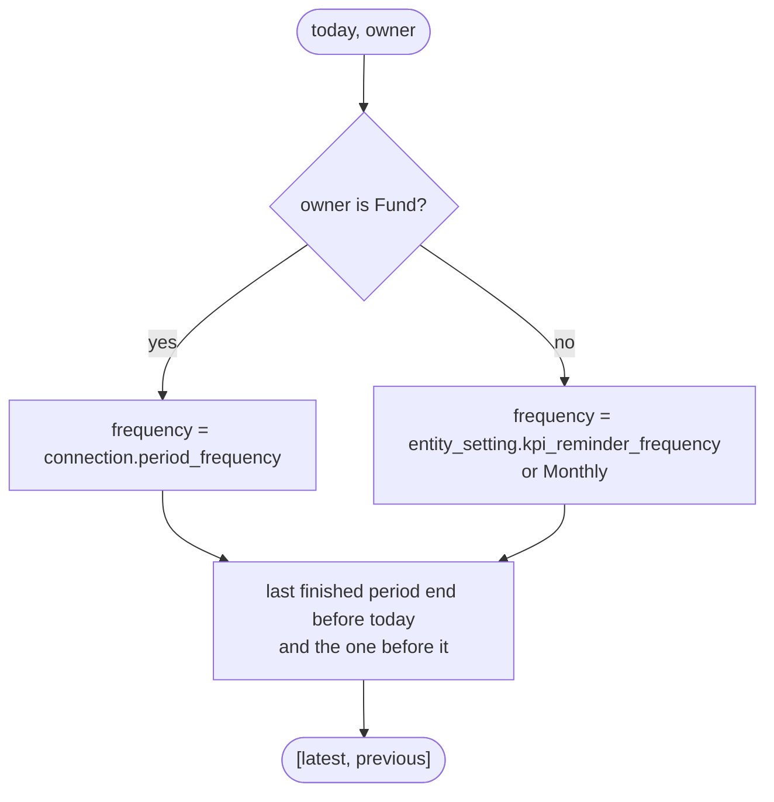

**Reconnect / connect acceptance (`XeroOauthController#callback` / `#choose_tenant`)**

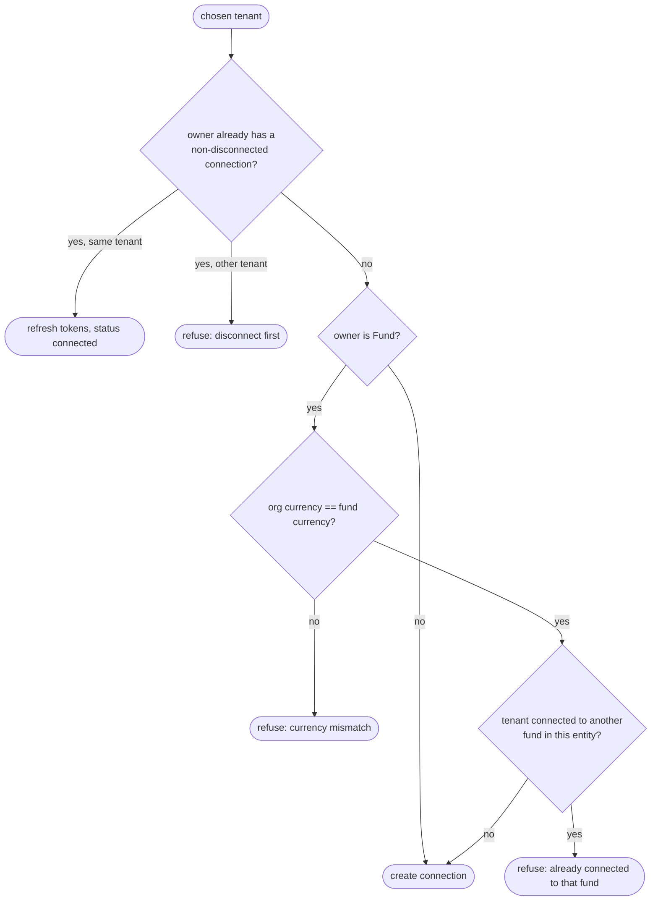

---

## Controllers and Routes

| Verb and path | Action | Does | Responds with |
|---|---|---|---|
| `GET /xero/connect?owner=<sgid>` | `XeroOauthController#connect` | Authorize owner, sign state, redirect | 302 to Xero |
| `GET /xero/callback` | `#callback` | Verify state, exchange code, list tenants | Tenant picker, or redirect to owner page |
| `POST /xero/choose_tenant` | `#choose_tenant` | Apply acceptance rules, create/reconnect, enqueue first pass | Redirect to owner page |
| `GET /xero_connections/:id` | `XeroConnectionsController#show` | Tab/panel body (status, mappings, held changes) | HTML (turbo frame) |
| `PATCH /xero_connections/:id` | `#update` | Change `period_frequency` | turbo_stream |
| `POST /xero_connections/:id/sync` | `#sync` | Validate period end, enqueue `XeroSyncJob` | turbo_stream "Sync queued" |
| `DELETE /xero_connections/:id` | `#destroy` | Revoke at Xero, soft delete | Redirect |
| `POST /investors/:investor_id/xero_connect_link` | `#send_connect_link` | Email portco users a link to their pending report's Xero button | turbo_stream flash |
| `PATCH /xero_account_mappings/:id` | `XeroAccountMappingsController#update` | Map / ignore / clear | turbo_stream row |
| `POST /xero_held_changes/:id/apply` | `XeroHeldChangesController#apply` | `apply!` | turbo_stream remove + flash |
| `POST /xero_held_changes/:id/dismiss` | `#dismiss` | `dismiss!` | turbo_stream remove |

---

## Policy

| Role | Access |
|---|---|
| Fund admin (can `update?` the fund) | Connect, reconnect, disconnect, Sync now, map accounts, apply/dismiss held changes for that fund |
| Fund-side user with `enable_kpis` and access to the portco | Connect/disconnect the portco, send connect link, view panel |
| Portco user (portco `investor_entity_id == user.entity_id`) | Connect only, from a report where `KpiReportPolicy` already allows them (`enable_portco_upload`) |
| Investor-side user | None |
| Any user, entity without `enable_xero` | None |

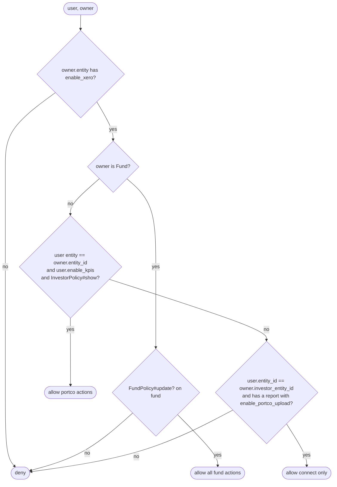

**Multi-tenancy:** every Xero table carries `entity_id` = the owner's `entity_id` (the fund
manager's entity, also for portco connections created by a founder). `XeroConnectionPolicy::Scope`
filters by `entity_id`; mappings and held changes are only reached through their connection.

---

## UI Changes

### At a glance

| Where in CapHive | Today | After this change | Who sees it |
|---|---|---|---|
| Fund → Xero tab | — | Connection status, frequency, Sync now, held changes, account mapping | Fund admins |
| Portfolio company → KPIs tab | Upload flow only | Xero panel: status, connect, send link, unmatched labels | Fund users with KPI access |
| Founder's pending KPI report | Upload workbook | + "Connect Xero instead of uploading" | Portco users |
| Account entries list | — | Synced entries carry note "Synced from Xero: <org> <code>" | Fund users |
| KPI approval screen | Source shows upload | Source "Xero" | Fund users |
| Notifications | — | Needs reconnecting / Sync failing / Items to review | Connector + fund admins |

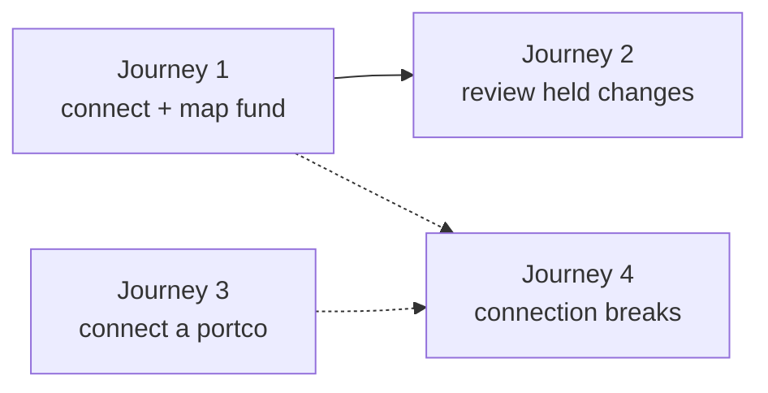

### Journey 1: A fund admin connects and maps a fund

```
Fund → Xero tab (before)                 Fund → Xero tab (after connect)
┌───────────────────────────────┐        ┌─────────────────────────────────────────────┐
│ ① ○ Not connected             │        │ ② Alpha Growth Fund I Pty Ltd (AUD) ● Conn. │
│ ① [ Connect Xero ]            │        │ ③ Periods [Quarterly ▾]   [Sync now]        │
└───────────────────────────────┘        │ ④ Account mapping  [Unmapped (5)|Mapped|Ign]│
                                         │   6100 Audit Fees  P&L [type ▾][name ][Save]│
                                         │   1000 Bank        BS  [Ignore]             │
                                         └─────────────────────────────────────────────┘
```

| Step | The user… | They see |
|---|---|---|
| 1 | Opens the Xero tab, clicks Connect Xero ① | Xero's sign-in and consent |
| 2 | Consents (picks the org if several) | Back on the tab: org name, currency, Connected ② |
| 3 | Sets periods ③ | Saved in place |
| 4 | Works through Unmapped ④: sets type and name, or Ignore | Row moves to Mapped/Ignored; count drops |
| 5 | Waits for the nightly sync or clicks Sync now ③ and picks a period | "Sync queued", then entries appear under Account Entries |

### Journey 2: A fund admin reviews held changes

```
┌──────────────────────────────────────────────────────────────────────┐
│ ① Changes awaiting review (1)                                        │
│ ② 30/06/2026  6100 Audit Fees   CapHive 12,000.00 → Xero 14,500.00   │
│    Allocation run 01/04/2026–30/06/2026 covers this date             │
│ ③ [Apply]  [Dismiss]                                                 │
└──────────────────────────────────────────────────────────────────────┘
```

| Step | The user… | They see |
|---|---|---|
| 1 | Gets "Xero: items to review for Alpha Growth Fund I" and opens the tab | Review list ① with one row ② |
| 2 | Clicks Apply ③ | Row disappears; flash "Applied. Re-run the allocation for 30/06/2026 to include it." |
| 2a | Or clicks Dismiss ③ | Row disappears; returns only if Xero shows a different figure |

### Journey 3: A portfolio company gets connected

```
Portco → KPIs → Xero panel                    Founder's pending report
┌──────────────────────────────────────────┐   ┌──────────────────────────────────────┐
│ ① [Connect Xero] [Send connect link]     │   │ KPI report — August 2026             │
│ ② Acme Robotics Ltd (GBP) ● Connected    │   │ [Upload workbook]  ③ [Connect Xero   │
│    Last pull 01/09/2026                  │   │                     instead of upl.] │
│ ④ Labels with no KPI mapping: …          │   └──────────────────────────────────────┘
└──────────────────────────────────────────┘
```

| Step | The user… | They see |
|---|---|---|
| 1 | Fund user clicks Connect Xero ① (has access) or Send connect link ① | Xero consent, or "Link sent to Acme Robotics users" |
| 2 | Founder opens the link / pending report, clicks ③ | Xero consent, then back on the report: "Xero connected. We'll fill your reports from now on." |
| 3 | After the next nightly pull, fund user opens the panel | Connected with last pull ②; unmatched labels ④ to add to the KPI mapping |
| 4 | Fund user opens the August report | Values awaiting approval, source "Xero"; approves as usual |

### Journey 4: The connection breaks

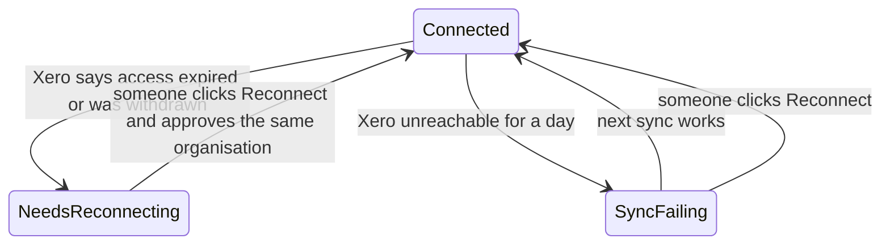

| Step | The user… | They see |
|---|---|---|
| 1 | Receives "Xero needs reconnecting for Alpha Growth Fund I" | Email + in-app notification with a link |
| 2 | Opens the tab | Status "Needs reconnecting" and a Reconnect button in place of Sync now |
| 3 | Reconnects to the same org | "Connected"; mappings intact; a sync is queued |

### Build notes (for implementers)

| Interaction | Screen update |
|---|---|
| Tab / panel | Lazy turbo frame `xero_connection_<owner>` loading `XeroConnectionsController#show` |
| Map / Ignore / Save | turbo_stream replaces the mapping row and the tab counts |
| Apply / Dismiss | turbo_stream removes the held row and updates the count |
| Sync now | Modal with a `date_field` (locale-date controller); turbo_stream "Sync queued" |
| Tenant picker | Plain full-page form (post-OAuth, outside any frame) |
| Fund tab | New entry in the fund show tab list, gated on `enable_xero` + `update?` |

---

## Cross-cutting Concerns

### Transactions and Queries

| What is read | When | N+1 risk | How it stays cheap |
|---|---|---|---|
| Synced entries for `(fund, period_end)` | Once per period pass | No | `account_entries.xero_synced.where(fund_id:, reporting_date:)` selecting `id, reporting_date, external_sync_id, amount_cents, cumulative` — hits the new index, prunes to one partition, ≤ ~60 rows |
| Mappings for the connection | Once per pass | No | Loaded once, indexed by `xero_account_id` |
| Allocation runs covering the date | Once per period pass | No | One query on `allocation_runs[fund_id]` |
| Existing held changes for the connection/date | Once per period pass | No | One query, indexed |
| KPI mappings for the portco | Once per portco pass | No | Same load as the workbook reader |
| Approved/unapproved KPI per mapping | Per matched label (≤ ~30) | Bounded | As today in `save_kpi_entry`; could preload per report later |
| Syncable connections | Nightly | No | `find_each`, ids only |

| Operation | In a transaction? | Why |
|---|---|---|
| One account's create/update/destroy | Yes, per account | Keeps each row consistent without locking the whole period |
| Create held change (+ supersede previous pending) | Yes | Exactly one pending per (mapping, date) |
| `XeroHeldChange#apply!` | Yes | Entry change and status change commit together |
| Token refresh | Yes, `with_lock` on the connection | Xero rotates refresh tokens; two concurrent refreshes would lose one |
| Whole period pass | No | A partial failure leaves already-applied accounts correct; next pass completes the rest (idempotent) |

### Exception Handling and Monitoring

| Failure scenario | Who is alerted | Channel | Detail |
|---|---|---|---|
| Authorisation expired / revoked | Connector + fund admins (portco: connector + fund users with KPI access to it) | Email + in-app (`XeroConnectionNotifier`) | Once per transition to `needs_reconnect` |
| Transient failures ≥ 24h | Same | Same | Once per transition to `sync_failing` |
| Rate limited | Nobody | — | Sidekiq retry honouring `Retry-After` |
| New unmapped accounts / new held changes | Fund admins | Email + in-app (`XeroReviewNeededNotifier`) | One digest per pass that adds items |
| Unexpected exception in a pass | Support | Sentry/ExceptionNotifier via existing job error handling | Claim released; connection untouched |
| Held-change apply on stale entry | The admin | Flash | "This entry changed since the review item was raised. Run Sync now for this period." |

### Performance and Security

- **Volume:** per fund pass ~3 Xero calls and ≤ ~60 `account_entries` rows; per portco pass ~2
  calls. 100+ connections are staggered over an hour; per-org Xero limits (60/min, 5,000/day)
  are never approached.
- **Big-table hygiene:** every `account_entries` read is scoped by `fund_id + reporting_date +
  external_sync_id IS NOT NULL` with narrow `select`; never `present?` on relations.
- **Secrets:** access/refresh tokens use Rails `encrypts`; never rendered or logged. Client
  id/secret come from per-environment credentials; IN and US have separate Xero apps.
- **OAuth:** signed, expiring `state` (owner sgid + user id + nonce) protects the callback;
  scopes are read-only (`offline_access`, accounting reports read, accounting settings read).
- **Tenant isolation:** policies + `entity_id` on all rows; the tenant id is only ever sent in the
  `xero-tenant-id` header by `XeroClient`.

---

## Design Decisions

1. **One polymorphic `XeroConnection` for funds and portcos** — Alternative: two tables.
   Rejected: identical lifecycle, tokens, failure handling and notifications.
2. **Report totals, not `/Journals` lines** — Alternative: line-level journals. Rejected for
   Phase I: 10–100× more calls and rows, and CapHive needs only per-account period figures.
   Phase II push may need lines to filter out CapHive's own postings.
3. **`external_sync_id` = bare `AccountID`** — Alternative: composite string
   `xero:<tenant>:<account>:<period>`. Rejected: period and org are already on the row, and a
   bare GUID is shorter to index.
4. **Hold on any covering allocation run, including removals** — per user decision. Alternative:
   locked runs only. Rejected by the user in favour of safety.
5. **Reuse KPI mapping labels instead of a KPI-side account mapping** — Alternative: map Xero
   AccountIDs to KPIs. Rejected: `reported_kpi_name` already exists, Xero totals ("Total Income",
   "Gross Profit") are labelled rows, and founders' fund teams already maintain those names.
6. **Extract `KpiValueStager` rather than rendering a workbook** — Alternative: build an
   in-memory workbook and feed `ImportKpiWorkbookJob`. Rejected: indirect, loses the source, and
   drags in sheet/period detection that doesn't apply.
7. **Soft-delete + fresh connection on disconnect** — Alternative: keep row, clear tokens.
   Rejected: reconnect-to-different-org is disallowed on a live connection, so disconnect is
   the reset point and should start clean.
8. **No in-place org switch** — per exploration: new GUIDs would duplicate entries.

---

## Testing

Cucumber only. Xero HTTP stubbed with WebMock via a new `features/support/xero_stubs.rb`
(fixtures under `features/fixtures/xero/` for Organisation, Accounts, P&L, BalanceSheet JSON)
tagged `@sync-http` (reuses `features/support/webmock_toggle.rb`); OAuth consent is simulated by stubbing the token endpoint and hitting
`/xero/callback` with a signed state. New step file `features/step_definitions/xero_steps.rb`;
reuses existing fund, allocation-run, KPI-report and notification steps. The KPI refactor is
guarded by running the existing KPI features (`features/startup/kpi_*.feature`, `investor_kpi_mappings.feature`) unchanged.

---

## Risks and Open Questions

- Uncertified Xero apps are capped at 25 connected orgs → run Phase I with pilot customers per
  environment; start Xero certification in parallel.
- `account_entries` is large and partitioned → add the column with `ALGORITHM=INSTANT`, build
  the index online per partition off-hours; see lld.md.
- Refresh-token rotation race (two workers) → refresh under a row lock; the claim already
  serialises passes per connection.
- Accountant changes a mapped account's type (P&L ↔ BS) in Xero → section re-read each pass;
  entry `cumulative` follows it (treated as a change, held if allocated).
- Portco held by two CapHive entities → each entity connects separately (two tokens for one
  org); acceptable in Phase I.
- Founder connects but labels don't match any mapping → report stays unsubmitted and reminders
  continue (E15); the panel lists labels to map.

| # | Open question | Current thinking | Status |
|---|---|---|---|
| 1 | Exact Xero OAuth scopes: legacy `accounting.reports.read` vs newer granular report scopes for apps registered now | Use whatever Xero's developer portal requires for a new app at registration time; read-only either way | Check before implementation |
| 2 | Sidekiq cron time per environment (IN vs US) | 02:00 in each environment's local zone | Check before implementation |
