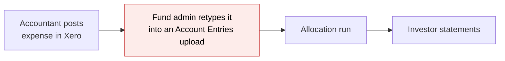
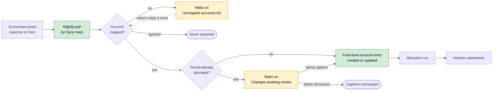
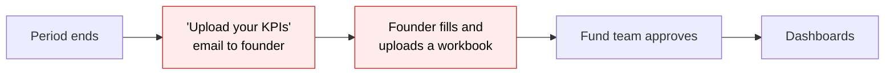
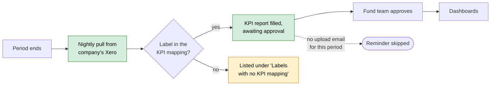

# Xero Pull Sync (Phase I) — Proposal

> **Audience:** Business team, product, QA, support — non-technical.
> **Companion document:** [Design](design.md)

> **Planning phase — no code changes.** This document proposes and explains the change. Do not
> edit application code while writing it; implementation happens later, in the tasks phase.

---

## Why

Customers keep two sets of books in Xero that CapHive also needs: the **fund's own books**
(expenses such as audit, legal and admin fees, and income such as bank interest) and each
**portfolio company's books** (revenue, costs, cash). Today both are retyped into CapHive by
hand: fund-level expenses as account entries, and portfolio-company numbers as quarterly KPI
uploads that the fund team has to chase. Pulling them straight from Xero removes the double
entry and the chasing.

Background research: `docs/modules/integrations/xero_integration_use_cases.md`.

## What Changes

Think of Xero as a read-only source that CapHive checks every night, the way a bank feed
works in accounting software: nothing is written back to Xero in this phase.

- A fund admin can **connect a fund to its Xero organisation**. CapHive then pulls the
  fund's profit-and-loss and balance-sheet figures for each period and turns them into
  **fund-level account entries**. The existing allocation runs split those across investors
  exactly as they do for entries uploaded today.
- The fund admin **maps each Xero account once** (to an entry type and name, or to
  "ignore"). An account that isn't mapped yet is never imported. It waits on a list for the
  admin.
- If an accountant **corrects a figure in Xero**, the next sync updates the same CapHive
  entry instead of adding a second one.
- If the figure belongs to a period that **already has an allocation run**, CapHive does not
  change it automatically. The change waits on a **review list**, where the admin applies
  or dismisses it.
- A portfolio company's founder (or a fund user who has access to that company's Xero) can
  **connect the company's Xero organisation**. Each period, CapHive pulls the company's
  figures into that period's **KPI report**, and the fund team **approves them the same way
  as uploaded KPIs**.
- A connected portfolio company **no longer gets the "please upload your KPIs" email** for a
  period once Xero has supplied that period's figures.
- If a connection stops working (the permission expired or was withdrawn in Xero), the right
  people are **told to reconnect**, instead of the data silently going stale.
- The whole feature is switched on per customer (an entity-level setting).

### Flow Diagram

#### Fund expenses and income

**Before:** everything in Xero is typed into CapHive a second time.



**After:** CapHive pulls from Xero every night; the admin only maps accounts once and reviews
changes to periods that are already allocated.



#### Portfolio-company KPIs

**Before:** the fund team chases every company for an upload every period.



**After (connected companies):** the figures come from the company's Xero; nobody is chased.



---

## User Stories

### US-1: Connect a fund to Xero

**As a** fund admin,
**I want** to connect my fund to the fund's Xero organisation,
**So that** its expenses and income reach CapHive without retyping.

**Acceptance criteria:**
- The fund page has a **Xero** tab showing "Not connected" and a **Connect Xero** button.
- Clicking it takes me to Xero's sign-in and consent screen, and back to the Xero tab
  afterwards.
- If my Xero login can see more than one organisation, I pick which one belongs to this fund.
- If that organisation's base currency differs from the fund's currency, the connection is
  refused with the message in *Validation Rules*.
- After connecting, the tab shows the organisation name, "Connected", and the account-mapping
  list filled with the organisation's accounts, all marked **Unmapped**.

### US-2: Map Xero accounts

**As a** fund admin,
**I want** to say what each Xero account becomes in CapHive,
**So that** only the accounts I care about are imported, under the names our reports use.

**Acceptance criteria:**
- Each row shows the Xero account code, name and type (Profit & Loss or Balance Sheet) and a
  status: **Unmapped**, **Mapped** or **Ignored**.
- For a mapped account I set the entry type (chosen from the fund's existing entry types or
  typed in), the entry name (defaults to the Xero account name), and whether to flip the
  sign.
- Marking an account **Ignored** stops it from ever being imported.
- Accounts the accountant adds later show up as **Unmapped** after the next sync, and I get
  one notification listing them.

### US-3: Nightly fund sync

**As a** fund admin,
**I want** each period's Xero figures to appear as fund-level account entries,
**So that** the allocation run picks them up.

**Acceptance criteria:**
- Every night CapHive pulls the **two most recently finished periods** (monthly or quarterly,
  as set on the Xero tab).
- A mapped Profit & Loss account becomes one entry holding **that period's movement**; a
  mapped Balance Sheet account becomes one entry holding the **balance at period end**
  (marked cumulative).
- Entries are dated the period's last day, have no folio (fund level), and a note saying
  they came from Xero.
- Accounts with a zero figure are not imported.
- I can also press **Sync now** and pick any period end date to pull just that period.

### US-4: Corrections in Xero

**As a** fund admin,
**I want** a corrected figure in Xero to update the entry CapHive already has,
**So that** I never have two entries for the same account and period.

**Acceptance criteria:**
- When the Xero figure for an already-imported account and period changes, the existing
  entry's amount is updated.
- When an account's figure for a period drops to zero or disappears, the imported entry is
  removed.
- Entries typed in or uploaded by hand are never touched by the sync.

### US-5: Periods already allocated

**As a** fund admin,
**I want** changes to already-allocated periods to wait for me,
**So that** finished allocations don't shift underneath me.

**Acceptance criteria:**
- If any allocation run for the fund covers the entry's date, a new, changed or removed
  figure is **not** applied. It appears on the **Changes awaiting review** list with the
  account, period, current CapHive amount and new Xero amount.
- **Apply** makes the change and reminds me to re-run the allocation. **Dismiss** leaves
  CapHive as it is; the same item comes back only if the Xero figure changes again.
- I get one notification per sync that adds items to the list.

### US-6: Connect a portfolio company's Xero

**As a** fund team member,
**I want** a portfolio company's Xero to feed its KPI reports,
**So that** I stop chasing uploads.

**Acceptance criteria:**
- On the portfolio company's page (KPIs tab) there is a **Xero** panel with **Connect Xero**
  (for when I have access to their Xero myself) and **Send connect link to company** (emails
  the company's users).
- A founder who follows the link, or opens a pending KPI report, sees **Connect Xero instead
  of uploading**.
- After connecting, the panel shows the organisation name, its currency, "Connected", and the
  last pull date.

### US-7: KPIs from Xero

**As a** fund team member,
**I want** each period's Xero figures to fill that period's KPI report,
**So that** I only review and approve.

**Acceptance criteria:**
- After each period ends, the nightly pull fills that period's KPI report (creating it if
  needed) from the company's Profit & Loss and Balance Sheet.
- A Xero line becomes a KPI when its label (e.g. "Total Income", "Gross Profit", "Total
  Bank") matches a **reported name** in the company's KPI mapping. This is the same mapping
  used for uploaded workbooks.
- Pulled KPIs show as **awaiting approval**, marked as coming from Xero, and appear in
  dashboards only after approval.
- If a pulled figure is unchanged from the approved one, nothing new is created.
- The panel lists Xero labels that matched no KPI, so I can add them to the mapping.
- Once a period's figures are in, the company gets no upload reminder for that period.

### US-8: Broken connection

**As a** fund admin or fund team member,
**I want** to be told when a Xero connection stops working,
**So that** missing data is never mistaken for "nothing to report".

**Acceptance criteria:**
- If Xero rejects the connection (expired or withdrawn), the status changes to **Needs
  reconnecting** and whoever connected it, plus the fund admins, are notified once.
- The tab or panel shows a **Reconnect** button. Reconnecting to the **same** organisation
  resumes syncing with existing mappings kept.
- Repeated temporary failures (Xero down, rate limits) are retried quietly. After a full day
  of failures the status becomes **Sync failing** with a notification.

---

## UI Behavior

### Fund → Xero tab

```
┌──────────────────────────────────────────────────────────────────────┐
│  Alpha Growth Fund I  │ Overview │ Commitments │ … │ Xero │           │
│                                                                      │
│  Xero organisation: Alpha Growth Fund I Pty Ltd (AUD)   ● Connected  │
│  Periods: [ Quarterly ▾ ]    Last sync: 30/09/2026 02:10             │
│  [ Sync now ]  [ Disconnect ]                                        │
│                                                                      │
│  Changes awaiting review (1)                                         │
│  ┌────────────────────────────────────────────────────────────────┐  │
│  │ 30/06/2026  6100 Audit Fees  CapHive 12,000.00 → Xero 14,500.00│  │
│  │ Allocation run 30/06/2026 covers this date   [Apply] [Dismiss] │  │
│  └────────────────────────────────────────────────────────────────┘  │
│                                                                      │
│  Account mapping                 [ Unmapped (2) | Mapped | Ignored ] │
│  Code  Xero account      Type   Status    Entry type     Entry name  │
│  6100  Audit Fees        P&L    Mapped    Expense        Audit Fees  │
│  6150  Legal Fees        P&L    Unmapped  [ ▾ ]          [        ]  │
│  4000  Interest Income   P&L    Mapped    Income         Interest    │
│  1000  Bank - Operating  BS     Ignored                              │
└──────────────────────────────────────────────────────────────────────┘
```

**Behavior notes:**
- Only shown when the entity has Xero switched on.
- Before connecting, the tab shows only "Not connected" and **Connect Xero**.
- **Sync now** asks for a period end date and runs in the background; the tab shows
  "Sync queued" and then updates.

### Portfolio company → KPIs tab → Xero panel

```
┌──────────────────────────────────────────────────────────────────────┐
│  Xero                                                                │
│  Acme Robotics Ltd (GBP)   ● Connected   Last pull: 01/09/2026       │
│  Labels with no KPI mapping: "Total Cost of Sales", "Total Bank"     │
│  [ Disconnect ]                                                      │
└──────────────────────────────────────────────────────────────────────┘
  (not connected:)  [ Connect Xero ]  [ Send connect link to company ]
```

### Founder's pending KPI report

```
┌──────────────────────────────────────────────────────────────────────┐
│  KPI report — August 2026                                            │
│  [ Upload workbook ]      or      [ Connect Xero instead of uploading ]│
└──────────────────────────────────────────────────────────────────────┘
```

---

## What This Feature Does NOT Cover

| Excluded | Covered In |
|---|---|
| Writing anything into Xero (journals, invoices, bills) | Phase II |
| Matching capital-call payments against Xero bank transactions | Not planned |
| Investment and valuation journals | Not planned |
| The management company's own books | Not planned |
| Investor-level (folio) entries from Xero | Never; Xero has no investor view. Allocation runs do this |
| AI-suggested account or KPI mapping | Later phase |
| QuickBooks, NetSuite or other accounting systems | Later phase |
| Flagging "draft / unreconciled" periods in a company's Xero | Later phase |

---

## Validation Rules

| Field | Rule | Default |
|---|---|---|
| Fund's Xero organisation | Base currency must equal the fund currency. Otherwise: "This Xero organisation reports in USD but Alpha Growth Fund I is in AUD. Connect the fund's own organisation." | — |
| Fund's Xero organisation | One organisation per fund, and one fund per organisation within an entity. Otherwise: "This Xero organisation is already connected to Beta Fund." | — |
| Periods (fund) | Monthly or Quarterly | Quarterly |
| Mapped account | Entry type and entry name required; name at most 125 characters, type at most 60 | Name = Xero account name |
| Sync now period | A past period end date matching the chosen period type | Most recent finished period |

---

## Behavior Rules

| Scenario | What User Sees |
|---|---|
| New Xero account appears | Listed as Unmapped; one notification per sync; nothing imported |
| Mapped account, period not allocated | Entry created or updated silently |
| Mapped account, period covered by any allocation run | Item on "Changes awaiting review"; entry unchanged |
| Admin applies a held change | Entry updated; message "Applied. Re-run the allocation for 30/06/2026 to include it." |
| Admin dismisses a held change | Item disappears; returns only if the Xero figure changes again |
| Account mapping changed to Ignored | Future syncs skip it; entries already imported stay until removed by hand |
| Xero figure drops to zero / account deleted in Xero | Imported entry removed (or held, if the period is allocated) |
| Fund reconnected to a **different** Xero organisation | Refused: "Disconnect first. Reconnecting to a different organisation is not supported." |
| Portco pull, label not in KPI mapping | Ignored; listed under "Labels with no KPI mapping" |
| Portco pull, value same as approved KPI | Nothing created |
| Connection expired or withdrawn | Status "Needs reconnecting", one notification, syncs stop |
| Disconnect | Syncs stop; Xero permission withdrawn; imported entries and KPIs stay |

---

## Resolved Design Decisions

| # | Decision | Resolution |
|---|---|---|
| 1 | Push to Xero? | No. Phase I is pull only; push is Phase II |
| 2 | How to recognise a previously imported entry | New column on account entries holding Xero's account ID; with the fund and date it identifies the entry |
| 3 | Where account mapping lives | New per-fund mapping list (Unmapped / Mapped / Ignored) |
| 4 | "Already allocated" means | **Any** allocation run for the fund (locked or not) whose dates cover the entry's date |
| 5 | Row per transaction or per account | Per account per period (period movement for P&L, closing balance for Balance Sheet) |
| 6 | KPI approval | The existing KPI approval, unchanged |
| 7 | KPI mapping | The existing KPI mapping's reported names, matched against Xero report labels |
| 8 | Who can connect a portfolio company | A fund user with KPI access, or the company's own users from their pending report |
| 9 | Periods pulled nightly | The two most recently finished periods; older periods via Sync now |
| 10 | Changing a fund's Xero organisation | Not supported in Phase I; disconnect and treat it as a fresh setup |

---

## Capabilities

### New Capabilities

- `xero/connections`: connecting a fund or portfolio company to a Xero organisation, the
  connection's health, and reconnect / disconnect.
- `xero/fund-ledger-sync`: account mapping, the nightly and on-demand pull into fund-level
  account entries, corrections, and the review list for allocated periods.
- `xero/portco-kpi-sync`: pulling a portfolio company's figures into KPI reports for
  approval, and suppressing the upload reminder.

### Modified Capabilities

<!-- None: KPI import/approval and account entries have no existing OpenSpec specs. -->

---

## Impact

- Fund page: new Xero tab.
- Portfolio company page (KPIs tab) and the founder's pending KPI report: new Xero panel and
  button.
- Account entries: one new field recording the Xero account an entry came from. The
  account-entries table is very large, so the database change needs a planned rollout.
- KPI reports: filled from Xero for connected companies; upload reminder skipped once filled.
- Notifications: new "Xero needs reconnecting", "Xero sync failing" and "Xero items to
  review" notifications.
- New dependency: a registered Xero app per environment (India and US separately), with its
  credentials.

---

## Benefits

1. Fund expenses and income are entered once, in Xero, and reach investor allocations
   without retyping.
2. Accountant corrections flow through automatically, and allocated periods never change
   silently.
3. Connected portfolio companies stop receiving upload chases; the fund team only approves.
4. Monthly KPIs for connected companies at no extra effort for founders.
5. Broken connections are flagged, so missing data is never mistaken for "nothing to report".

---

## FAQ

| Question | Answer |
|---|---|
| Who can use this? | Customers with Xero switched on. Fund admins connect funds; users with KPI access connect portfolio companies; founders can connect their own company. |
| Does CapHive change anything in Xero? | No. Access is read-only in Phase I. |
| What happens to account entries we uploaded before? | Nothing. The sync only updates entries it created itself. |
| What if Xero and an upload both contain the same expense? | Both will exist. Once a fund is connected, stop uploading those accounts, or mark the account Ignored. |
| Can we see which entries came from Xero? | Yes. Their notes say so, and KPIs show "Xero" as their source. |
| What if the accountant changes a closed quarter? | If an allocation run covers that date, the change waits on the review list; nothing moves until the admin applies it. |
| Does a portfolio company need a CapHive login? | Only if the founder connects it themselves. Otherwise a fund user with access to their Xero can connect it. |
| Why doesn't every Xero line become a KPI? | Only lines whose label is in the company's KPI mapping are imported, the same rule as uploaded workbooks. |
| Is there a limit on connections? | Until CapHive's Xero app is certified by Xero, each environment can connect at most 25 organisations. See design.md. |
| Pricing / billing? | No change in this phase; the feature is switched on per customer. |

---

## Design Principle for the Next Phase

- **Reuse the KPI import path.** The portfolio-company pull should produce the same
  "reported name → value" rows a workbook upload produces and go through the same
  staging and approval. Don't build a second KPI pipeline.
- **Reuse the account-entry import rules.** Fund-level entries from Xero must look exactly
  like uploaded fund-level entries (no folio, same fields), so allocation runs need no
  change.
- **Risks of complexity to deal with head-on:** OAuth token storage and refresh (new to the
  codebase); the "any allocation run covers the date" hold, which must also cover removals;
  and the very large account-entries table (the new column and index, and keeping every
  sync lookup indexed).
