# Zoho eSign, production ready — Design

> **Audience:** Engineering team.
> **Companion documents:** [Proposal](proposal.md) · [Spec](specs/) · [LLD](lld.md) · [QA checklist](qa-checklist.md) · [Tasks](tasks.md)

> **Planning phase — no code changes.** This document explains HOW the proposal will be built.
> Do not edit application code while writing it; implementation happens later, in the tasks phase.

> **Design, not code.** Diagrams and tables only; real class, method, table and path names live
> inside them.

> **Zoom one picture.** Part 1 draws the picture in plain words, Part 2 redraws it with real names,
> Part 3 has one card per box (same numbers ①–⑦), Part 4 is reference material.

---

## Contents

- [1. The idea](#1-the-idea)
  - [What this adds](#what-this-adds)
  - [The idea in one picture](#the-idea-in-one-picture)
  - [Walkthrough: one example, start to finish](#walkthrough-one-example-start-to-finish)
  - [Key ideas](#key-ideas)
- [2. The same picture with real names](#2-the-same-picture-with-real-names)
  - [Picture](#picture)
  - [What each box does](#what-each-box-does)
  - [One run, end to end](#one-run-end-to-end)
  - [Lifecycles](#lifecycles)
  - [What users see](#what-users-see)
  - [Design decisions](#design-decisions)
- [3. One card per box](#3-one-card-per-box)
  - [① Company's Zoho account](#-companys-zoho-account)
  - [② Platform account and ③ Account chooser](#-platform-account-and--account-chooser)
  - [④ Zoho caller](#-zoho-caller)
  - [⑤ eSign engine](#-esign-engine)
  - [⑥ Webhook gate](#-webhook-gate)
  - [⑦ Screens and alerts](#-screens-and-alerts)
- [4. Reference](#4-reference)
  - [Class diagram](#class-diagram)
  - [Data model and schema changes](#data-model-and-schema-changes)
  - [Component contracts](#component-contracts)
  - [Notifications](#notifications)
  - [Cross-cutting concerns](#cross-cutting-concerns)
  - [Worked examples](#worked-examples)
  - [Testing](#testing)
  - [Delivery: three pull requests](#delivery-three-pull-requests)
  - [Risks and open questions](#risks-and-open-questions)

---

## 1. The idea

### What this adds

Zoho already plugs into the shared eSign pipeline (`EsignHelper` → provider helper → `EsignJob` /
`EsignUpdateJob`) like Digio and Docusign. This change finishes it: every Zoho call goes through one
region-aware caller, each call is made on an **account** chosen by a cutover date (the Digio
`digio_cutover_date` idea), companies can store their own account, and live updates are verified and
processed in the background.

### The idea in one picture

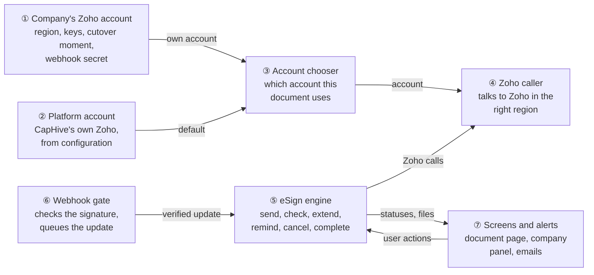

### Walkthrough: one example, start to finish

Arka Capital (Zoho company) starts on CapHive's platform account, connects its own US account, and
signs a document through it. Data is from the [shared setup](#worked-examples).

**Legend:** ✓ done · ● we are here: waiting on this, not done yet · ○ not started · ↺ redone ·
✗ ended without success (needs a resend)

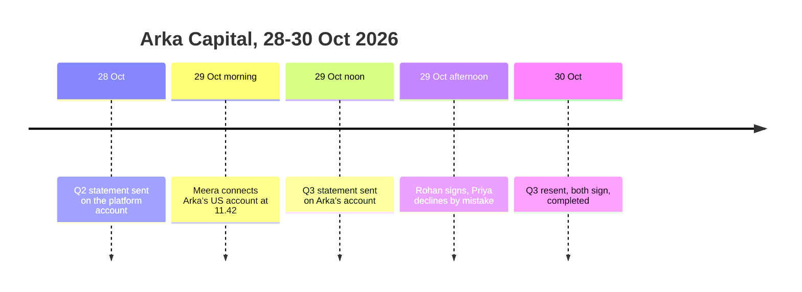

**Phase 1 — before connecting**

| # | When | What happens | Behind the scenes | Result |
|---|---|---|---|---|
| 1 | 28 Oct 10:00 | Asha sends "Arka Fund I - Q2 Statement" | the chooser (③) finds no company account, so the platform account (②) is used; the engine (⑤) sends through the caller (④) to `sign.zoho.in` | Connect&nbsp;account&nbsp;○<br>Send&nbsp;document&nbsp;✓<br>**Collect&nbsp;signatures&nbsp;●**<br>Complete&nbsp;document&nbsp;○ |

**Phase 2 — connecting the company account**

| # | When | What happens | Behind the scenes | Result |
|---|---|---|---|---|
| 2 | 29 Oct 11:35 | Meera submits region India by mistake | the panel (⑦) calls the connection setup on the company account (①); the caller (④) exchanges the grant code at `accounts.zoho.in`, Zoho answers `invalid_client` | **Connect&nbsp;account&nbsp;●** (nothing saved)<br>Send&nbsp;document&nbsp;✓ (Q2)<br>Collect&nbsp;signatures&nbsp;● (Q2)<br>Complete&nbsp;document&nbsp;○ |
| 3 | 29 Oct 11:42 | Meera picks United States with a fresh grant code | the caller (④) exchanges it at `accounts.zoho.com`; the company account (①) is saved Connected with `connected_at` 11:42 | Connect&nbsp;account&nbsp;✓<br>Send&nbsp;document&nbsp;✓ (Q2)<br>**Collect&nbsp;signatures&nbsp;●** (Q2)<br>Complete&nbsp;document&nbsp;○ |
| 4 | 29 Oct 11:47 | Meera adds the webhook in Zoho and presses Test Url | the webhook gate (⑥) checks the HMAC with Arka's secret, stamps `last_webhook_at`, replies 200 | Same as row 3 |

**Phase 3 — signing on the company account**

| # | When | What happens | Behind the scenes | Result |
|---|---|---|---|---|
| 5 | 29 Oct 12:00 | Asha sends "Arka Fund I - Q3 Statement" | the chooser (③) sees the company account (①) connected before now, so the engine (⑤) sends through the caller (④) to `sign.zoho.com`; each signer's Zoho id is stored | Connect&nbsp;account&nbsp;✓<br>Send&nbsp;document&nbsp;✓<br>**Collect&nbsp;signatures&nbsp;●**<br>Complete&nbsp;document&nbsp;○ |
| 6 | 29 Oct 13:00 | The nightly-style check runs for Q2 | the chooser (③) sees Q2 was sent before 11:42, so the platform account (②) is used — Q2 keeps syncing | Same as row 5 |
| 7 | 29 Oct 15:00 | Rohan signs; Zoho posts an update | the webhook gate (⑥) verifies, replies 200, queues it; the engine (⑤) marks Rohan Signed | Same as row 5 |
| 8 | 29 Oct 15:10 | Priya declines by mistake | gate (⑥) → engine (⑤): Priya Failed, document Failed | Connect&nbsp;account&nbsp;✓<br>Send&nbsp;document&nbsp;✓<br>Collect&nbsp;signatures&nbsp;✗ (declined)<br>Complete&nbsp;document&nbsp;○ |
| 9 | 30 Oct 09:00 | Asha resends Q3 | the engine (⑤) creates a new request on Arka's account (still chosen by ③) | Connect&nbsp;account&nbsp;✓<br>Send&nbsp;document&nbsp;↺<br>**Collect&nbsp;signatures&nbsp;●**<br>Complete&nbsp;document&nbsp;○ |

**Phase 4 — a stall, then completion**

| # | When | What happens | Behind the scenes | Result |
|---|---|---|---|---|
| 10 | 30 Oct 10:00 | Zoho is slow while Asha clicks "Get eSignatures' updates" | the caller (④) times out; the update job retries later; the document keeps In progress | Same as row 9 |
| 11 | 30 Oct 11:00 | Both signed; Zoho posts "completed" twice | the gate (⑥) queues both; the engine (⑤) completes once (atomic claim), downloads signed copy and certificate once | Connect&nbsp;account&nbsp;✓<br>Send&nbsp;document&nbsp;✓<br>Collect&nbsp;signatures&nbsp;✓<br>Complete&nbsp;document&nbsp;✓ |

The key moment, row 5 — the document page right after sending:

```
+---------------------------------------------------------------+
|  Arka Fund I - Q3 Statement                                   |
|  eSign Status            [Requested]                          |
|  eSignature Expires On   28/11/2026    (29 Oct + 30 days)     |
|  eSignature Reminders    Every 7 day(s)                       |
|  Signer             Status                                    |
|  rohan@example.com  [Requested]                               |
|  priya@example.com  [Requested]                               |
|  [Get eSignatures' updates] [Send Reminder] [Extend Expiry]   |
+---------------------------------------------------------------+
```

**What to notice**

- One rule (③) picks the account for every action, so Q2 and Q3 coexist without a per-document link.
- Credentials never leave ① and ②; everything else asks the caller (④).
- The webhook gate (⑥) replies before any work, so a slow download never fails Zoho's 5-second rule.
- Duplicate or repeated updates are harmless: completion is claimed once.
- A failure (wrong region, timeout) changes nothing that was already correct.

### Key ideas

| # | Idea | In one line | Card |
|---|---|---|---|
| 1 | Account, not provider | Every Zoho call is made on an account value: platform or company | [② ③](#-platform-account-and--account-chooser) |
| 2 | Cutover by time | Company account if the document was sent at/after `connected_at`, else platform | [② ③](#-platform-account-and--account-chooser) |
| 3 | One caller | Only `ZohoSignClient` knows regions, tokens, timeouts and error types | [④](#-zoho-caller) |
| 4 | Verify, then queue | Webhooks are authenticated per address and processed by a job | [⑥](#-webhook-gate) |
| 5 | Own vocabulary | Zoho statuses are mapped through one table; unknown ones are logged only | [⑤](#-esign-engine) |
| 6 | Capabilities, not names | Views/policies ask `esign_supports?(:feature)` instead of comparing "Zoho" | [⑦](#-screens-and-alerts) |

**FAQ**

| Question | Answer |
|---|---|
| Why not one Zoho account per document (stored id)? | The cutover date answers the realistic case (platform → own) with no extra column; reconnecting to a different account later is out of scope (proposal). |
| Does Digio or Docusign change? | No behaviour change. They share `EsignHelper`, the shared webhook address and the update jobs, which only gain Zoho-specific branches. |
| Why keep the platform account at all? | Companies can start signing before buying a Zoho plan, as with Digio. |
| What blocks users? | Only a company account in Needs reconnect blocks sending for that company. |

---

## 2. The same picture with real names

### Picture

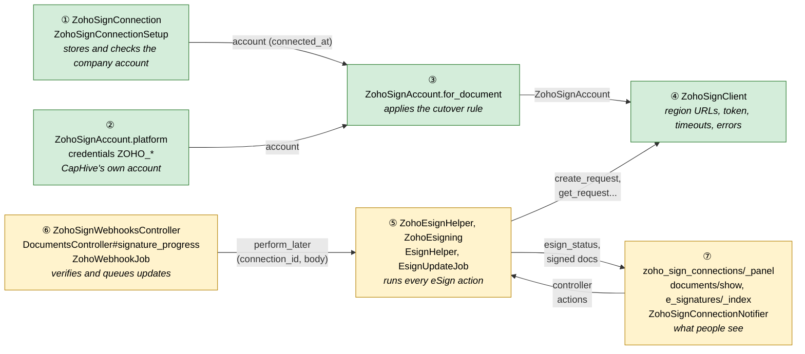

Colour = footprint: **green** new, **amber** modified, **grey** reused unchanged. Exact files are in
[lld.md File Map](lld.md#file-map).

### What each box does

| # | Box | Real parts | What it does | When it runs | What it decides | Details |
|---|---|---|---|---|---|---|
| ① | Company's Zoho account | `ZohoSignConnection` (`zoho_sign_connections`), `ZohoSignConnectionSetup`, `ZohoSignConnectionsController`, `ZohoSignConnectionPolicy` | Connect, verify, reconnect, disconnect, webhook secret, health | Request (admin) and on credential rejection | Connected vs Needs reconnect; may disconnect | [card ①](#-companys-zoho-account) |
| ② | Platform account | `ZohoSignAccount.platform` reading `ZOHO_CLIENT_ID`, `ZOHO_CLIENT_SECRET`, `ZOHO_REFRESH_TOKEN`, `ZOHO_WEBHOOK_SECRET`, `ZOHO_REGION` | CapHive's default account | On demand | — | [card ②③](#-platform-account-and--account-chooser) |
| ③ | Account chooser | `ZohoSignAccount.for_document`, `.for_entity` | Picks the account for a document | Before every Zoho call | Platform or company | [card ②③](#-platform-account-and--account-chooser) |
| ④ | Zoho caller | `ZohoSignClient` | HTTP to the account's region; token cache; error mapping | Every Zoho call | Which error type a failure is | [card ④](#-zoho-caller) |
| ⑤ | eSign engine | `ZohoEsignHelper`, `ZohoEsigning`, `EsignHelper`, `EsignJob`, `EsignUpdateJob`, `Document`, `ESignature` | Send, sync, extend, remind, cancel, complete; status mapping | Request and jobs | Document and signer statuses | [card ⑤](#-esign-engine) |
| ⑥ | Webhook gate | `ZohoSignWebhooksController`, `DocumentsController#signature_progress`, `ZohoWebhookJob` | Authenticate, acknowledge, queue, scope to tenant | Zoho callback | Accept (200), refuse (401) or ignore | [card ⑥](#-webhook-gate) |
| ⑦ | Screens and alerts | `zoho_sign_connections/_panel`, `entities/show`, `documents/_form`, `documents/show`, `e_signatures/_index`, `EntitySetting#esign_supports?`, `DocumentPolicy`, `ZohoSignConnectionNotifier`, `EntityMailer#zoho_sign_needs_reconnect` | Panels, buttons, messages, email | Page render / transition | What is visible to whom | [card ⑦](#-screens-and-alerts) |

### One run, end to end

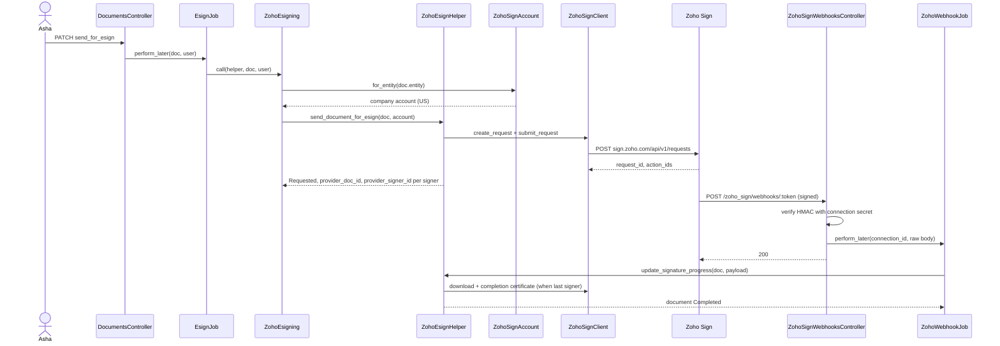

### Lifecycles

**Connection status** (stored, `zoho_sign_connections.status`):

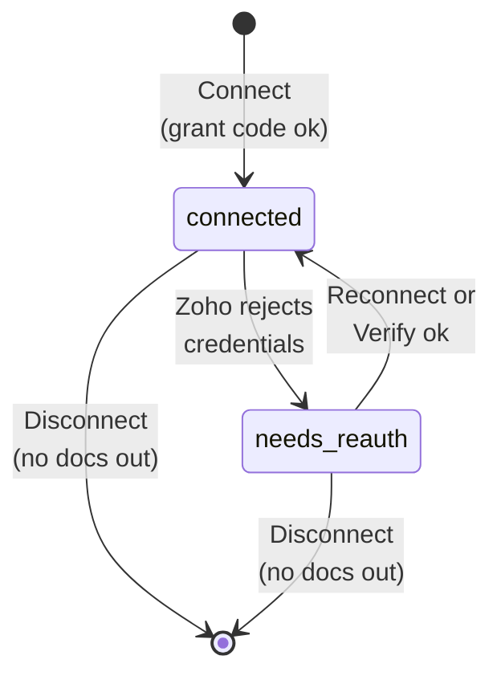

**Document eSign status for Zoho** (stored, `documents.esign_status`):

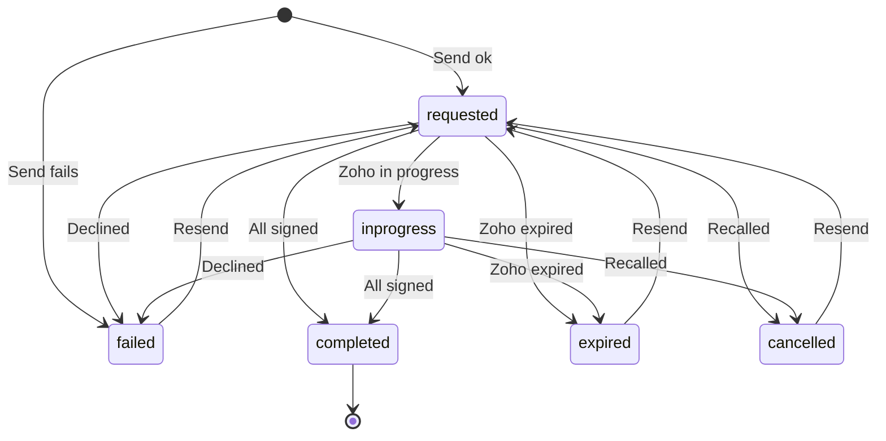

**Signer status** (stored, `e_signatures.status`): `""` → `sent` (submitted) → `requested`
(viewed/waiting) → `signed` | `failed` (declined) | `cancelled` | `expired`.

### What users see

| Where in CapHive | Today | After this change | Who sees it |
|---|---|---|---|
| Company page | Nothing about Zoho | Zoho eSign panel (connect / status / webhook) | Company admins, support — Zoho companies only |
| Document › Edit | Expiry/reminder fields for Zoho | Same fields, now validated server-side | Users who can edit the document |
| Document › Signatures | Send Reminder, Extend Expiry for Zoho | Same, shown via capability; clearer refusal messages | Users who can edit the document |
| Email | — | "Zoho account needs reconnecting" | Company admins |

Main everyday journey — connecting (proposal [Part A](proposal.md#part-a--once-connect-arkas-own-zoho)):

```
+-------------------------------------------------------------+
|  Zoho eSign                         (1) [Using CapHive's]   |
|  Region        (2) [ United States (sign.zoho.com)   v ]    |
|  Client ID     (3) [ 1000.ABCDEFGHIJ                   ]    |
|  Client Secret (3) [ ****************                  ]    |
|  Grant code    (3) [ 1000.4f9c...                      ]    |
|                                      (4) [Connect]          |
+-------------------------------------------------------------+
```

| Step | The user… | They see |
|---|---|---|
| (1) | opens the company page | Badge "Using CapHive's" |
| (2) | picks the region matching their Zoho address | 10 fixed choices |
| (3) | pastes Client ID, Secret and a fresh grant code | Secret masked |
| (4) | clicks Connect | Panel replaced in place by Connected state, or the error inline |

### Design decisions

1. **Cutover by `connected_at`, not a per-document account id** — Choice: compare `sent_for_esign_date`
   with `connected_at`. Alternative: store `zoho_sign_connection_id` on documents. Rejected: extra
   column and backfill for an edge case the user scoped out; mirrors Digio.
2. **Platform account from credentials, not a DB row** — Choice: `ZohoSignAccount.platform` reads Rails
   credentials. Alternative: seed a `zoho_sign_connections` row with `entity_id` NULL. Rejected:
   moves platform secrets into the DB and needs a support UI; credentials are the existing pattern.
3. **One account value object for both** — `ZohoSignAccount` (region, client id/secret, refresh token,
   webhook secret, connection). Alternative: branch on "platform?" throughout. Rejected: duplicated
   branches in helper, client and jobs.
4. **Access token in `Rails.cache`, keyed by a credentials fingerprint** — Alternative: encrypted
   `access_token` columns refreshed under `with_lock` (the Xero design). Rejected: Zoho does not rotate
   refresh tokens, so a concurrent refresh is harmless; one mechanism serves platform and company
   accounts, and a credential change can never reuse an old token.
5. **Self Client + grant code (Option A)** — Alternative: OAuth redirect with CapHive-registered Zoho
   apps per region (Option B). Deferred: needs app registration in ten regions; documented in the
   runbook.
6. **Per-company webhook address with a token** — Alternative: one address, find the company from the
   payload's `org_id`. Rejected: `org_id` is not in Zoho's documented payload and the secret must be
   known before trusting the payload.
7. **Webhooks queued** — Alternative: keep inline processing. Rejected: completion downloads two files;
   Zoho requires a 200 within 5 s and disables the webhook after 20 failures.
8. **Capability check `EntitySetting#esign_supports?`** — Alternative: keep `esign_provider == "Zoho"`
   literals. Rejected: four scattered literals; the capability list lives next to `esign_provider`.
9. **Flat class names (`ZohoSignClient`)** — every pack folder is a Zeitwerk root (`config/application.rb`),
   so `Zoho::Client` would need a new namespace exclusion; flat names follow `ZohoEsigning`.
10. **No new RSpec tier** — the project tests through Cucumber; Zoho HTTP is stubbed with WebMock
    (existing `features/support/webmock_toggle.rb`).
11. **Status badge stays on the model** — `Document#esign_status_badge` sits next to the existing
    `ESignature#status_badge`; there is no Draper decorator for either today.

**FAQ**

| Question | Answer |
|---|---|
| Why is the shared address still used for Zoho? | It is where CapHive's platform account webhook already points; changing it would need re-registering in Zoho for no gain. Company accounts get their own address. |
| Why not move all eSign code into `core/documents`? | File-count limit and no behaviour gain; new connection code goes to `core/documents`, Zoho services stay next to `ZohoEsigning` in `core/investor_kycs/services/zoho`. |
| What if two jobs refresh the same token at once? | Both get valid tokens; the later write wins in the cache. Zoho refresh tokens are not rotated. |
| What if `ZOHO_REGION` is unset? | Platform defaults to India, where CapHive's account lives. |

---

## 3. One card per box

### ① Company's Zoho account

A company's own Zoho Sign account: region, Self Client credentials, refresh token, cutover moment,
webhook token and secret, and health.

| Owns | Reads / receives | Produces |
|---|---|---|
| `zoho_sign_connections` row; connect/verify/reconnect/disconnect; webhook secret reveal/regenerate; Needs reconnect transition | Admin form params; Zoho token response via ④; counts of documents out for signature | `ZohoSignAccount` for ③; status; one notification per transition |

**Connect / reconnect**

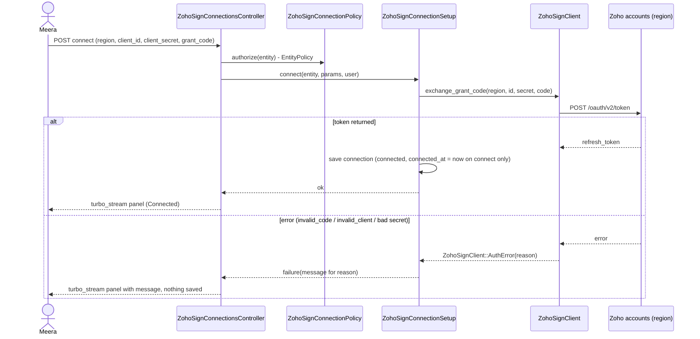

**Responsibilities**

| Operation | Transaction / idempotency | Notes |
|---|---|---|
| Connect | Single insert; unique `entity_id` rejects a double click (second gets "already connected" and the panel re-renders) | Grant code never stored |
| Reconnect | Update in place; `connected_at` unchanged; on failure nothing written | Blank client secret keeps stored one |
| Verify | One read call (`GET /api/v1/requests` with `row_count` 1) | Sets `last_verified_at`; success also clears Needs reconnect |
| Needs reconnect | Conditional update `WHERE status = 'connected'`; notify only when 1 row changed | Called by ④ on `AuthError` |
| Disconnect | Refused while documents are out for signature on the connection (count query); then destroy | Audited |
| Reveal secret | Allowed once: sets `webhook_secret_revealed_at` | Regenerate resets it |

**Routes**

| Verb and path | Action | Does | Responds with |
|---|---|---|---|
| `POST /entities/:entity_id/zoho_sign_connection` | `create` | Connect | turbo_stream panel |
| `PATCH /entities/:entity_id/zoho_sign_connection` | `update` | Reconnect | turbo_stream panel |
| `DELETE /entities/:entity_id/zoho_sign_connection` | `destroy` | Disconnect | turbo_stream panel |
| `POST /entities/:entity_id/zoho_sign_connection/verify` | `verify` | Verify | turbo_stream panel |
| `POST /entities/:entity_id/zoho_sign_connection/reveal_webhook_secret` | `reveal_webhook_secret` | Show once | turbo_stream panel with secret |
| `POST /entities/:entity_id/zoho_sign_connection/regenerate_webhook_secret` | `regenerate_webhook_secret` | New secret | turbo_stream panel with secret |

**Access**

| Role | View panel | Connect / reconnect / verify / disconnect / secrets |
|---|---|---|
| Company admin of the entity (not an investor advisor) | Yes | Yes |
| Support | Yes | Yes |
| Other users of the entity | No | No (refused) |
| Company admin of another entity | No | No (refused) |

Scoping: the controller loads the entity from `params[:entity_id]` and authorizes
`ZohoSignConnectionPolicy`, which delegates to `EntityPolicy#update?` (own entity + company admin, or
support). The connection is always `entity.zoho_sign_connection`; no connection id is taken from params.

**Worked examples:** H1, H2, H3, H4, E1–E8, X1–X6

**FAQ**

| Question | Answer |
|---|---|
| Why delegate to `EntityPolicy#update?`? | Exactly the people who may edit company settings; no second rule to keep in sync. |
| Why can't support pick another company's connection by id? | There is no id in the routes; the entity in the URL decides, and the policy checks it. |
| Why refuse disconnect instead of warning? | Documents on that account could no longer be synced or cancelled; refusing is the simple safe rule. |
| What does Verify call? | A cheap list call with one row, needing only the documents READ scope. |

### ② Platform account and ③ Account chooser

`ZohoSignAccount` is a small value object: `region`, `client_id`, `client_secret`, `refresh_token`,
`webhook_secret`, `connection` (nil for platform) and `token_cache_key`. `.platform` builds it from
credentials; `ZohoSignConnection#account` builds it from a row. `.for_document(doc)` and
`.for_entity(entity)` apply the cutover.

| Owns | Reads / receives | Produces |
|---|---|---|
| Cutover rule; platform configuration reading | `doc.entity.zoho_sign_connection`, `doc.sent_for_esign_date`, credentials | `ZohoSignAccount` |

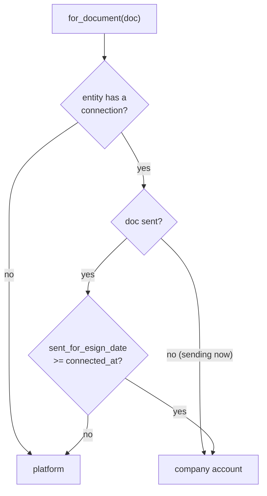

- `token_cache_key` = region + `client_id` + SHA-256 of the refresh token, so any credential change gets
  a new key (spec: token not reused after reconnect).
- `ZOHO_REGION` defaults to `in`. The old `ZOHO_SIGN_URL` / `ZOHO_ACCOUNTS_URL` env vars are removed;
  the URLs come from the region table in ④.

**Worked examples:** H5, H6, E9, E10, E11

**FAQ**

| Question | Answer |
|---|---|
| Why does an unsent document use the company account? | It will be sent now, after the cutover. |
| What if the clock of `sent_for_esign_date` equals `connected_at` exactly? | Company account (`>=`), covered by E10. |
| What if a company disconnects while documents are out? | It cannot (card ①), so the rule never points at a missing connection for an out-for-signature document. Completed documents need no further calls except downloads already done. |

### ④ Zoho caller

The only place that knows Zoho's addresses, tokens, timeouts and error formats.

| Owns | Reads / receives | Produces |
|---|---|---|
| Region table; HTTP; access-token cache; error mapping | `ZohoSignAccount`; request data and files from ⑤ | Parsed JSON / PDF bodies; typed errors |

**Region table** (single source; the Canada row is verified in a sandbox before release — see risks)

| Key | Name | Accounts | Sign API |
|---|---|---|---|
| `com` | United States | accounts.zoho.com | sign.zoho.com |
| `eu` | Europe | accounts.zoho.eu | sign.zoho.eu |
| `in` | India | accounts.zoho.in | sign.zoho.in |
| `jp` | Japan | accounts.zoho.jp | sign.zoho.jp |
| `com.au` | Australia | accounts.zoho.com.au | sign.zoho.com.au |
| `ca` | Canada | accounts.zohocloud.ca | sign.zohocloud.ca |
| `sa` | Saudi Arabia | accounts.zoho.sa | sign.zoho.sa |
| `uk` | United Kingdom | accounts.zoho.uk | sign.zoho.uk |
| `sg` | Singapore | accounts.zoho.sg | sign.zoho.sg |
| `ae` | UAE | accounts.zoho.ae | sign.zoho.ae |

**Calls** (paths from the Zoho Postman collection in `zoho esign docs/`)

| Method | Zoho call |
|---|---|
| `exchange_grant_code` (class) | `POST {accounts}/oauth/v2/token` `grant_type=authorization_code` |
| `access_token` | `POST {accounts}/oauth/v2/token` `grant_type=refresh_token`, cached `expires_in - 60 s` |
| `create_request(data, file)` / `submit_request(id, actions)` | `POST /api/v1/requests` / `POST /api/v1/requests/:id/submit` |
| `get_request(id)` | `GET /api/v1/requests/:id` |
| `download_pdf(id)` / `completion_certificate(id)` | `GET .../pdf` / `GET .../completioncertificate` |
| `recall(id)` / `remind(id)` / `extend(id, date)` / `delete_request(id)` | `POST .../recall` / `POST .../remind` / `PUT .../extend` / `PUT .../delete` |
| `list_requests_probe` | `GET /api/v1/requests` with `row_count` 1 (Verify) |

**Errors**

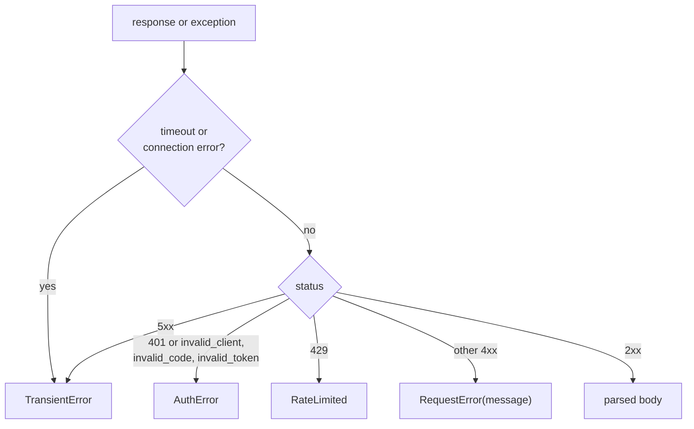

- Timeouts: open 5 s, read 30 s (60 s for PDF downloads).
- A 401 on an API call with a cached token: delete the cache entry, refresh once, retry once; a second
  401 raises `AuthError`.
- `AuthError` on a company account calls `ZohoSignConnection#mark_needs_reauth!` (card ①) before raising.
- No retries inside a request; background retries belong to the jobs (card ⑤, ⑥).

**Worked examples:** H5, E12, X7, X8, X9, X10

**FAQ**

| Question | Answer |
|---|---|
| Why no HTTParty `include` on the helper any more? | One client keeps the timeouts and error mapping in one place; the helper stops building URLs. |
| Why not retry inside the request? | A user click must answer quickly; jobs already retry with back-off. |
| Why is Canada different? | Zoho's Canada data centre uses `zohocloud.ca`; the derived `zoho.zohocloud.ca` from the endpoint template is suspect, so it is verified before release. |

### ⑤ eSign engine

The existing eSign pipeline with Zoho specifics: `ZohoEsigning` (Trailblazer) for sending,
`ZohoEsignHelper` for every other action, `EsignHelper` dispatch, `EsignJob` / `EsignUpdateJob`.

| Owns | Reads / receives | Produces |
|---|---|---|
| Request payload (signers, fields, expiry, reminders); status mapping; completion; eSign log | Document, signers, account from ③, Zoho responses from ④, webhook payloads from ⑥ | `documents.esign_status`, `esign_expires_at`, `provider_doc_id`; `e_signatures.status`, `provider_signer_id`; signed copy and certificate documents; `EsignLog` |

**Send (ZohoEsigning steps)**

| Step | Refuses with | Notes |
|---|---|---|
| `check_account` | "<Company>'s Zoho account needs to be reconnected…" | Company account in needs_reauth |
| `validate_signer_count` | "Zoho allows at most 25 signers per document." | |
| `validate_doc_size` | existing 25 MB message | unchanged |
| `send_document_for_esign` | — | create → submit; stores `provider_signer_id` from create response's `actions[].action_id` matched by position |
| `update_document` | "Error sending <name> for eSigning - <reason>" | Failed document, EsignLog, `delete_request` best effort if create succeeded and submit failed |
| rescue | same message | `ZohoSignClient::Error`, `PDF::Reader::MalformedPDFError` → failure path, `ErrorReport.notify` |

**Status mapping** (one table in `ZohoEsignHelper`)

| Zoho `request_status` | Document | Zoho `action_status` | Signer |
|---|---|---|---|
| `inprogress` | `inprogress` | `SIGNED`, `COMPLETED`, `APPROVED` | `signed` |
| `completed` | via completion rule | `DECLINED` | `failed` |
| `expired` | `expired` | `VIEWED`, `UNOPENED`, `NOACTION`, `WAITING_FOR_MY_TURN`, `WAITING_FOR_OTHERS`, `YET_TO_SIGN`, `FORWARDED` | `requested` |
| `recalled` | `cancelled` | anything else | unchanged, logged |
| `declined` | `failed` | | |
| anything else | unchanged, logged | | |

**Webhook events** (`update_signature_progress(doc, payload)`)

| `operation_type` | Effect |
|---|---|
| `RequestSubmitted` | signers with status blank (`""` or NULL) → `sent` |
| `RequestViewed` | logged only |
| `RequestSigningSuccess` | signer (by `action_id`, else email) → `signed`; completion rule |
| `RequestRejected` | signer → `failed`; document → `failed` |
| `RequestForwarded` | signer slot kept (matched by `action_id`); logged in `api_updates` |
| `RequestRecalled` / `RequestExpired` | document and signers → `cancelled` / `expired` |
| `RequestCompleted` | completion rule |
| other | logged only |

**Completion** — `Document#signature_completed` claims completion with an atomic `update_all`
(existing); only the claiming call downloads the signed copy and the certificate (existing
`attach_esign_supplementary_document`). Certificate failure is logged, completion stands.

**Extend / remind / cancel** — Extend validates the date (real date, tomorrow or later, no upper limit
and never clamped — the POC's silent clamp to today+99 is removed) before calling Zoho and returns the
refusal message; remind and cancel keep their controller actions and messages;
cancel keeps `EsignHelper#update_esign_status` first (existing).

**Jobs**

| Job | Queue | Retries | Idempotency |
|---|---|---|---|
| `EsignJob` (send) | default | none (unchanged) — a failed send is a Failed document the user can resend | resend guarded by `resend_for_esign?` |
| `EsignUpdateJob` (pull) | default | `retry_on ZohoSignClient::TransientError, RateLimited`, polynomial, 5 attempts; `AuthError` discarded after the connection is marked | status writes are absolute values |
| `ZohoWebhookJob` | default | same as `EsignUpdateJob` | signer/document writes absolute; completion claimed once |

**Worked examples:** H7–H14, E13–E26, X11–X17

**FAQ**

| Question | Answer |
|---|---|
| Why match signers by `action_id`? | Forwarding changes the email that signs; the action id stays with the slot. Email is the fallback for documents sent before the column existed. |
| Why does a decline fail the whole document? | Zoho ends the request on a decline; Failed makes it resendable (`RESEND_FOR_ESIGN_STATUSES`). |
| Why delete the draft when submit fails? | Otherwise each failed attempt leaves a draft in the client's Zoho; best effort, errors only logged. |
| Why not retry sends automatically? | A send that half-succeeded must not create a second request; the user resends explicitly. |

### ⑥ Webhook gate

Two entry points, one handler: the shared `DocumentsController#signature_progress` (platform account,
plus Digio/Docusign unchanged) and `ZohoSignWebhooksController#create` (one address per company).

| Owns | Reads / receives | Produces |
|---|---|---|
| Signature check; tenant scoping; 200/401 answers; `last_webhook_at` | Raw body, `X-ZS-WEBHOOK-SIGNATURE`, URL token | `ZohoWebhookJob` with `(connection_id or nil, raw body)` |

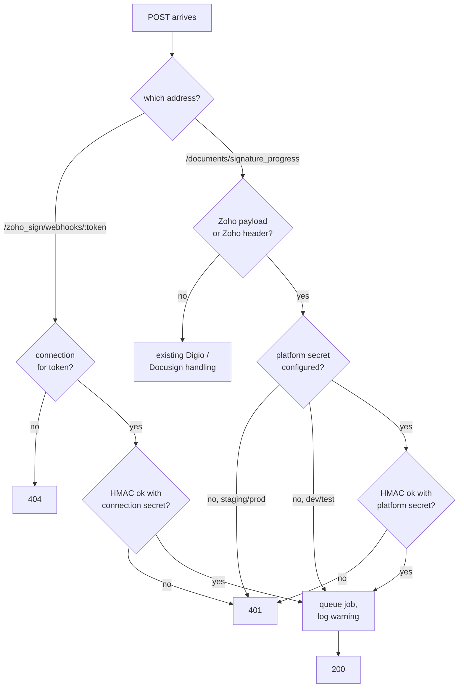

**Scoping in `ZohoWebhookJob`**

| Address | Document must be | Otherwise |
|---|---|---|
| Company | `entity_id = connection.entity_id`, `provider_doc_id = request_id`, `sent_for_esign_date >= connected_at` | logged, nothing changes |
| Shared | `provider_doc_id = request_id` and `ZohoSignAccount.for_document(doc)` is platform | logged, nothing changes |

- HMAC: base64(HMAC-SHA256(raw body, secret)), compared with `ActiveSupport::SecurityUtils.secure_compare`.
- Zoho payload detection on the shared address: header present, or `notifications.operation_type` and
  `requests.request_id` present (same test as `EsignHelper.update_signature_progress`).
- `ZohoSignWebhooksController` skips authentication, CSRF and entity selection, like `signature_progress`.

**Worked examples:** H8, H15, E27–E33, X18–X22

**FAQ**

| Question | Answer |
|---|---|
| Why 404 for an unknown token but 200 for an unknown request? | An unknown token is not a Zoho webhook we set up; an unknown request on a valid address is a real Zoho event we may not track (e.g. Zoho's Test Url). |
| Why is the dev/test exception safe? | `Rails.env.local?` only; staging and production refuse without a secret. |
| Can a company's address affect platform documents? | No: scoping requires the company's entity and the cutover. |
| What about replayed old updates? | Status writes are absolute and completion is claimed once, so replays are harmless. |

### ⑦ Screens and alerts

What people see: the company panel, the document page buttons/fields, and the reconnect email.

| Owns | Reads / receives | Produces |
|---|---|---|
| `zoho_sign_connections/_panel`; capability checks; email | Connection state; `EntitySetting#esign_supports?`; `DocumentPolicy` | HTML, turbo_stream, email |

- `EntitySetting::ESIGN_CAPABILITIES = { "Zoho" => %i[expiry_settings reminders extend_expiry connection] }`;
  `esign_supports?(feature)` replaces the `esign_provider == "Zoho"` literals in `DocumentPolicy`
  (`extend_esign_expiry?`, `send_esign_reminder?`), `documents/_form`, `documents/show` and the new panel.
- `Document` validates `esign_expiration_days` 1..99 and `esign_reminder_period` 1..30 (allow nil).
- Panel: rendered in `entities/show` inside a turbo frame when `esign_supports?(:connection)` and
  `policy(entity).update?`. Connect/Reconnect form in the same partial.
- Extend modal: shows the allowed window text; the controller shows the helper's refusal message.

**Build notes:** turbo_stream replace of `#zoho_sign_connection_panel`; no new Stimulus controller
(the existing `docform_controller#toggleReminderPeriod` stays).

**Worked examples:** H1, H12, H13, E1, E2, E16, E17, X3

**FAQ**

| Question | Answer |
|---|---|
| Why a capability list instead of `zoho?`? | Policies and views ask about features; a future provider adds a line, not new conditionals. |
| Where do messages come from? | The proposal's Behavior Rules; the helper returns them in `ZohoResult`. |

---

## 4. Reference

### Class diagram

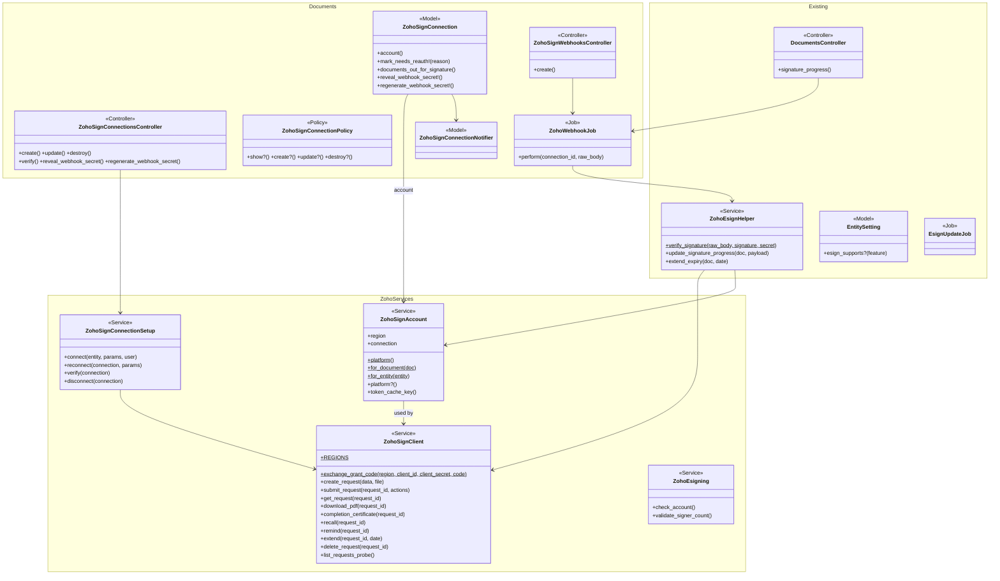

### Data model and schema changes

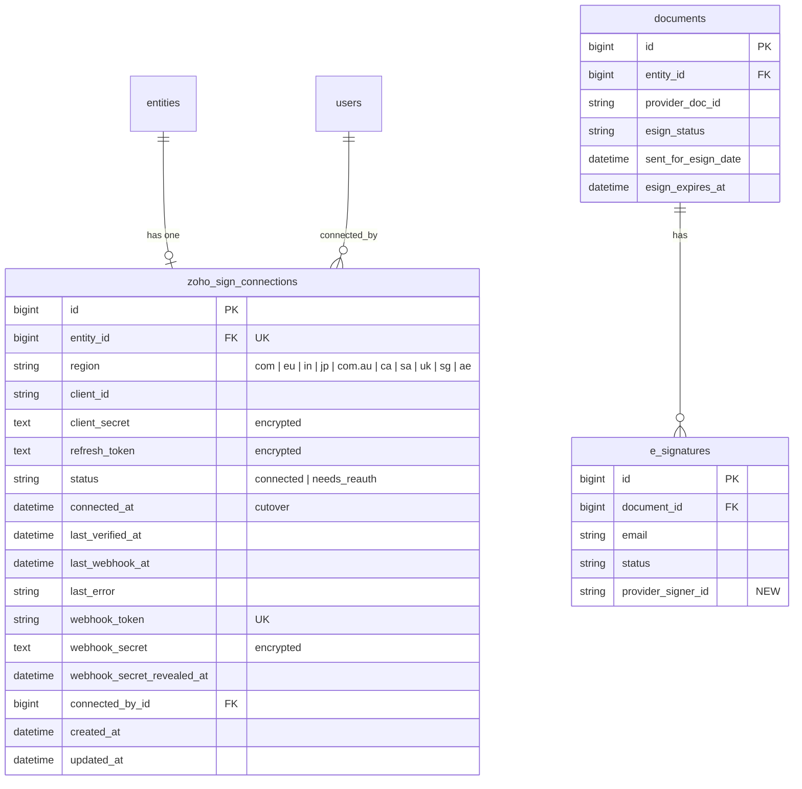

**Indexes:** `zoho_sign_connections.entity_id` unique · `zoho_sign_connections.webhook_token` unique.

**Schema changes**

**`zoho_sign_connections`** (new): a company's own Zoho account, one per company.

| Column / index | What changed | Why it's needed |
|---|---|---|
| `entity_id` | Added: bigint, not null, FK, unique index | Owner; one connection per company |
| `region` | Added: string, not null | Picks addresses from the region table |
| `client_id` | Added: string, not null | Self Client id, sent with token requests |
| `client_secret` | Added: text, not null, `encrypts` | Self Client secret |
| `refresh_token` | Added: text, not null, `encrypts` | Obtains access tokens |
| `status` | Added: string, not null, default `connected` | Health: `connected` / `needs_reauth` |
| `connected_at` | Added: datetime, not null | The cutover moment; unchanged on reconnect |
| `last_verified_at` | Added: datetime | Shown after Verify |
| `last_webhook_at` | Added: datetime | "Last update" on the panel; proves the webhook works |
| `last_error` | Added: string | Why it needs reconnecting, shown on the panel |
| `webhook_token` | Added: string, not null, unique index (`has_secure_token`) | The per-company webhook address |
| `webhook_secret` | Added: text, not null, `encrypts` | HMAC secret for that address |
| `webhook_secret_revealed_at` | Added: datetime | "Show once" |
| `connected_by_id` | Added: bigint, FK users | Audit of who connected |
| `created_at`, `updated_at` | Added | Standard |

**`e_signatures`** (changed): Zoho's per-signer id must survive forwarding.

| Column / index | What changed | Why it's needed |
|---|---|---|
| `provider_signer_id` | Added: string, nullable | Zoho `action_id`, matches webhook and poll events to the signer slot |

**Changes to existing models:**
- `Entity` `has_one :zoho_sign_connection, dependent: :restrict_with_error`.
- `EntitySetting` gains `ESIGN_CAPABILITIES` and `esign_supports?`.
- `Document` gains range validations for expiry and reminder period.
- `ZohoSignConnection` is `audited except: %i[client_secret refresh_token webhook_secret]`.

### Component contracts

| From → To | Contract | Direction rule |
|---|---|---|
| ① → ③ | `ZohoSignConnection#account` → `ZohoSignAccount` with `connection` and `connected_at` | ③ reads ①, never writes |
| ② → ③ | `ZohoSignAccount.platform` from credentials | read-only |
| ③ → ④ | `ZohoSignClient.new(account)` | ④ never chooses an account |
| ⑤ → ④ | client methods; returns parsed JSON or raises `ZohoSignClient::Error` subclasses | only ④ talks HTTP to Zoho |
| ⑥ → ⑤ | `ZohoWebhookJob.perform_later(connection_id_or_nil, raw_body)` → `ZohoEsignHelper#update_signature_progress(doc, payload)` | gate never changes documents |
| ⑤ → ⑦ | `documents.esign_status`, `e_signatures.status`, signed/certificate documents, `ZohoResult` messages | views read; no Zoho calls from views |
| ⑦ → ⑤ | `DocumentsController` actions → `EsignHelper` / `EsignJob` | authorized by `DocumentPolicy` |
| ④ → ① | `mark_needs_reauth!(reason)` on `AuthError` for a company account | only state change ④ may cause |

### Notifications

| Notification | Trigger | Recipients | Channel | Customisable | Default | Sent once? |
|---|---|---|---|---|---|---|
| Zoho account needs reconnecting (`ZohoSignConnectionNotifier` → `EntityMailer#zoho_sign_needs_reconnect`) | Connection moves `connected` → `needs_reauth` | The company's active company admins (`entity.employees.active.company_admins`) | Email (and in-app notification record) | No (internal alert) | On | Yes — only the call whose conditional update changed the row notifies; repeated `AuthError`s while already `needs_reauth` send nothing |
| Existing send result alert ("sent for eSigning" / "Error sending …") | Send finishes | The sender | In-app `UserAlert` (existing) | No | On | One per send |
| Investor signing emails | Zoho request sent / reminders | Signers | Email **from Zoho**, not CapHive | In Zoho | Per document settings | Zoho's own schedule; "Send Reminder" sends one immediately |

Investors receive no new CapHive notification. Investor advisors receive nothing new.

### Cross-cutting concerns

#### Transactions and queries

- Connect: one insert inside a transaction; the unique `entity_id` index decides double clicks.
- Needs reconnect: one conditional `UPDATE ... WHERE status = 'connected'`; the returned row count gates
  the notification.
- Disconnect check: one count on `documents` (`entity_id`, `sent_for_esign`, `sent_for_esign_date >=
  connected_at`, `esign_status` in active statuses).
- Webhook job: one lookup `documents.provider_doc_id` scoped by `entity_id` (company address); signers
  loaded once per event (`index_by(:provider_signer_id)`, email fallback).
- Completion: existing atomic `update_all` claim.

#### Exception handling and monitoring

| Failure | Who is alerted | Channel | Detail |
|---|---|---|---|
| Send fails | Sender | `UserAlert` (danger) | Message with Zoho/exception reason; `ErrorReport.notify(source: "ZohoEsignHelper send")` |
| Credentials rejected | Company admins | `ZohoSignConnectionNotifier` email | Once per transition; `last_error` on panel |
| Webhook refused (401) | — | Log only | Avoids alert floods from scanners |
| Transient / rate limit in jobs | — | Job retries; `ErrorReport.notify` on final failure | |
| Unknown status / event | — | `EsignLog` + log | No alert |
| Certificate download fails | — | `ErrorReport.notify` | Completion stands |

#### Performance and security

- Volume: one company account = Zoho's ~50 calls/min; jobs retry on 429. Webhook replies within
  milliseconds (verify + enqueue).
- Tenant isolation: connection always reached through the entity in the URL or the webhook token;
  webhook scoping by `entity_id` + cutover; `EntityPolicy#update?` for every panel action.
- Secrets: `encrypts` (Active Record encryption keys exist per environment, see risks); never rendered
  after submit; `grant_code` added to `filter_parameters` (`secret`/`token` already filtered); Zoho
  token responses never logged; `EsignLog` stores only request/status payloads with `image_string`
  stripped (existing).
- SSRF: only addresses from the fixed region table are called.
- HMAC compared in constant time over the raw body.

### Worked examples

**ID legend:** **H** = Happy path · **E** = Edge case · **X** = Error (exception) case.
Spec names: **C:** `zoho-sign-connections`, **S:** `zoho-esign`. Feature files under
`features/core/`: `zoho_sign_connections.feature` (CN), `zoho_esign.feature` (ES),
`zoho_esign_webhook.feature` (WH). Time frozen at **29 Oct 2026 12:00 IST** unless stated.

**Shared setup:**

| Record | Name | Key data |
|---|---|---|
| Entity | Arka Capital | Investment Fund, eSign provider Zoho |
| Entity | Bodhi Partners | Investment Fund, eSign provider Zoho, own connection (Japan) |
| Entity | Chola Ventures | Investment Fund, eSign provider Digio |
| User | Meera | Arka company admin |
| User | Asha | Arka employee who can edit documents |
| User | Kabir | Bodhi company admin |
| User | Ravi | CapHive support |
| Platform account | CapHive | region `in`, webhook secret `plat-secret` |
| Connection | Arka (when connected) | region `com`, `connected_at` 29 Oct 2026 11:42, webhook secret `arka-secret` |
| Document | Arka Fund I - Q3 Statement | 3 pages, signers Rohan (rohan@example.com), Priya (priya@example.com) |
| Document | Arka Fund I - Q2 Statement | sent 28 Oct 2026 10:00 on the platform account, In progress |

#### Happy Path

| # | Scenario | Given | When | Then | Spec scenario | Feature |
|---|---|---|---|---|---|---|
| H1 | Admin sees panel | Arka not connected | Meera opens Arka's company page | Zoho eSign panel "Using CapHive's" | C: Panel shown to a company admin on a Zoho company | CN |
| H2 | Connect | Zoho US accepts the code | Meera connects with region United States | Connected, "Connected on 29/10/2026 12:00" | C: Successful connection | CN |
| H3 | Reveal secret once | Arka connected, secret never shown | Meera clicks Show webhook secret, then reloads | Secret shown once; afterwards only Regenerate | C: Secret revealed once; C: Secret not shown again | CN |
| H4 | Verify | Arka connected, Zoho accepts | Meera clicks Verify connection | "Connection verified", Connected | C: Verification succeeds | CN |
| H5 | Send on company account | Arka connected | Asha sends Q3 | Request created at `sign.zoho.com`, status Requested, Expires On 28/11/2026 (29 Oct + 30 days) | S: Successful send; C: Sent after connecting; C: Calls go to the chosen region | ES |
| H6 | Send on platform account | Arka not connected | Asha sends Q3 | Request created at `sign.zoho.in` | C: Not connected | ES |
| H7 | Settings sent | Q3 expiry 30, reminders on every 7 | Asha sends | Zoho payload expiration 30, reminders true, period 7 | S: Configured values sent | ES |
| H8 | Webhook signed | Q3 sent on Arka's account | Zoho posts RequestSigningSuccess for Rohan signed with `arka-secret` to Arka's address | 200; Rohan Signed; Priya Requested | S: Valid signature accepted | WH |
| H9 | Poll partial | Q3 sent; Zoho shows Rohan SIGNED, Priya YET_TO_SIGN | Asha clicks Get eSignatures' updates | Rohan Signed, Priya Requested, document In progress | S: Partially signed | ES |
| H10 | Completion | Both SIGNED | Zoho posts RequestCompleted | Document Completed; one signed copy; one "Arka Fund I - Q3 Statement - Signature Certificate" | S: Completed once | WH |
| H11 | Extend | Q3 In progress | Asha extends to 15 Dec 2026, Zoho accepts | Expires On 15/12/2026, success message | S: Valid extension | ES |
| H12 | Reminder | Q3 In progress | Asha clicks Send Reminder | Zoho remind called; "Reminder was sent to pending signer(s)" | S: Reminder sent | ES |
| H13 | Cancel | Q3 In progress, Zoho accepts recall | Asha clicks Cancel eSignatures | Document and signers Cancelled | S: Cancelled | ES |
| H14 | Reconnect | Arka in needs_reauth | Meera reconnects with a fresh code | Connected; Connected on still 29/10/2026 11:42; Q3 syncs again | C: Reconnect after revocation | CN |
| H15 | Submitted | Q3 sent, signers blank | Zoho posts RequestSubmitted | Rohan and Priya Sent | S: Submitted | WH |
| H16 | Disconnect | Arka connected, no documents out on it | Meera disconnects and confirms | Panel "Using CapHive's"; next send uses `sign.zoho.in` | C: Disconnect allowed | CN |

#### Edge Cases

| # | Scenario | Given | When | Then | Spec scenario | Feature |
|---|---|---|---|---|---|---|
| E1 | Digio company | Chola (Digio) | Its admin opens the company page | No Zoho panel | C: Panel hidden when the provider is not Zoho | CN |
| E2 | Digio document | Chola document sent | User opens it | No Extend Expiry, Send Reminder, expiry/reminder fields; direct PATCH extend refused | S: Hidden for Digio | ES |
| E3 | Missing fields | — | Meera submits with blank grant code and secret | Both marked required; nothing saved | C: Missing fields | CN |
| E4 | Region not in list | — | Direct POST with region `xx` | "Pick a Zoho region"; nothing saved | C: Region outside the list refused | CN |
| E5 | Double click Connect | Zoho accepts | Two connect requests at once | One connection; second shows already connected | C: Successful connection | CN |
| E6 | Reconnect keeps blank secret | Arka connected | Meera reconnects with blank secret and fresh code | Stored secret kept; Connected | C: Reconnect after revocation | CN |
| E7 | Regenerate secret | Arka connected | Meera regenerates; Zoho posts with old `arka-secret` | 401; nothing changes | C: Regenerated secret invalidates the old one | WH |
| E8 | Secrets filtered | — | Meera connects | Request log shows `[FILTERED]` for client_secret and grant_code | C: Secrets kept out of logs | CN |
| E9 | Old document on platform | Q2 sent 28 Oct on platform; Arka connected 29 Oct 11:42 | Daily check runs for Q2 | Call goes to `sign.zoho.in`; Q2 updates normally | C: Sent before connecting | ES |
| E10 | Sent exactly at cutover | `connected_at` 11:42:00 | Document sent at 11:42:00 | Company account used | C: Sent after connecting | ES |
| E11 | Sent one second before | `connected_at` 11:42:00 | Document sent 11:41:59, then polled | Platform account used | C: Sent before connecting | ES |
| E12 | Token not reused | Arka reconnected with new credentials | Q3 polled | New token requested for the new credentials | S: Token not reused after reconnect | ES |
| E13 | Defaults | Expiry and reminder blank | Asha sends | Expiration 90, period 4 | S: Defaults applied | ES |
| E14 | Expiry 99 / 1 accepted | — | Asha saves 99, then 1 | Saved | S: Out-of-range expiry refused | ES |
| E15 | Expiry 0 / 100 refused | — | Asha saves 0, then 100 | "must be between 1 and 99"; not saved | S: Out-of-range expiry refused | ES |
| E16 | Reminder 30 / 31 | — | Asha saves 30, then 31 | 30 saved; 31 refused | S: Out-of-range expiry refused | ES |
| E17 | 25 signers | 25 signers | Asha sends | Sent | S: Too many signers | ES |
| E18 | Boxes on all pages | 3 pages, display All, 2 signers | Asha sends | 6 fields: pages 1–3 per signer, distinct y positions per signer | S: Signature boxes on every page | ES |
| E19 | First page only | display First | Asha sends | Fields on page 1 only | S: Signature boxes on every page | ES |
| E20 | Forced order | force_esign_order | Asha sends | `is_sequential` true, signing_order 0,1 | S: Forced signing order | ES |
| E21 | Extend to tomorrow | Today 29 Oct | Extend to 30 Oct 2026 | Accepted | S: Valid extension | ES |
| E22 | Extend far into the future | Today 29 Oct | Extend to 31 Dec 2027 | Accepted; shows 31/12/2027 (not shortened) | S: Far-future date accepted | ES |
| E23 | Extend to a past date | Today 29 Oct | Extend to 1 Oct 2026 | "Choose a date from 30/10/2026 onward."; Zoho not called | S: Past date refused | ES |
| E24 | Extend to today | Today 29 Oct | Extend to 29 Oct 2026 | Same refusal | S: Past date refused | ES |
| E25 | Expiry reconciled | Q3 shows 28/11/2026 | Poll returns expire_by 15 Dec 2026 | Shows 15/12/2026 | S: Expiry reconciled | ES |
| E26 | Reminder hidden on completed | Q3 Completed | Asha opens Q3; direct PATCH send_esign_reminder | No button; request refused | S: Not offered on completed documents | ES |
| E27 | Duplicate signed update | H8 done | Same update posted again | Rohan Signed; nothing else changes | S: Duplicate update | WH |
| E28 | Completed twice | Both signed | RequestCompleted posted, and Asha polls | Exactly one signed copy and one certificate | S: Completed once | WH |
| E29 | Forwarded then signed | Rohan forwards to sam@example.com | Zoho posts RequestForwarded then RequestSigningSuccess by sam with Rohan's action_id | Rohan's slot Signed | S: Forwarded then signed | WH |
| E30 | Recalled in Zoho (poll) | Q3 recalled directly in Zoho | Asha polls | Document Cancelled; Resend available | S: Recalled in Zoho | ES |
| E31 | Expired event | Q3 out | Zoho posts RequestExpired | Document and signers Expired | S: Recalled in Zoho | WH |
| E32 | Unknown request | — | Signed update for request id 999 to Arka's address | 200; nothing changes | S: Unknown request | WH |
| E33 | Acknowledged first | Completion download stubbed slow | RequestCompleted posted | 200 returned; document Completed after jobs run | S: Acknowledged before processing | WH |
| E34 | Dev without platform secret | test env, platform secret blank | Unsigned Zoho update on shared address | 200 and processed, warning logged | S: Valid signature accepted | WH |
| E35 | Viewed event | Q3 out | RequestViewed posted | Logged only; statuses unchanged | S: Duplicate update | WH |

#### Error Cases

| # | Scenario | Given | When | Then (what the user sees, who is alerted) | Spec scenario | Feature |
|---|---|---|---|---|---|---|
| X1 | Non-admin connects | Asha (not admin) | Direct POST connect | Refused; no connection | C: Non-admin cannot connect | CN |
| X2 | Other company's admin | Kabir (Bodhi) | Direct PATCH/DELETE on Arka's connection URL | Refused; Arka unchanged | C: Admin of another company cannot touch the connection | CN |
| X3 | Expired grant code | Zoho answers `invalid_code` | Meera connects | Expired-code message; nothing saved | C: Expired grant code | CN |
| X4 | Wrong region | Zoho India answers `invalid_client` | Meera connects with India | Wrong-region message; nothing saved | C: Wrong region | CN |
| X5 | Failed reconnect | Arka needs_reauth; Zoho `invalid_code` | Meera reconnects | Message; credentials and status unchanged | C: Failed reconnect changes nothing | CN |
| X6 | Disconnect with documents out | 3 documents In progress on Arka's account | Meera disconnects | "3 documents are still out for signature on this account…"; connection kept | C: Disconnect refused with documents out | CN |
| X7 | Verify rejected | Zoho 401 on verify | Meera clicks Verify | Needs reconnect; message | C: Verification fails on credentials | CN |
| X8 | Revoked during poll | Zoho 401 for Arka; 3 Arka documents out | Daily check runs | Connection needs_reauth; one email to Meera; 3 documents unchanged | C: Credentials revoked | ES |
| X9 | Zoho timeout in poll | Zoho does not answer | Daily check for Q3 | Status unchanged; job retried | S: Zoho slow during a background check | ES |
| X10 | Rate limited | Zoho 429 | Poll | Not Failed; job retried | S: Rate limited | ES |
| X11 | Needs reconnect blocks send | Arka needs_reauth | Asha sends | Reconnect message; nothing sent | C: Sending blocked while reconnect is needed | ES |
| X12 | 26 signers | 26 signers | Asha sends | "Zoho allows at most 25 signers per document."; nothing sent | S: Too many signers | ES |
| X13 | Zoho unreachable on send | Timeout on create | Asha sends | Document Failed; alert "Error sending … - timeout"; resend possible | S: Zoho unreachable | ES |
| X14 | Unreadable PDF | File not a PDF | Asha sends | Document Failed; alert with reason | S: Unreadable file | ES |
| X15 | Submit fails after create | Create ok, submit 400 | Asha sends | Failed; draft deleted in Zoho (delete call made) | S: Zoho unreachable | ES |
| X16 | Tampered extend | — | PATCH extend with "not-a-real-date" | "Choose a date from 30/10/2026 onward."; no error page; Zoho not called | S: Tampered value | ES |
| X17 | Zoho refuses extend | Zoho 400 | Asha extends to 15 Dec | "Error extending eSignature expiry"; unchanged | S: Valid extension | ES |
| X18 | Missing signature | — | Unsigned update to Arka's address | 401; nothing changes | S: Missing signature refused | WH |
| X19 | Wrong signature on shared | Platform secret set | Update signed with `wrong` to shared address | 401; nothing changes | S: Wrong signature refused | WH |
| X20 | Other company's document | Bodhi's address, Arka's request id, Bodhi's secret | Update posted | 200; Arka's document unchanged | S: Update for another company's document | WH |
| X21 | Unknown token | — | Post to `/zoho_sign/webhooks/nope` | 404 | S: Missing signature refused | WH |
| X22 | Staging without platform secret | staging env flag, platform secret blank | Unsigned Zoho update on shared address | 401 | S: Wrong signature refused | WH |
| X23 | Unknown poll status | Zoho returns `request_status` "paused" | Asha polls | Statuses unchanged; response in EsignLog | S: Unknown status | ES |
| X24 | Signer declines | Q3 out | RequestRejected for Priya | Priya Failed; document Failed; Resend available | S: Signer declines | WH |
| X25 | Recall refused | Zoho 400 on recall | Asha cancels | "Error cancelling eSignature(s)"; unchanged | S: Recall refused | ES |
| X26 | Certificate unavailable | Zoho 500 on certificate | Completion | Completed with signed copy; no certificate; ErrorReport logged | S: Certificate unavailable | WH |

Every spec scenario appears at least once in the Spec scenario columns above.

### Testing

Cucumber only. All Zoho HTTP is stubbed with WebMock: the Around hook in
`features/support/webmock_toggle.rb` is extended to `@sync-http or @zoho-http`, and a new
`features/support/zoho_sign_stub.rb` stubs the token, request, download and certificate endpoints per
region. Reused: `zoho_esign_steps.rb` (rewritten to drop `allow_any_instance_of` and `sleep`); new:
`zoho_sign_connection_steps.rb`. Every scenario carries a comment with its ID (e.g. `# H5`) and the
spec scenario path; code comments name the IDs of the paths they implement.

### Delivery: three pull requests

Each PR is at most 20 files (counted in [lld.md](lld.md#file-map)); they stack on the two existing POC
branches (`zohosign-1` → `zohosign-2`).

| PR | Contents | Boxes |
|---|---|---|
| 1 — Platform hardening | ② (platform only), ④, ⑤, ⑥ (shared address), ⑦ capability checks and validations; existing step file kept green | ②④⑤⑥⑦ |
| 2 — Company accounts | ① and ③, ⑥ company address, ⑦ panel and email, `provider_signer_id` | ①③⑤⑥⑦ |
| 3 — Tests and docs | All features/steps/stubs/factory, runbook, OpenSpec artifacts | — |

### Risks and open questions

- PRs 1–2 merge before PR 3's tests → review and merge the three back to back; the existing 8 Zoho
  scenarios run on PR 1 and PR 2.
- Zoho status names are not listed in the docs folder → the mapping table is verified against a sandbox
  run before PR 1 merges (QA checklist); unknown values are logged, never applied.
- Canada addresses (`zohocloud.ca`) are unverified (Zoho's endpoint page gives only a template) → a
  token exchange against Canada is part of the pre-release sandbox check; the region table row is
  corrected if it fails.
- Active Record encryption keys must exist in every deployed environment → `config/application.rb`
  fetches them from credentials outside development/test; confirm `staging.in`, `staging.us`,
  `production.us` have `active_record_encryption` before PR 2 deploys (`production.in` has it).
- Platform webhook refuses unsigned updates in staging/production → set `ZOHO_WEBHOOK_SECRET` and enable
  HMAC on CapHive's Zoho webhook in the same release (runbook).
- The four POC migrations carry no guards; `db:schema:load` marks them as run, so only a developer
  database that already has the columns would fail → add `if_not_exists: true` while the POC branches
  are still unmerged; otherwise leave as is.
- Zoho grant-code and token lifetimes are not stated in the docs folder → messages say "about 10
  minutes"; the client re-tries on failure.

| # | Open question | Current thinking | Status |
|---|---|---|---|
| 1 | Exact OAuth scopes for remind/extend/recall | `ZohoSign.documents.CREATE,READ,UPDATE`; confirm in sandbox | Verify before release |

**FAQ**

| Question | Answer |
|---|---|
| Where do I start reviewing? | Card ④ (`ZohoSignClient`) then card ⑤; PR 1 is mostly those two. |
| What if the sandbox shows different status names? | Change the one mapping table in `ZohoEsignHelper`; nothing else depends on Zoho's words. |
| What if the Canada address is wrong? | The sandbox check catches it before release; fixing it is one row in the region table. |
