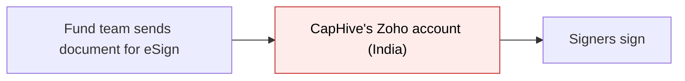
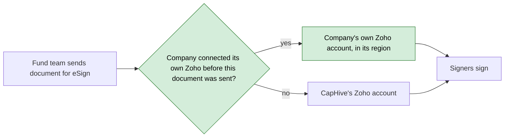
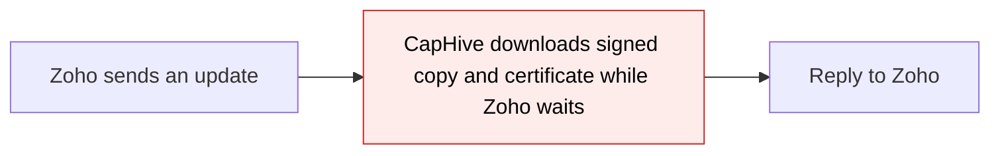
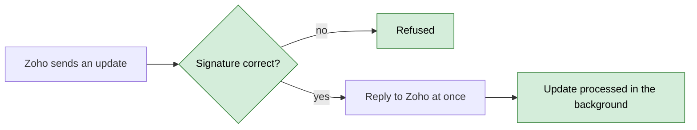
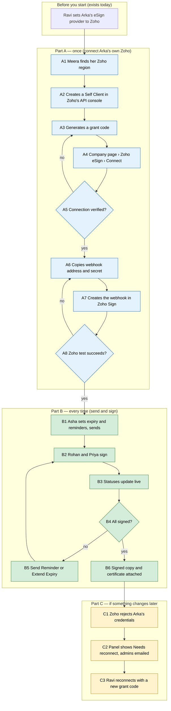

# Zoho eSign, production ready — Proposal

> **Audience:** Business team, product, QA, support — non-technical.
> **Companion document:** [Design](design.md)
> **New to this? Start with the [Workflow Journey](#workflow-journey)** — every action, in order, from start to the outcome.

> **Planning phase — no code changes.** This document proposes and explains the change. Do not
> edit application code while writing it; implementation happens later, in the tasks phase.

---

## Why

Zoho was added as a third eSign provider (next to Digio and Docusign) as a proof of concept: every
company's documents go through one CapHive-owned Zoho account, configured only for development and
India staging. Before clients rely on it, it has to be finished to production standard: companies
must be able to sign through **their own** Zoho account in **their own region** (US, Japan, Europe…),
status updates from Zoho must be secure and reliable, and the gaps found in review must be closed.

## What Changes

- **Two ways to sign with Zoho.** A company on Zoho starts on CapHive's own Zoho account (as today).
  At any time its admin can **connect the company's own Zoho account**; from that moment new
  documents go through the company's account. Documents already out for signature finish on the
  account they were sent from. This is the same "cutover" idea Digio already uses.
- **Any Zoho region.** When connecting, the admin picks the region their Zoho account lives in
  (US, Europe, India, Japan, Australia, Canada, Saudi Arabia, UK, Singapore, UAE). Documents and
  signer data stay in that region.
- **A Zoho panel on the company page** to connect, check, reconnect and disconnect the account, and to
  copy the address and secret Zoho needs to send live updates back to CapHive.
- **Secure, reliable live updates.** Updates from Zoho are accepted only when they carry the correct
  secret signature; anything else is refused. Updates are acknowledged at once and processed in the
  background, so Zoho never gives up on CapHive because a reply was slow.
- **Clear statuses.** A document's eSign status always uses CapHive's own words (Requested,
  In progress, Completed, Expired, Cancelled, Failed). A signer declining marks the document Failed so
  it can be sent again. Unknown Zoho statuses are logged, never shown.
- **Fixes found in review:**
  - Extending the deadline beyond the allowed window is refused with a message instead of being
    silently shortened.
  - A send that fails part-way (file unreadable, Zoho unreachable) marks the document Failed and tells
    the sender, instead of leaving it stuck.
  - A signer who forwards the document to a colleague no longer breaks completion.
  - "Sent" now shows on signers when Zoho confirms the document went out (this update was never
    applied before).
  - A document with more than 25 signers is refused before it is sent (Zoho's limit).
- **Proper tests and an operations guide** (setup per client, platform rollout, troubleshooting).
- **BREAKING (support/ops only):** live updates from CapHive's own Zoho account are refused in staging
  and production until the platform webhook secret is configured. See [FAQ](#faq).

### Flow Diagram

**Which Zoho account a document is sent from** — before: always CapHive's; after: the company's own
once connected.





**How a live update from Zoho is handled** — before: accepted even without a signature and processed
while Zoho waits; after: checked, acknowledged at once, processed in the background.





---

## Workflow Journey

### Who is involved

| Person | Role | What they do in the journey |
|---|---|---|
| Ravi | CapHive support | Sets the company's eSign provider to Zoho (exists today). Connects, reconnects or disconnects Arka's own Zoho account in CapHive |
| Meera | Company admin at Arka Capital | Creates the Self Client and webhook in Arka's Zoho account (US region) and gives Ravi the details |
| Asha | Fund operations user at Arka | Sends documents for eSign, extends deadlines, sends reminders |
| Rohan, Priya | Investors (signers) | Sign the document in Zoho's email link |

### The journey on one page



### Before you start

| Needed | Why | Where it comes from |
|---|---|---|
| Company's eSign provider is Zoho | Decides which provider sends documents | CapHive support sets it (admin dashboard), as today for Digio/Docusign |
| A Zoho Sign account on an API-enabled plan | Own-account signing and webhooks need it | The client buys it from Zoho (Enterprise, API, Zoho One or People Plus plans have webhooks) |
| Support access in CapHive | Only CapHive support can connect an account | Existing roles |
| Zoho admin access in the client's Zoho | To create the Self Client and webhook | The client's Zoho account |

Without Part A, the company simply keeps signing through CapHive's own Zoho account — Part B works
the same either way.

### Part A — once (connect Arka's own Zoho)

| Step | Who | Where | Action | What the system does | What you see |
|---|---|---|---|---|---|
| A1 | Meera | Zoho, address bar | Notes the domain of her Zoho account (`sign.zoho.com` → US) | — | — |
| A2 | Meera | Zoho API console › Self Client › Create | Creates a Self Client | — | Zoho shows a Client ID and Client Secret |
| A3 | Meera | Self Client › Generate Code | Enters scopes `ZohoSign.documents.CREATE,ZohoSign.documents.READ,ZohoSign.documents.UPDATE`, duration 10 minutes | — | Zoho shows a grant code (single use, ~10 minutes) |
| A4 | Ravi | CapHive › Company page › Zoho eSign › Connect | Picks region "United States", pastes Client ID, Client Secret and grant code, clicks **Connect** | Exchanges the grant code with Zoho in the US region, stores the credentials encrypted, records "connected on" (the cutover) | — |
| A5 | — | — | — | If Zoho accepts: status Connected. If not: nothing is saved | "Connected — documents sent from now on use Arka's Zoho account (United States)." or the refusal message (see [What goes wrong](#what-goes-wrong)) |
| A6 | Ravi | Zoho eSign panel › Webhook | Clicks **Show webhook secret** (shown once) and copies address and secret | Generates the secret if none exists | Webhook address and secret with copy buttons |
| A7 | Meera | Zoho Sign › Settings › Developer settings › Webhooks › Create webhook | Pastes address, enables **HMAC signature**, pastes the secret, ticks events Signed by a recipient, Completed by all, Declined, Expires, Recalled, Sent; saves | — | Webhook listed in Zoho |
| A8 | Meera | Zoho webhook › Test Url | Clicks **Test Url** | Checks the signature, replies OK at once | Zoho shows success; CapHive panel shows "Last update received: just now" |

### Part B — every time (send and sign)

| Step | Who | Where | Action | What the system does | What you see |
|---|---|---|---|---|---|
| B1 | Asha | Document › Edit | Sets "eSign Expires In (days)" 30, "Send Automatic Reminders" on, "Reminder Every (days)" 7; adds signers Rohan and Priya | Validates 1–99 days, 1–30 days, at most 25 signers | — |
| B1 | Asha | Document › Signatures › **Send For eSignatures** | Sends | Picks the account (Arka's own — connected before this send), uploads the file, places one signature box per signer | "Document was queued for eSignature." then "Document sent for eSigning" |
| B2 | Rohan, Priya | Zoho email link | Sign | — | Zoho's signing page |
| B3 | — | — | — | Each Zoho update is checked, acknowledged, and applied in the background; the daily status check also runs as a safety net | Signer badges change Requested → Signed; document shows In progress |
| B5 | Asha | Document › Signatures › **Send Reminder** | Clicks | Asks Zoho to remind whoever has not signed | "Reminder was sent to pending signer(s)" |
| B5 | Asha | Document › Signatures › **Extend Expiry** | Picks 15 Dec 2026, clicks Extend Expiry | Checks the date is tomorrow or later (no upper limit), asks Zoho to extend | "Document's eSignature expiry was extended"; Expires On shows 15/12/2026 |
| B6 | — | — | — | When all have signed: downloads the signed copy and Zoho's completion certificate, once each | Document status Completed; two new documents: "<name>" (Signed) and "<name> - Signature Certificate" |

### Part C — if something changes later

| Step | Who | Where | Action | What the system does | What you see |
|---|---|---|---|---|---|
| C1 | — | — | Zoho rejects Arka's credentials (client deleted the Self Client) | Marks the connection Needs reconnect, emails Arka's company admins once | — |
| C2 | Asha | Document › Send For eSignatures | Tries to send | Refuses: own account is the one to use, and it needs reconnecting | "Arka's Zoho account needs to be reconnected. Contact CapHive support to reconnect it." |
| C3 | Meera, Ravi | Zoho eSign panel › **Reconnect** | Meera generates a new grant code (A2–A3); Ravi submits it | Replaces the credentials; keeps the original "connected on" date | "Connected" again; sending works |
| C4 | Ravi | Zoho eSign panel › **Regenerate webhook secret** | Confirms | Replaces the secret; updates signed with the old secret are refused from now on | New secret shown once — paste it into the Zoho webhook (A7) |
| C5 | Ravi | Zoho eSign panel › **Disconnect** | Confirms | Refused while documents are still out for signature on Arka's account; otherwise removes the connection, new documents go back to CapHive's account | "3 documents are still out for signature on this account. Wait for them to finish or cancel them first." |

### What you see

Company page, Zoho eSign panel after connecting (A5–A8):

```
+-------------------------------------------------------------------+
|  Zoho eSign                                          [Connected]  |
|                                                                   |
|  Account        Arka Capital's own Zoho account                   |
|  Region         United States (sign.zoho.com)                     |
|  Connected on   29/10/2026 11:42  (documents sent from this       |
|                 moment use this account)                          |
|  Last update    29/10/2026 11:47 (webhook test)                   |
|                                                                   |
|  Webhook address                                                  |
|  https://<caphive-host>/zoho_sign/webhooks/k7Q2...9xZ    [Copy]   |
|  Webhook secret ********************  [Show once] [Regenerate]    |
|                                                                   |
|  [Verify connection]   [Reconnect]   [Disconnect]                 |
+-------------------------------------------------------------------+
```

Document page, eSign details after B1 (sent Thu 29 Oct 2026, expiry 30 days, reminders every 7 days):

```
+-------------------------------------------------------------------+
|  eSign Status            [In progress]                            |
|  eSignature Expires On   28/11/2026      (29 Oct + 30 days)       |
|  eSignature Reminders    Every 7 day(s)                           |
|                                                                   |
|  Signer                 Status                                    |
|  rohan@example.com      [Signed]                                  |
|  priya@example.com      [Requested]                               |
|                                                                   |
|  [Get eSignatures' updates] [Send Reminder] [Extend Expiry]       |
|  [Cancel eSignatures]                                             |
+-------------------------------------------------------------------+
```

Extend Expiry dialog on 29 Oct 2026 — any date from tomorrow onward, no upper limit:

```
+-----------------------------------------------+
|  Extend eSign Expiry                       x  |
|                                               |
|  New Expiry Date   [ 15 Dec 2026 ]            |
|  Allowed: from 30/10/2026 onward              |
|                                               |
|              [Cancel]  [Extend Expiry]        |
+-----------------------------------------------+
```

### What goes wrong

**The grant code expired before Ravi clicked Connect (A4).** Zoho's grant codes last about ten
minutes and work once. CapHive shows "Zoho did not accept the grant code — it may have expired or
already been used. Generate a new code in Zoho's API console and try again." Nothing is saved. Meera and Ravi
repeat A3 and A4 within ten minutes.

**The region is wrong (A4).** Ravi picks India but Arka's account is in the US. Zoho's India region
does not know its Self Client, so CapHive shows "Zoho did not recognise this Client ID in the India
region. Check the region matches the address of your Zoho account (sign.zoho.com = United States)."

**The webhook secret was mistyped in Zoho (A8).** Zoho's Test Url fails because CapHive refuses the
update. The panel's "Last update" does not change. Ravi regenerates the secret (C4), Meera pastes it into
the Zoho webhook again and re-tests. Until it is fixed, statuses still update through
**Get eSignatures' updates** and the daily check.

### Summary: the minimum actions

| # | Action | Who | How often |
|---|---|---|---|
| 1 | Set eSign provider to Zoho | Ravi | Once per company |
| 2 | Connect own Zoho account (A1–A5) | Meera in Zoho, Ravi in CapHive | Once per company (optional — without it CapHive's account is used) |
| 3 | Create the webhook in Zoho (A6–A8) | Ravi in CapHive, Meera in Zoho | Once per company |
| 4 | Send a document for eSign | Asha | Every document |
| 5 | Reconnect | Meera in Zoho, Ravi in CapHive | Only if Zoho rejects the credentials |

---

## User Stories

### US-1: Connect the company's own Zoho account

**As** CapHive support,
**I want** to connect a company's own Zoho Sign account in its region,
**So that** its documents and signer data stay in its account and region.

**Acceptance criteria:**
- The Zoho eSign panel appears on the company page only when the company's eSign provider is Zoho,
  and only to CapHive support.
- Connect requires a region (one of the ten listed), Client ID, Client Secret and grant code.
- On success the panel shows Connected, the region, and "Connected on" with date and time.
- On failure nothing is saved and the message names the likely cause (expired code, wrong region,
  wrong client secret).
- The Client Secret, grant code and webhook secret are never shown again after submission (the
  webhook secret only via "Show once").

### US-2: Documents use the right account automatically

**As a** fund operations user,
**I want** documents to go through the right Zoho account without choosing it,
**So that** switching accounts never interrupts signing.

**Acceptance criteria:**
- A document sent at or after "Connected on" uses the company's account; a document sent before it
  uses CapHive's account — for every later action (status check, reminder, extend, cancel, download).
- A company with no connection keeps using CapHive's account.

### US-3: Secure live updates

**As** CapHive,
**I want** to accept only genuine updates from Zoho,
**So that** nobody can mark documents signed, expired or cancelled by faking a Zoho update.

**Acceptance criteria:**
- An update without a signature, or with a wrong one, is refused and changes nothing.
- A company's webhook address only affects that company's documents.
- Updates are acknowledged immediately; the document changes shortly after.

### US-4: Statuses that make sense

**As a** fund operations user,
**I want** eSign statuses in CapHive's usual words,
**So that** I know whether a document needs action.

**Acceptance criteria:**
- Document statuses are Requested, In progress, Completed, Expired, Cancelled or Failed.
- A signer declining marks that signer Failed and the document Failed; it can then be sent again.
- When Zoho confirms the document was sent, signers without a status show Sent.
- A signer who forwards the document to a colleague: the colleague's signature completes that
  signer's slot.

### US-5: Deadline and reminders

**As a** fund operations user,
**I want** to set the expiry and reminder schedule, send a reminder now and extend a deadline,
**So that** signers have time and are nudged.

**Acceptance criteria:**
- Expiry 1–99 days (default 90), reminders on by default every 1–30 days (default 4).
- Send Reminder and Extend Expiry appear only for Zoho documents out for signature.
- An extension can be any date from tomorrow onward, with no upper limit; today, a past date or an
  invalid date is refused with "Choose a date from <tomorrow> onward." and the expiry is unchanged.

### US-6: Connection problems are visible

**As a** company admin,
**I want** to know when our Zoho connection stops working,
**So that** sending is not silently broken.

**Acceptance criteria:**
- When Zoho rejects the stored credentials, the panel shows Needs reconnect and company admins get
  one email, copied to support (not one per document).
- Sending is refused with a message pointing to CapHive support.
- Reconnecting restores sending; documents already out for signature resume syncing.

---

## UI Behavior

### Company page › Zoho eSign panel (not connected)

```
+-------------------------------------------------------------------+
|  Zoho eSign                                  [Using CapHive's]    |
|                                                                   |
|  Documents are signed through CapHive's Zoho account. Connect     |
|  your own Zoho Sign account to keep documents in your account     |
|  and region.                                                      |
|                                                                   |
|  Region          [ United States (sign.zoho.com)        v ]       |
|  Client ID       [ 1000.ABCDEFGHIJ                        ]       |
|  Client Secret   [ ****************                       ]       |
|  Grant code      [ 1000.4f9c...                           ]       |
|                  Generate in Zoho API console > Self Client;      |
|                  valid about 10 minutes.  How to?  (guide link)   |
|                                                                   |
|                                            [Connect]              |
+-------------------------------------------------------------------+
```

**Behavior notes:**
- Shown only when the company's eSign provider is Zoho; visible to CapHive support only.
- Connect shows a spinner and stays on the page; success or the error replaces the panel without a
  full reload.
- Connected state: see [What you see](#what-you-see). Status badge colours: Connected green,
  Needs reconnect red.
- Show webhook secret reveals it once; afterwards only Regenerate is offered.
- Disconnect and Regenerate ask for confirmation.

### Document › Edit (Zoho companies only)

Fields "eSign Expires In (days)", "Send Automatic Reminders" and "eSign Reminder Every (days)" exist
today; the reminder period hides when reminders are switched off (unchanged).

### Document › Signatures

"Send Reminder" and "Extend Expiry" (existing) show only while the document is out for signature on
Zoho. "Cancel eSignatures" works for Zoho documents (recalls the request in Zoho).

---

## What This Feature Does NOT Cover

| Excluded | Covered In |
|---|---|
| One-click "Sign in with Zoho" connect (Option B — CapHive registers its own Zoho app per region) | Future change; described in the operations guide |
| Detecting that a company reconnected to a *different* Zoho account | Future change (edge case) |
| Moving old proof-of-concept test requests between accounts | Not needed — they were tests |
| Changing Digio or Docusign behaviour | Unchanged |
| Choosing the account per document | Not planned — the cutover decides |
| Aadhaar eSign and e-stamping through Zoho | Future change, once CapHive has a working paid Zoho account. Until then these documents are refused; the operations guide has what each needs |
| Zoho templates, embedded signing, bulk send | Not planned |

---

## Validation Rules

| Field | Rule | Default |
|---|---|---|
| Region | One of: United States, Europe, India, Japan, Australia, Canada, Saudi Arabia, United Kingdom, Singapore, UAE | — (required) |
| Client ID | Required | — |
| Client Secret | Required on Connect; on Reconnect, blank keeps the stored one | — |
| Grant code | Required; single use; about 10 minutes | — |
| eSign Expires In (days) | Whole number 1–99 | 90 |
| Send Automatic Reminders | On / off | On |
| eSign Reminder Every (days) | Whole number 1–30 | 4 |
| New Expiry Date | Tomorrow or later, no upper limit; must be a real date | Current expiry |
| Signers per document | At most 25 (Zoho limit) | — |
| File size | At most 25 MB (Zoho limit, unchanged) | — |

---

## Behavior Rules

| Scenario | What User Sees |
|---|---|
| Company not connected, sends a document | Sent through CapHive's account, as today |
| Connected, sends a document | Sent through the company's account |
| Document sent before connecting, then a status check / reminder / extend / cancel | Still uses CapHive's account; works normally |
| Connection Needs reconnect, user sends | "<Company>'s Zoho account needs to be reconnected. Contact CapHive support to reconnect it." Nothing sent |
| Connection Needs reconnect, a document on that account is checked | Status left unchanged (not marked Failed); panel shows Needs reconnect |
| Zoho unreachable or file unreadable during send | Document Failed; sender alerted "Error sending <name> for eSigning - <reason>"; can be sent again |
| Live update with no or wrong signature | Refused; document unchanged |
| Live update for a document of another company | Refused; document unchanged |
| Live update for an unknown document | Acknowledged and logged; nothing changes |
| Signer declines | Signer Failed, document Failed, can be sent again |
| Signer forwards to a colleague, colleague signs | That signer shows Signed |
| Request recalled (in CapHive or in Zoho) | Document and signers Cancelled |
| Request expires | Document and signers Expired |
| All signers sign | Document Completed; signed copy and certificate added once each, even if Zoho reports completion twice |
| Extend Expiry to today or a past date | "Choose a date from <tomorrow> onward."; expiry unchanged |
| Zoho refuses the extension | "Error extending eSignature expiry"; expiry unchanged |
| More than 25 signers | Send refused: "Zoho allows at most 25 signers per document." |
| Disconnect with documents still out for signature on that account | Refused with the count of such documents |

---

## Resolved Design Decisions

| # | Decision | Resolution |
|---|---|---|
| 1 | One CapHive account or one per company? | Both: CapHive's account is the default; a company can connect its own |
| 2 | When does a company's own account take over? | From the moment it is connected ("cutover"), like Digio. Earlier documents finish on CapHive's account |
| 3 | How does a company connect? | Option A: the admin creates a Zoho Self Client and pastes Client ID, Secret and a grant code. Option B (one-click) is documented as a future alternative |
| 4 | Which regions? | All ten Zoho regions, from a fixed list; no free-typed addresses |
| 5 | How are live updates secured? | Every company gets its own webhook address and secret; updates must be signed. CapHive's own account must also have a secret in staging and production |
| 6 | What does a decline do? | Document Failed (can be resent) |
| 7 | Extension outside the window? | Refused with a message, never silently shortened |
| 8 | Unknown Zoho status? | Logged, not shown, document unchanged |
| 9 | Reconnecting | Replaces credentials, keeps the cutover date |
| 10 | Disconnecting | Allowed only when no documents are out for signature on that account |
| 11 | Old proof-of-concept requests | Not migrated (they were tests) |
| 12 | Temporary "swap token without restart" shortcut from the proof of concept | Removed; credentials live with the connection |
| 13 | Delivery | Three pull requests of at most 20 files: platform hardening, per-company connections, then tests and docs (see [Design](design.md)) |

---

## Capabilities

### New Capabilities

- `documents/zoho-esign`: sending, tracking, extending, reminding, cancelling and completing Zoho
  eSign requests; live updates; status rules.
- `documents/zoho-sign-connections`: a company's own Zoho Sign account — connect, verify, reconnect,
  disconnect, region, cutover, webhook address and secret, connection health.

### Modified Capabilities

None (no existing capability covers eSign).

---

## Impact

- **Company page:** new Zoho eSign panel.
- **Document page:** eSign details, Send Reminder, Extend Expiry, Cancel for Zoho documents; clearer
  statuses.
- **Live update address:** the shared eSign update address keeps serving Digio, Docusign and CapHive's
  Zoho account; each connected company gets its own Zoho address.
- **Background jobs:** Zoho updates are processed in the background; the daily eSign status check is
  unchanged and also covers own-account documents.
- **Emails:** one new email to company admins, copied to support, when their Zoho connection needs reconnecting.
- **Configuration (ops):** CapHive's Zoho account credentials, region and webhook secret must be set in
  every environment where Zoho is offered (US staging, India and US production are not set yet).
- **Zoho:** each connected company uses its own Zoho API limits (about 50 calls a minute).

---

## Benefits

1. Clients sign through their own Zoho account, branding and region — data stays where they need it.
2. Clients can start on CapHive's account immediately and move to their own later without disrupting
   documents already out for signature.
3. Faked status updates can no longer mark documents signed, expired or cancelled.
4. Statuses are reliable: no stuck sends, no documents that never complete because a signer forwarded
   them, no silently shortened deadlines.
5. Support has a guide for setting up each client and fixing connection problems.

---

## FAQ

| Question | Answer |
|---|---|
| Who can connect a Zoho account? | CapHive support only |
| Does a company have to connect its own account? | No. Without one, CapHive's account is used, exactly as today |
| What happens to documents already out for signature when we connect? | They finish on the account they were sent from; nothing to do |
| Which Zoho plan does the client need? | One with API access and webhooks (Enterprise, API, Zoho One or People Plus). Without webhooks statuses still update via "Get eSignatures' updates" and the nightly check, just not live |
| Can a client use a Zoho account in the US or Japan? | Yes — any of the ten Zoho regions |
| Is the client's Zoho secret safe? | It is stored encrypted, never shown again and never written to logs |
| What if the client deletes the Self Client in Zoho? | The panel shows Needs reconnect, admins get an email, sending is paused until they reconnect |
| Do signers notice anything different? | Emails come from the client's own Zoho account once connected; signing is unchanged |
| Pricing/billing? | No CapHive change. Zoho usage is billed by Zoho to whichever account sends |
| What do ops need to do before release? | Configure CapHive's Zoho account (credentials, region, webhook secret) per environment — see the operations guide |
| Does this change Digio or Docusign? | No |

---

## Design Principle for the Next Phase

Keep it DRY and simple:

- **Reuse the Digio cutover idea** for choosing the account — a date comparison, not a per-document
  account link.
- **Reuse the existing eSign plumbing** (EsignHelper/EsignJob/EsignUpdateJob, the daily status check,
  ESignature status updates, the shared eSign log) rather than a parallel Zoho pipeline.
- **One place knows how to talk to Zoho** (addresses per region, tokens, timeouts, errors); everything
  else asks it.
- **Risk of complexity — flag for design:** (a) two webhook entry points (shared and per company) must
  share one handler; (b) the platform account and company accounts must look the same to the rest of
  the code; (c) concurrent token refresh for one account; (d) the three-PR, 20-file limit means the
  design must keep the file count down — prefer extending existing files over many small new ones.
