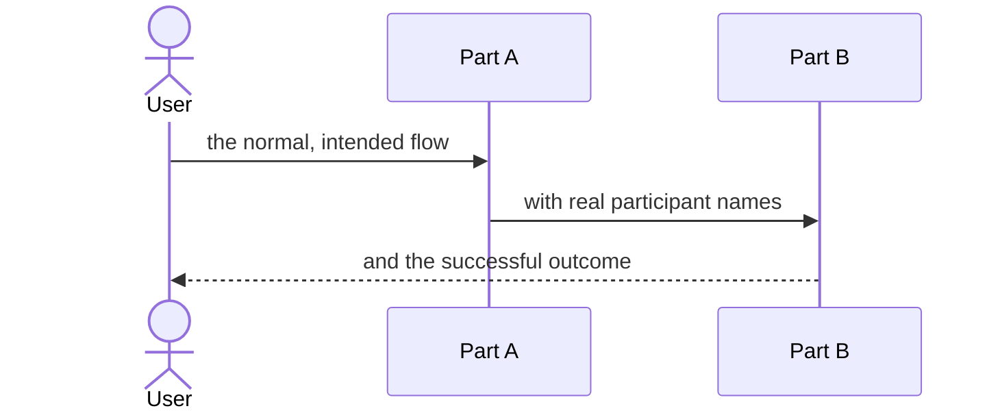
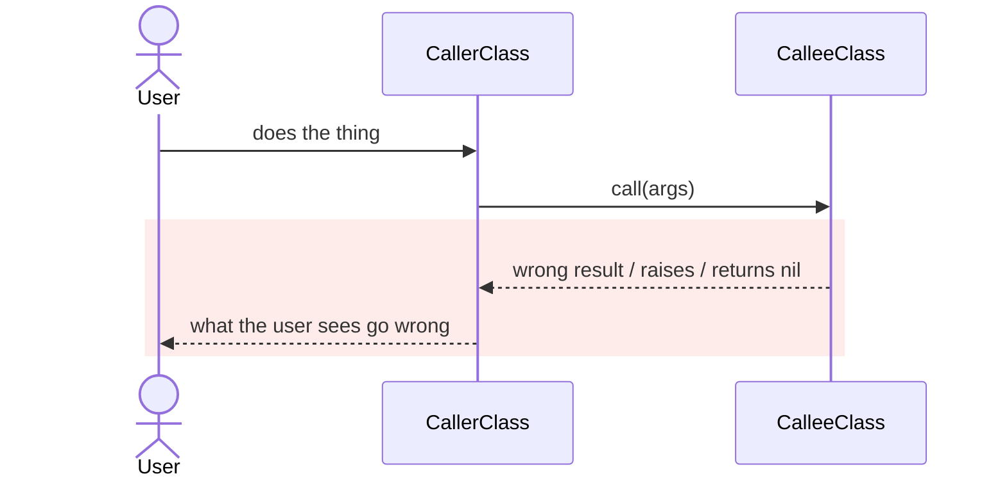
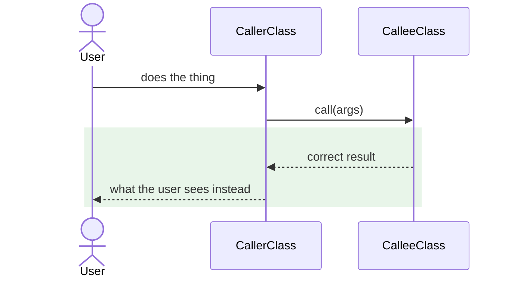

# [Bug Name] — Report

> **Audience:** The developer fixing this, and the reviewer checking the fix.
> **Companion document:** [Tasks](tasks.md)

> **Planning phase — no code changes.** This document diagnoses the bug and plans the fix.
> Implementation happens later, in the tasks phase.

> **Evidence, not guesses.** Every claim in Root Cause carries a `file.rb:LINE` you have opened.
> Those line numbers are **as of `<pre-fix short SHA>`** — the fix deletes the lines they point
> at, so read them with `git show <sha>:<path>`.

---

## Summary

<!-- Two sentences. What breaks, and why. Someone who reads only this should be able to repeat
     the cause correctly. -->

---

## The Feature — how it is meant to work

<!-- REQUIRED, and written BEFORE any mention of the defect. The core idea of the thing being
     fixed, in enough detail that a reader who has never seen it could follow Root Cause - and
     ideally rebuild it.

     Cover: what the feature is for; its moving parts and who talks to whom; the shape of the
     data that flows between them; what is checked, and where; and WHY it is built this way
     rather than the obvious alternative. A bug is the occasion to document the feature
     properly, so go deeper here than feels necessary.

     Nothing here describes the bug. This is what SHOULD happen. -->

### The idea

<!-- Two or three paragraphs: the problem the feature solves and the mechanism it uses. -->

### How it fits together

| Part | Responsibility | Talks to |
|---|---|---|
| <!-- `ClassName` --> | <!-- what it owns --> | <!-- --> |

### What it rests on

<!-- The guarantees and assumptions: what must be true for this to work. These are usually
     exactly what the bug turns out to have violated - but say them here as design, not as
     diagnosis. -->

- <!-- e.g. both regions hold the same signing secret -->

---

## Symptom

| | |
|---|---|
| **What the user sees** | <!-- verbatim message / screen / error --> |
| **Reproduce** | <!-- numbered steps, or "intermittent — see below" --> |
| **Who is affected** | <!-- which users, roles, regions, tenants --> |
| **How often** | <!-- every time / ~50% / only when X --> |
| **Since when** | <!-- release, commit, or unknown --> |

<!-- If it is INTERMITTENT, say what varies between a success and a failure. That is usually the
     whole clue: a race, a cached value, a clock, a load-balanced box, a per-user data shape. -->

---

## Root Cause

<!-- The actual defect. One short paragraph per contributing cause, each with file:line. -->

**Why it was hard to see:**

<!-- The swallowed exception, the silent fallback, the missing log line, the error message that
     collapsed five causes into one. This is often the second bug — the fix should close it too,
     and if it does, that belongs in the Fix table below. -->

---

## Blast Radius

<!-- Everything else that touches the code being changed. This is what stops a one-line fix from
     breaking three other things. -->

| Also touches this code | Does this fix change it? | Needs checking |
|---|---|---|
| <!-- e.g. `MultiSiteUserSyncJob` --> | <!-- No --> | <!-- features/login/multi_site.feature --> |

---

## Fix

### How it works today

<!-- REQUIRED. A mermaid sequenceDiagram of the broken exchange: who calls whom, with what, and
     the step where it goes wrong. Use real participant names and short aliases. Mark the
     failing step with a red rect so the eye lands on it.

     A sequence diagram, not a flowchart: a bug lives in an interaction, and a flowchart hides
     exactly the part that matters - which participant was holding the wrong value, and when.
     Even a one-line fix has a caller and a callee. Draw them. -->

### How it works after the fix

<!-- REQUIRED. The same participants and the same exchange, repaired. Keep the participant list
     and the message wording identical where the behaviour is unchanged, so a reader can diff
     the two diagrams by eye and see only what this fix alters. -->

<!-- Keep each diagram under ~1400px wide, or a Markdown preview scales it down until the
     labels are unreadable. Short aliases and short messages; split a very wide diagram in two
     rather than letting it sprawl. Lint both before finishing (see the artifact instruction). -->

### What changes

| # | Before | After | Where |
|---|---|---|---|
| 1 | <!-- current behaviour / value / branch --> | <!-- new behaviour --> | <!-- `path/to/file.rb` — `Class#method` --> |

---

## Verification

<!-- Each row becomes exactly ONE Cucumber scenario. The Feature column names the file it lands
     in. H = happy path (it works now), E = edge case, X = error case.
     A fix with no X rows has usually not considered how it fails. -->

**ID legend:** **H** = Happy path · **E** = Edge case · **X** = Error (exception) case

### Happy Path

| # | Scenario | Given | When | Then | Feature |
|---|---|---|---|---|---|
| H1 | | | | | |

### Edge Cases

| # | Scenario | Given | When | Then | Feature |
|---|---|---|---|---|---|
| E1 | | | | | |

### Error Cases

| # | Scenario | Given | When | Then | Feature |
|---|---|---|---|---|---|
| X1 | | | | | |

**Fails against current code:** <!-- e.g. X1 and X2 — list the IDs that reproduce the bug. At
least one is required: a bug fix whose tests all pass before the fix has not reproduced it. -->

---

## Risks and Rollout

- <!-- [Risk] → Mitigation -->

| | |
|---|---|
| **Safe to deploy alone?** | <!-- Yes / No — if No, what must ship with it --> |
| **Data backfill needed?** | <!-- No / what, and whether it is reversible --> |
| **Both regions together?** | <!-- No / Yes, and why (IN and US are independent) --> |
| **Rollback** | <!-- how, and whether anything persists that the old code cannot read --> |

---

## Spec Impact

<!-- Exactly one of:

     **None.** The specs already describe the correct behaviour; the code did not match them.
     This is the normal case. Set `skip_specs: true` in this change's .openspec.yaml, or
     `openspec validate` rejects the change for having zero spec deltas.

     **Escalate.** This changes the externally visible contract / adds a capability / is a
     feature wearing a bug's clothes. Stop here and re-create the change under the
     `spec-driven` schema with /openspec-propose. Do not half-write specs in this schema.
-->
