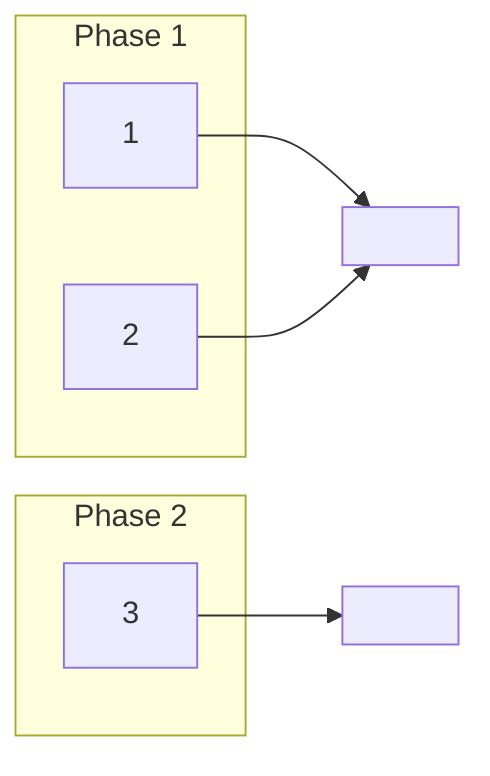
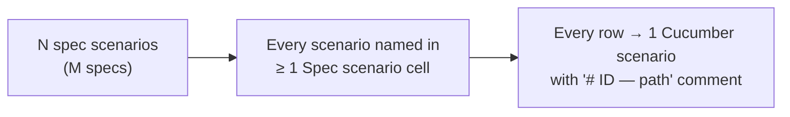

# [Feature Name] — Business Rules (H/E/X)

<!-- LARGE CHANGES ONLY. Create this file when design.md's worked examples pass about 30 H/E/X
     rows, or their scenarios span 3 or more features. A smaller change has no business-rules.md:
     its tables stay in design.md › Part 4 › Worked examples. Decide when writing design.md.
     When this file exists, design.md keeps the "Worked examples" heading with one paragraph that
     links here and names the ID ranges, and each card's **Worked examples:** line links to the
     section below that holds its IDs. The qa-checklist and tasks take their IDs from here. -->

<!-- STYLE: bullets and diagrams, not prose. One idea per bullet; table cells a phrase each —
     longer reasoning goes in bullets under the table. -->

> **Audience:** Product, QA, developers. Every row becomes exactly one Cucumber scenario.
> **Companions:** [Proposal](proposal.md) · [Design](design.md) · [Specs](specs/)

---

## Contents

<!-- Links to every ## heading, in order. -->

- [How to read this](#how-to-read-this)
- [Shared setup](#shared-setup)
- [1. <Group> — Phase 1](#1-group--phase-1)
- [Coverage](#coverage)

---

## How to read this

<!-- One mermaid flowchart: groups (the numbered sections below) inside a subgraph per phase,
     each pointing at the spec it proves. Then the legend bullets. -->

- **ID legend:** **H** = happy path · **E** = edge case · **X** = error (exception) case. IDs run
  across the whole file (H1…Hn), never restart per section.
- **Spec scenario** column: `<spec short name>: <scenario name>`. Short names: <!-- e.g. SA = spec-a -->.
- **Feature** column: the planned Cucumber file under `features/<domain>/` (or `features/security/` for refusal rows).
- Every scenario carries a comment above it: `# E12 — Edge case: …`.
- <!-- number conventions: currency and units, rounding ("compared as displayed, 2 decimals"), time zone -->

---

## Shared setup

<!-- Every record the rows refer to, with real-looking names and figures. Rows below use these
     names, never "a user" or "some amount". Include a second tenant for the isolation rows. -->

| Record | Name | Key data |
|---|---|---|
| <!-- Tenant --> | <!-- --> | <!-- --> |

---

## 1. <Group> — Phase 1

<!-- One numbered section per group of behaviour (usually one per design box or per feature),
     with its phase in the heading. Each section has the three tables; a table with nothing to
     say keeps its heading and one line explaining why. Edge and Error tables are EXHAUSTIVE (see
     the design instruction's list: thresholds, blanks, several records, rounding, cut-off dates,
     out-of-order transitions, re-runs, permissions, direct requests, the unchanged legacy path). -->

### Happy path

| # | Scenario | Given | When | Then | Spec scenario | Feature |
|---|---|---|---|---|---|---|
| H1 | | | | | | |

### Edge cases

| # | Scenario | Given | When | Then | Spec scenario | Feature |
|---|---|---|---|---|---|---|
| E1 | | | | | | |

### Error cases

| # | Scenario | Given | When | Then (what the user sees, who is alerted) | Spec scenario | Feature |
|---|---|---|---|---|---|---|
| X1 | | | | | | |

---

## Coverage

| Group | H | E | X | Total |
|---|---|---|---|---|
| 1 <Group> | | | | |
| **Total** | | | | |

- `features/security/<feature>_tenant_isolation.feature` gathers every refusal row (other tenant, wrong role, direct request) — attacker refused, owner allowed, direct request refused.
- An edge case found during apply gets a new row here **and** a scenario, never a scenario alone.
