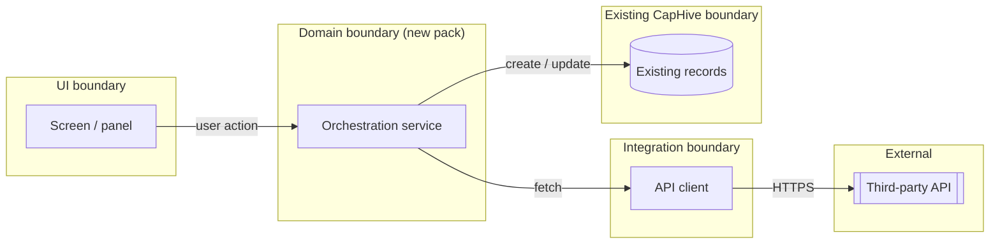
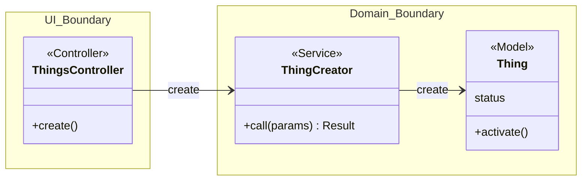
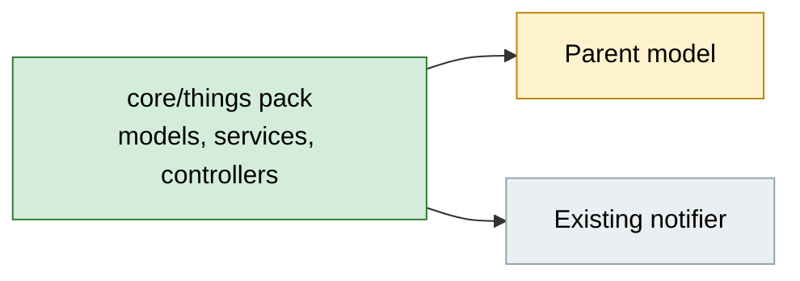
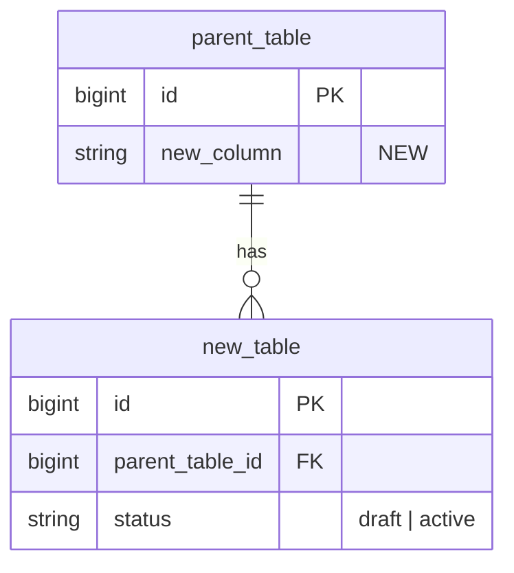
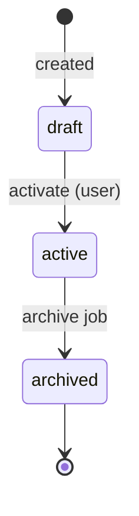
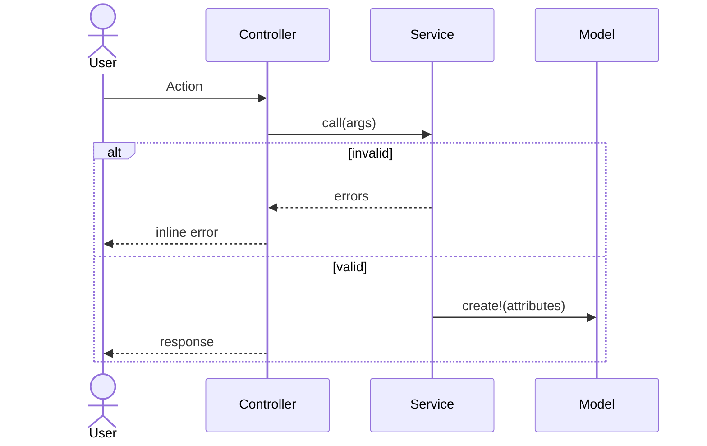
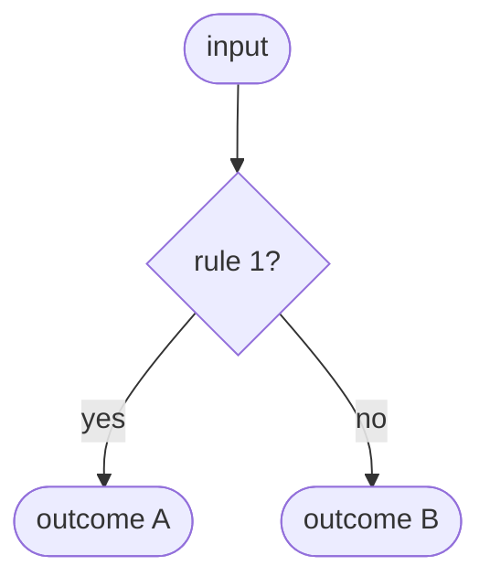
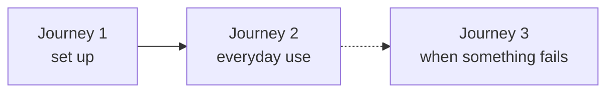

# [Feature Name] — Design

> **Audience:** Engineering team.
> **Companion documents:** [Proposal](proposal.md) · [Spec](specs/)

> **Planning phase — no code changes.** This document explains HOW the proposal will be built.
> Do not edit application code while writing it; implementation happens later, in the tasks phase.

> **Design, not code.** Explain the design with mermaid diagrams and tables. Do NOT paste Ruby/JS
> class bodies, migrations, route blocks or policy code. Put real class, method, table and path
> names inside the diagrams and tables instead.

> **Scale to the change.** Sections marked **CORE** are always present. Sections marked
> **CONDITIONAL** say when they apply. When one doesn't apply, keep the heading and write a single
> line: `N/A — <reason>`. A small change should produce a short document.

> **No repetition.** Each fact lives in one section. The proposal owns *what users see and the
> business rules*, the spec owns *requirements*, and this document owns *how*. Link instead of
> restating.

> **FAQ tables are optional.** Add one under a section only when there is a non-obvious "why" or
> "why not X" a reader will ask. Don't add empty FAQ slots.

---

## Contents

<!-- CORE. Links to every ## and ### heading in this document, in order (GitHub anchors:
     lowercase, punctuation dropped, spaces → hyphens). Keep N/A sections listed. Rename the
     Journey entries to match your journeys. Update it whenever headings change. -->

- [Overview](#overview)
- [Architecture](#architecture)
  - [Component Boundaries](#component-boundaries)
  - [Class Diagram](#class-diagram)
  - [Change Footprint](#change-footprint)
- [Data Model and States](#data-model-and-states)
  - [Data Model](#data-model)
  - [State Transitions](#state-transitions)
- [Behaviour](#behaviour)
  - [Pipeline / Flow](#pipeline--flow)
  - [Sequence Diagrams](#sequence-diagrams)
  - [Worked Examples](#worked-examples)
- [Key Components](#key-components)
  - [Decision Flows](#decision-flows)
- [Controllers and Routes](#controllers-and-routes)
- [Policy](#policy)
- [UI Changes](#ui-changes)
  - [At a glance](#at-a-glance)
  - [Journey 1: Who does what](#journey-1-who-does-what) <!-- one entry per journey -->
  - [Build notes (for implementers)](#build-notes-for-implementers)
- [Cross-cutting Concerns](#cross-cutting-concerns)
  - [Transactions and Queries](#transactions-and-queries)
  - [Exception Handling and Monitoring](#exception-handling-and-monitoring)
  - [Performance and Security](#performance-and-security)
- [Design Decisions](#design-decisions)
- [Testing](#testing)
- [Risks and Open Questions](#risks-and-open-questions)

---

## Overview

<!-- CORE. 2-3 sentences: what this adds technically and which existing pattern it follows. -->

---

## Architecture

### Component Boundaries

<!-- CORE. Group the feature into boundaries/components (e.g. UI, Scheduling, Domain/Service,
     Integration, existing CapHive modules it touches, Notifications, External systems) as
     mermaid flowchart subgraphs. Label every arrow that crosses a boundary with what flows
     across it. Then list each crossing in the contract table. -->



| From → To | Contract | Direction rule |
|---|---|---|
| <!-- UI → Domain --> | <!-- what is asked / passed --> | <!-- e.g. UI never writes records directly --> |

### Class Diagram

<!-- CORE. A mermaid classDiagram of every NEW class and every EXISTING class that changes,
     enclosed in `namespace` blocks matching the Component Boundaries above. Show the stereotype
     (<<Model>>, <<Service>>, <<Job>>, <<Controller>>, <<Policy>>, <<Notifier>>), the public
     methods other classes call, and enum-like attributes. Edges between namespaces are the
     boundary contracts (--> calls, ..> enqueues/notifies, o-- owns). -->



### Change Footprint

<!-- CORE. One sentence naming the pack(s) new code lives in, then one mermaid flowchart of new
     (green), modified (amber) and reused-unchanged (grey) parts, with edges for dependencies.
     This is the only place that lists what is new, changed or reused. Exact file paths belong in
     tasks.md. -->



---

## Data Model and States

### Data Model

<!-- CONDITIONAL: include when tables or columns are added or changed. Tables as a mermaid
     erDiagram, not migration code. Show new tables with every column (a short comment for
     enums, nullability and encryption), columns added to existing tables marked NEW, and
     existing tables only with the columns this feature reads. Mark PK/FK/UK. Indexes go on one
     line below. Follow with a column-rationale table for non-obvious columns only. -->



**Indexes:** <!-- e.g. unique `new_table[parent_table_id, status]` -->

| Column | Why |
|---|---|
| <!-- non-obvious column only --> | <!-- rationale --> |

**Changes to existing models:** <!-- bullets: new associations, new methods (name + one-line
behaviour), changed callbacks, and what stays unchanged -->

### State Transitions

<!-- CORE if the feature has any status, lifecycle or derived state (e.g. "edited since sync");
     otherwise N/A. One mermaid stateDiagram-v2 per lifecycle. Label every transition with its
     trigger (user action, job, callback, external event). Say below the diagram whether a state
     is stored or derived. Worked examples below refer to these state names. -->



---

## Behaviour

### Pipeline / Flow

<!-- CONDITIONAL: include only when the processing has several branches or stages that the
     sequence diagrams would split up (e.g. a sync that files, parks or ignores). A mermaid
     flowchart with real class/method names and a diamond per branch. Otherwise N/A. -->

### Sequence Diagrams

<!-- CORE. A mermaid sequenceDiagram for the happy path and one for each error/edge flow worth
     explaining (failure, retry, review, concurrent update). Real participant names; alt/else
     for branches, loop for iteration, `Note over` for invariants. Mermaid gotcha: `Note` is
     reserved, so never use it as a participant id (use `participant NoteRec as Note (model)`). -->



### Worked Examples

<!-- CORE. Three tables, not prose. One row per example, IDs H1.., E1.., X1.. Each row becomes
     exactly one Cucumber scenario in the named feature file. The Spec scenario column names the
     spec scenario(s) the row proves. Every spec scenario must appear in at least one row, so a
     reviewer can spot gaps by scanning that column. Use real-ish data from the shared setup. -->

**ID legend:** **H** = Happy path · **E** = Edge case · **X** = Error (exception) case. IDs are
referenced from tasks.md and Cucumber scenario names.

**Shared setup:**

| Record | Name | Key data |
|---|---|---|
| <!-- e.g. Entity --> | <!-- Alpha Capital --> | <!-- … --> |

#### Happy Path

| # | Scenario | Given | When | Then | Spec scenario | Feature |
|---|---|---|---|---|---|---|
| H1 | <!-- short title --> | <!-- starting state --> | <!-- action --> | <!-- observable result --> | <!-- spec scenario name --> | <!-- feature file --> |

#### Edge Cases

| # | Scenario | Given | When | Then | Spec scenario | Feature |
|---|---|---|---|---|---|---|
| E1 | <!-- boundary / duplicate / concurrency / empty --> | | | | | |

#### Error Cases

| # | Scenario | Given | When | Then (what the user sees, who is alerted) | Spec scenario | Feature |
|---|---|---|---|---|---|---|
| X1 | <!-- invalid input / unauthorized / external failure --> | | | | | |

---

## Key Components

<!-- CONDITIONAL: include when there are services or jobs. One row per component: its
     responsibility, and what an implementer must know (queue, retries, idempotency,
     transaction). No code. Add a mermaid decision flowchart under "Decision Flows" for every
     non-trivial decision (matching, routing, eligibility, fallbacks). -->

| Component | Responsibility | Notes |
|---|---|---|
| <!-- `ServiceName` --> | <!-- what it owns --> | <!-- queue, retries, idempotency --> |

### Decision Flows



---

## Controllers and Routes

<!-- CONDITIONAL: include when routes or controller actions are added. One row per route. -->

| Verb and path | Action | Does | Responds with |
|---|---|---|---|
| <!-- `POST /things` --> | <!-- `create` --> | <!-- authorize, call service --> | <!-- redirect / turbo_stream --> |

---

## Policy

<!-- CORE. Who can do what, in plain terms. Add a mermaid decision flowchart when access depends
     on more than one condition. State how entity_id scoping is enforced. No policy code. -->

| Role | Access |
|---|---|
| <!-- e.g. Fund Admin --> | <!-- e.g. full access --> |
| <!-- e.g. Investor --> | <!-- e.g. none --> |

**Multi-tenancy:** <!-- how entity_id scoping is enforced -->

---

## UI Changes

<!-- CONDITIONAL: include whenever a screen, email or alert changes. Write it for someone who has
     never seen the feature: walk through the UI the way users will use it. Implementation terms
     (Turbo, Stimulus, controllers) go ONLY in "Build notes" at the end. User-facing messages and
     validation rules stay in the proposal, so link to them. -->

### At a glance

<!-- Where the feature shows up, as a before/after table, then a tiny flowchart of the journeys
     below in the order users meet them. -->

| Where in CapHive | Today | After this change | Who sees it |
|---|---|---|---|
| <!-- e.g. Investor → Notes tab --> | <!-- current --> | <!-- new behaviour --> | <!-- roles --> |



### Journey 1: Who does what

<!-- Rename the heading, e.g. "Journey 1: A partner connects Granola". -->

<!-- One subsection per journey. Each has:
     1. A small ASCII wireframe of the screen involved, with numbered callouts ① ② ③ on the
        elements that matter. Show each distinct look of the screen (e.g. before/after connect).
     2. A step table whose "They see" column refers to those callouts.
     For a journey with no screen of its own (e.g. background work surfacing later), skip the
     wireframe. For a component with several visual states (connected / error / disabled), add a
     stateDiagram-v2 with plain-English state names and transitions labelled with what the user
     does or what happens. -->

```
Screen name
┌──────────────────────────────────────────┐
│  ① Status:  ○ Not set up                  │
│  ② [ field                          ]     │
│  ③ [ Save ]                               │
└──────────────────────────────────────────┘
```

| Step | The user… | They see |
|---|---|---|
| 1 | <!-- action --> | <!-- result, citing ①②③ --> |

### Build notes (for implementers)

<!-- The only place for Turbo Frames/Streams, reused pickers, Stimulus, and what updates without a
     reload. -->

| Interaction | Screen update |
|---|---|
| <!-- e.g. Save --> | <!-- e.g. row replaced in place, no reload --> |

---

## Cross-cutting Concerns

### Transactions and Queries

<!-- CONDITIONAL: include when the feature reads or writes the database. Plain language, no query
     code. List every read with its N+1 risk, and every multi-table write with its transaction
     boundary. -->

| What is read | When | N+1 risk | How it stays cheap |
|---|---|---|---|
| <!-- e.g. contacts matching attendee emails --> | <!-- each meeting --> | <!-- Yes/No --> | <!-- one indexed lookup --> |

| Operation | In a transaction? | Why |
|---|---|---|
| <!-- plain language --> | <!-- Yes/No --> | <!-- --> |

### Exception Handling and Monitoring

<!-- CONDITIONAL: include when anything can fail at runtime (jobs, external calls, user input).
     One row per failure mode. The X-rows in Worked Examples give the concrete cases, so don't
     repeat them here. -->

| Failure scenario | Who is alerted | Channel | Detail |
|---|---|---|---|
| <!-- e.g. Job fails after retries --> | <!-- User / Support / Both --> | <!-- Email / WhatsApp / In-app --> | <!-- --> |

### Performance and Security

<!-- CORE, one or two bullets each: expected volume, background vs inline work, tenant isolation,
     secrets, input sanitisation. -->

---

## Design Decisions

<!-- CORE. Numbered: choice, alternative considered, why rejected. Favour the simpler/DRYer option,
     and state the reason when you don't. -->

1. **Decision title** — Choice made. Alternative considered: X. Rejected because: Y.

---

## Testing

<!-- CORE, 2-4 lines. Cucumber only, since this project has no RSpec tier. The Feature column in
     Worked Examples is the scenario-to-file mapping, so don't repeat it. State only: shared test
     setup (stubs, tags such as @sync-http, factories), and reused vs new step files. -->

---

## Risks and Open Questions

<!-- CORE. Risks as "risk → mitigation" bullets. Open questions only if genuinely deferrable; a
     question that changes specs, approach or tasks must be resolved with the user now. -->

- [Risk] → Mitigation

| # | Open question | Current thinking | Status |
|---|---|---|---|
| 1 | <!-- --> | <!-- --> | <!-- Deferred / Check before implementation --> |
