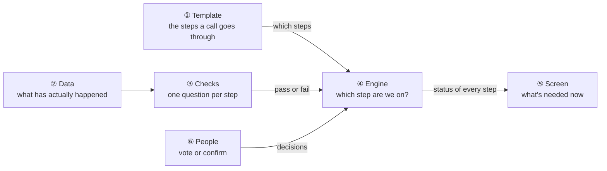
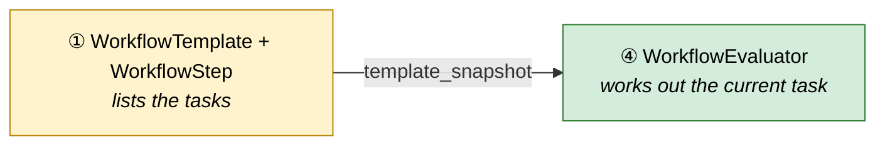
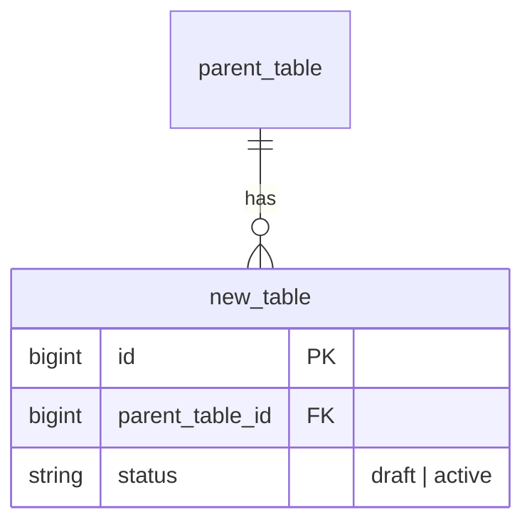

# [Feature Name] — Design

> **Audience:** Engineering team.
> **Companion documents:** [Proposal](proposal.md) · [Spec](specs/)

> **Planning phase — no code changes.** This document explains HOW the proposal will be built.
> Do not edit application code while writing it; implementation happens later, in the tasks phase.

> **Design, not code.** Explain the design with mermaid diagrams and tables. Do NOT paste Ruby/JS
> class bodies, migrations, route blocks or policy code. Put real class, method, table and path
> names inside the diagrams and tables instead.

> **Zoom one picture.** The whole design hangs off ONE numbered picture. Part 1 draws it in plain
> words. Part 2 redraws the SAME picture, same shape and same numbers, with real names. Part 3 has
> one card per box, in the same order. Part 4 is reference material that spans several boxes. The
> numbers ①②③ mean the same box everywhere, so a reader always knows where they are.

> **FAQ per section.** Parts 1 and 2, every card in Part 3, and Part 4 each end with a FAQ table of
> the real "why", "why not X" and "what if" questions a reviewer will ask about that section.
> Answer from the design; no filler questions.

> **Scale to the change.** **CORE** sections are always present. **CONDITIONAL** sections say when
> they apply; otherwise keep the heading with `N/A — <reason>`. A small change has fewer boxes and
> shorter cards, not empty ones.

> **No repetition.** Each fact lives in one place. The proposal owns *what users see and the business
> rules*, the spec owns *requirements*, this document owns *how*. Cards link to Part 4 for shared
> tables (schema, class diagram) instead of copying them.

---

## Contents

<!-- CORE. Links to every ## and ### heading (GitHub anchors keep the ①②③ characters). Regenerate
     after the document is finished. -->

---

## 1. The idea

### What this adds

<!-- CORE. 2-3 sentences: what this adds technically and which existing pattern it follows. -->

### The idea in one picture

<!-- CORE. The whole feature as ONE flowchart that someone who reads nothing else can follow.
     - 5-9 boxes, numbered ①②③… in reading order. Each box has a short plain-English name and a
       one-line description. No class names here.
     - The core of the idea (the engine, the record, the decision) in the middle; inputs left,
       what people see or get on the right.
     - Label every arrow with what flows or why.
     - No subgraphs, colours or error paths: those belong in the cards.
     Example (capital call journey): -->

### Walkthrough: one example, start to finish

<!-- CORE. Right after the picture: one realistic example (use the shared-setup data from Part 4) told
     as a story, detailed but easy to follow.
     - A short setup paragraph and a legend for any notation. Name steps/stages as TASKS ("Create
       remittances", "Approve notices"), never as outcomes ("Remittances ready"): next to a "current"
       mark an outcome name reads as a claim that it is already true. The legend must say what the
       current mark means in words ("● we are here: waiting on this, not done yet").
     - Optional: a mermaid `timeline` of the whole story at a glance.
     - Tables grouped by phase: # | When | What happens (plain words) | Behind the scenes (cite the
       picture's ①②③ boxes) | Result (state after).
       In "Behind the scenes" always write the box's name with its number in brackets, e.g. "the tick (⑨)
       asks the evaluator (④)". Never bare numbers like "⑨ asks ④": readers can't decode them.
       Spell the Result out in full: every step/state by name with its mark (✓ ● ○ ↺), one per line
       ( ), current one in bold. Never a compact symbol string like ✓✓●○○ (user found it confusing).
       For a row that changes nothing, write "Same as row N".
       Keep that column wide: join each step name with &nbsp; so it never wraps, and pad the header
       with &nbsp; (markdown has no column-width setting).
     - Include at least one mistake or undo, and one stall or failure, not only the happy path.
     - One small ASCII snapshot of what the user sees at the most important moment.
     - Close with "What to notice": 3-5 bullets naming the design ideas the story demonstrated. -->

### Key ideas

<!-- CORE. 3-7 rows: the ideas a reader must hold to follow the rest, each linking to its card. -->

| # | Idea | In one line | Card |
|---|---|---|---|
| 1 | <!-- --> | <!-- --> | <!-- [④](#④-engine) --> |

**FAQ**

| Question | Answer |
|---|---|
| <!-- e.g. Does anything block users? --> | <!-- --> |

---

## 2. The same picture with real names

### Picture

<!-- CORE. The SAME flowchart as Part 1: same boxes, same numbers, same arrows, same layout. Each box
     now holds the real classes/tables/partials, and each arrow the real thing that flows (a
     method, a result object, a column). Under the class names, add ONE italic line saying what the box
     does ( <i>works out which task the call is on</i>), and a `click X "#card-anchor"` line per
     box linking to its Part 3 card. Colour each box by footprint, which makes this the only
     new / changed / reused list: -->

Colour = footprint: **green** new, **amber** modified, **grey** reused unchanged. Exact files are in
[lld.md File Map](lld.md#file-map).

### What each box does

<!-- CORE. One row per box, same numbers. This is the medium-level description. -->

| # | Box | Real parts | What it does | When it runs | What it decides | Details |
|---|---|---|---|---|---|---|
| ① | <!-- --> | <!-- classes, tables, partials --> | <!-- --> | <!-- request / job / cron --> | <!-- --> | <!-- [card ① →](#①-…) --> |

### One run, end to end

<!-- CORE. ONE sequenceDiagram of the main happy path across the boxes, with real participants.
     Edge and error flows go in the card of the box that owns them. Mermaid gotcha: `Note` is
     reserved, so never use it as a participant id. -->

### Lifecycles

<!-- CORE if any stored or derived status exists, else N/A. One stateDiagram-v2 per lifecycle,
     every transition's trigger labelled. Say whether each state is stored or derived. -->

### What users see

<!-- CONDITIONAL: whenever a screen, email or alert changes. Written for a reader who has never seen
     the feature, as user journeys, not widget states:
     - an "At a glance" table (Where in CapHive | Today | After this change | Who sees it);
     - the main everyday journey here: a small ASCII wireframe with ①②③ callouts plus a
       Step | The user… | They see table.
     Other journeys go in the card of the box they belong to. User-facing messages stay in the
     proposal. Turbo/Stimulus details go in the owning card's build notes. -->

### Design decisions

<!-- CORE. Numbered: choice, alternative considered, why rejected. Favour the simpler/DRYer option,
     and say why when you don't. -->

1. **Decision title** — Choice made. Alternative considered: X. Rejected because: Y.

**FAQ**

| Question | Answer |
|---|---|
| <!-- --> | <!-- --> |

---

## 3. One card per box

> Same order and numbers as the picture.

<!-- CORE. One ### card per box (a trivial box may share a card with its neighbour, e.g.
     "② Data and ③ Checks"). Every card has the same shape:
     1. One or two sentences: what this box is.
     2. A one-row table: Owns | Reads / receives | Produces.
     3. Its own detail, only what applies:
        - sequence diagrams for its edge/error flows;
        - decision flowcharts for its non-trivial decisions (matching, routing, eligibility,
          fallbacks);
        - its rows of the component responsibility table (queue, retries, idempotency,
          transaction);
        - routes (Verb and path | Action | Does | Responds with) and build notes if it is UI;
        - the role → access table and decision flowchart if it is where access is checked
          (state how entity_id scoping is enforced; no policy code);
        - its secondary user journeys.
        Link to Part 4 for the schema and class diagram rather than copying them.
     4. **Worked examples:** the H/E/X IDs from Part 4 that prove this box.
     5. **FAQ** table. -->

### ① [Box name]

<!-- what it is -->

| Owns | Reads / receives | Produces |
|---|---|---|
| <!-- --> | <!-- --> | <!-- --> |

<!-- detail -->

**Worked examples:** <!-- H1, E3, X2 -->

**FAQ**

| Question | Answer |
|---|---|
| <!-- --> | <!-- --> |

---

## 4. Reference

> Whole-system material that spans several boxes.

### Class diagram

<!-- CORE. classDiagram of every new or changed class, in `namespace` blocks matching the boxes or
     packs, with stereotypes (<<Model>>, <<Service>>, <<Job>>, <<Controller>>, <<Policy>>), public
     methods and the edges between namespaces. -->

### Data model and schema changes

<!-- CONDITIONAL: when tables or columns change. An erDiagram (new tables with every column, columns
     added to existing tables marked NEW, existing tables only with the columns read; PK/FK/UK).
     Indexes on one line. Then "Schema changes": for EVERY new or changed table, one sentence on
     why the table changes, followed by a row per new or changed column and index:
     Column / index | What changed | Why it's needed. Not only the non-obvious ones; a reviewer
     must be able to justify every column from this table alone. Then "Changes to existing
     models" as bullets. -->

**Indexes:** <!-- -->

**Schema changes**

**`new_table`** (new): <!-- why this table exists -->

| Column / index | What changed | Why it's needed |
|---|---|---|
| <!-- `status` --> | <!-- Added: string, "draft" \| "active" --> | <!-- --> |

**Changes to existing models:** <!-- bullets -->

### Component contracts

<!-- CORE. From → To | Contract | Direction rule, one row per arrow in the Part 2 picture. -->

| From → To | Contract | Direction rule |
|---|---|---|
| <!-- ③ → ④ --> | <!-- --> | <!-- --> |

### Cross-cutting concerns

#### Transactions and queries

<!-- CONDITIONAL. Plain language: every read with its N+1 risk, every multi-table write with its
     transaction boundary. -->

#### Exception handling and monitoring

<!-- CONDITIONAL. One row per failure mode: who is alerted, channel (tie to `Noticed`), detail. -->

#### Performance and security

<!-- CORE. A bullet or two each: volume, background vs inline, tenant isolation, sanitisation. -->

### Worked examples

<!-- CORE. Happy Path (H1..), Edge Cases (E1..) and Error Cases (X1.., X for eXception) tables with
     columns # | Scenario | Given | When | Then | Spec scenario | Feature, using real-ish data from
     a shared-setup table. Every spec scenario must appear in the Spec scenario column of at least
     one row; check and add rows for gaps. Each row becomes exactly one Cucumber scenario. Prose
     Given/When/Then bullets are not acceptable. -->

**ID legend:** **H** = Happy path · **E** = Edge case · **X** = Error (exception) case.

**Shared setup:**

| Record | Name | Key data |
|---|---|---|
| <!-- --> | <!-- --> | <!-- --> |

#### Happy Path

| # | Scenario | Given | When | Then | Spec scenario | Feature |
|---|---|---|---|---|---|---|
| H1 | | | | | | |

#### Edge Cases

| # | Scenario | Given | When | Then | Spec scenario | Feature |
|---|---|---|---|---|---|---|
| E1 | | | | | | |

#### Error Cases

| # | Scenario | Given | When | Then (what the user sees, who is alerted) | Spec scenario | Feature |
|---|---|---|---|---|---|---|
| X1 | | | | | | |

### Testing

<!-- CORE, 2-4 lines. Cucumber only (no RSpec tier). Shared setup (stubs, tags, factories) and
     reused vs new step files. The Feature column above is the mapping; don't repeat it. -->

### Risks and open questions

<!-- CORE. Risks as "risk → mitigation" bullets. Open questions only if genuinely deferrable; a
     question that changes specs, approach or tasks must be resolved with the user now. -->

- [Risk] → Mitigation

| # | Open question | Current thinking | Status |
|---|---|---|---|
| 1 | <!-- --> | <!-- --> | <!-- Deferred --> |

**FAQ**

| Question | Answer |
|---|---|
| <!-- e.g. Where do I start reviewing? --> | <!-- --> |
