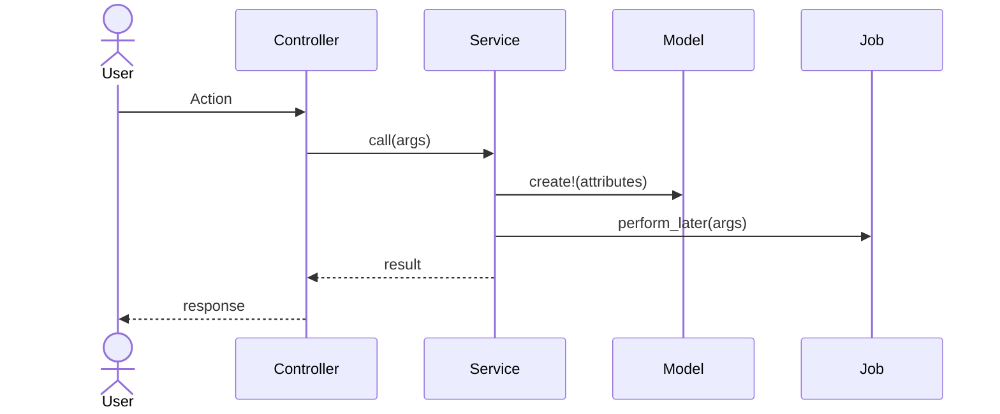

# [Feature Name] — Design

> **Audience:** Engineering team.
> **Companion document:** [Proposal](proposal.md)

> **Planning phase — no code changes.** This document explains HOW the proposal will be built.
> Do not edit application code while writing it; implementation happens later, in the tasks phase.

> **Keep it DRY and simple.** Prefer reusing existing services, components, and patterns over
> introducing new abstractions. If a section would just restate the proposal, link to it instead
> of repeating it.

---

## Overview

<!-- 2-3 sentence summary of what this adds technically. -->

## Architecture

### Pipeline / Flow

<!-- ASCII diagram showing the call chain with REAL class names and method names.
     Example:
     ```
     User Action
         └─> Controller#action
                 ├─> ServiceObject.call(args)
                 │       ├─> Check: condition?
                 │       ├─> Model.create!(attributes)
                 │       └─> Job.perform_later(args)
                 └─> redirect / Turbo Stream response
     ```
-->

### Sequence Diagrams

<!-- One sequence diagram per major flow — happy path plus at least one error/edge flow. Use
     mermaid so they render in GitHub/most viewers. Name real participants (Controller, Service,
     Model, Job, external API) rather than generic actors. -->



<!-- Add a second diagram for the primary error/edge path, e.g. validation failure, a background
     job retry, or a third-party API timeout. -->

### Pack Location

<!-- File tree showing where new files go under app/packs/.
     Example:
     ```
     app/packs/core/folders/
       ├── models/
       │   └── folder_nda_config.rb          ← NEW
       ├── controllers/
       │   └── folder_nda_configs_controller.rb  ← NEW
       └── policies/
           └── folder_nda_config_policy.rb   ← NEW
     ```
-->

**FAQ**

| Question | Answer |
|---|---|
| <!-- e.g. Why this pack and not an existing one? --> | <!-- answer --> |

---

## Data Model Changes

### Migration: `table_name`

```ruby
# db/migrate/YYYYMMDD_create_table_name.rb
class CreateTableName < ActiveRecord::Migration[8.1]
  def change
    create_table :table_name do |t|
      # columns here
      t.timestamps
    end
  end
end
```

**Column rationale:**

| Column | Why |
|---|---|
| <!-- column --> | <!-- rationale --> |

### Model: `ModelName`

```ruby
# app/packs/<pack>/<domain>/models/model_name.rb
# frozen_string_literal: true

# YARD comment explaining the model purpose.
class ModelName < ApplicationRecord
  # associations, validations, callbacks, methods
end
```

### Model Changes: `ExistingModel` (existing — add association)

```ruby
# app/packs/<pack>/<domain>/models/existing_model.rb
# Add inside the class body:
has_one :new_association, class_name: "NewModel", dependent: :destroy
```

**FAQ**

| Question | Answer |
|---|---|
| <!-- e.g. Why a new table instead of a column on an existing one? --> | <!-- answer --> |

---

## Key Components

### ServiceName (New Service)

**Path:** `app/packs/<pack>/<domain>/services/service_name.rb`

**Key methods:**
- `method_name(args)` — description

```ruby
# Key logic snippet
```

### JobName (New Job)

**Path:** `app/packs/<pack>/<domain>/jobs/job_name.rb`

- Description of what the job does
- Queue, retry behavior
- Integration with existing jobs

**FAQ**

| Question | Answer |
|---|---|
| <!-- e.g. Why a background job instead of inline? --> | <!-- answer --> |

---

## Controller

```ruby
# app/packs/<pack>/<domain>/controllers/controller_name.rb
# frozen_string_literal: true

# YARD comment.
class ControllerName < ApplicationController
  # actions, strong params, authorization
end
```

## Routing

```ruby
# config/routes/<domain>.rb
resources :parent do
  resource :child, controller: "controller_name", only: %i[new create edit update]
end
```

**Resulting paths:**
- `GET    /parent/:parent_id/child/new`
- `POST   /parent/:parent_id/child`

**FAQ**

| Question | Answer |
|---|---|
| <!-- e.g. Why nested under parent instead of top-level? --> | <!-- answer --> |

---

## Policy

<!-- Who can access this feature. State it in plain terms before the code — this is what
     support/QA will ask first. -->

**Access control:**

| Role | Access |
|---|---|
| <!-- e.g. Fund Admin --> | <!-- e.g. full access --> |
| <!-- e.g. Investor --> | <!-- e.g. read-only, own records only --> |
| <!-- e.g. Support --> | <!-- e.g. full access, all entities --> |

```ruby
# app/packs/<pack>/<domain>/policies/policy_name.rb
# frozen_string_literal: true

# YARD comment.
class PolicyName < ApplicationPolicy
  # authorization methods
end
```

**Multi-tenancy:** <!-- how entity_id scoping is enforced for this feature -->

**FAQ**

| Question | Answer |
|---|---|
| <!-- e.g. Can an investor see another investor's data? --> | <!-- answer, should be No, and why --> |

---

## Views

### Partial: `_partial_name.html.erb`

**Path:** `app/packs/<pack>/<domain>/views/<controller>/_partial_name.html.erb`

- What it renders
- Turbo Frame / Turbo Stream behavior
- Stimulus controller connections

### Stimulus Controller

```javascript
// app/javascript/controllers/controller_name_controller.js
import { Controller } from "@hotwired/stimulus"

// YARD-style comment.
export default class extends Controller {
  static targets = ["target1", "target2"]

  // methods
}
```

**FAQ**

| Question | Answer |
|---|---|
| <!-- e.g. Does this require a page reload? --> | <!-- answer --> |

---

## Transactions and Queries

<!-- Every query and transaction this feature adds or touches. The goal is to catch N+1s and
     unbounded loops before they ship, not after. -->

**Queries added/changed:**

| Query | Triggered by | N+1 risk | Mitigation |
|---|---|---|---|
| <!-- e.g. Model.where(entity_id:).includes(:assoc) --> | <!-- e.g. index action, per row --> | <!-- Yes/No --> | <!-- e.g. `includes`/`preload`, counter cache, batch load --> |

**Transaction boundaries:**

| Operation | Wrapped in transaction? | Why |
|---|---|---|
| <!-- e.g. Service#call --> | <!-- Yes/No --> | <!-- e.g. writes to 2 tables that must stay consistent --> |

**FAQ**

| Question | Answer |
|---|---|
| <!-- e.g. Does this add a query per row in a list view? --> | <!-- answer --> |

---

## Exception Handling and Monitoring

<!-- For every failure mode this feature can hit: who finds out, and how. -->

| Failure scenario | Who is alerted | Channel | Detail |
|---|---|---|---|
| <!-- e.g. Job fails after retries --> | <!-- User / Support / Both --> | <!-- Email / WhatsApp / In-app alert --> | <!-- e.g. Sidekiq retry exhausted → Noticed notification to support --> |
| <!-- e.g. External API timeout --> | <!-- User / Support / Both --> | <!-- Email / WhatsApp / In-app alert --> | <!-- answer --> |
| <!-- e.g. Validation failure on user input --> | <!-- User --> | <!-- In-app alert --> | <!-- inline form error, no notification needed --> |

**FAQ**

| Question | Answer |
|---|---|
| <!-- e.g. What happens if the job silently fails? --> | <!-- answer --> |

---

## Existing Infrastructure Reused

| Component | Path | Purpose |
|---|---|---|
| <!-- component --> | <!-- path --> | <!-- what we use it for --> |

## Files Changed Summary

### New Files
- `path/to/new/file.rb` — description

### Modified Files
- `path/to/existing/file.rb` — what changed

## Design Decisions

1. **Decision title** — Choice made. Alternative considered: X. Rejected because: Y.

<!-- Every decision should favor the simpler, DRYer option unless there's a concrete reason not
     to — state that reason here rather than leaving it implicit. -->

---

## Worked Examples

<!-- 1-2 concrete examples per case, with real-ish data. These double as the source material for
     Cucumber scenarios in the tasks phase. -->

### Happy Path

**Example 1: <!-- short title -->**
- **Given:** <!-- starting state -->
- **When:** <!-- action taken -->
- **Then:** <!-- observable result -->

### Edge Cases

**Example 1: <!-- e.g. empty/boundary input -->**
- **Given:** <!-- starting state -->
- **When:** <!-- action taken -->
- **Then:** <!-- observable result -->

### Error Cases

**Example 1: <!-- e.g. invalid input, race condition, external failure -->**
- **Given:** <!-- starting state -->
- **When:** <!-- action taken -->
- **Then:** <!-- observable result, including what the user sees and who gets alerted -->

**FAQ**

| Question | Answer |
|---|---|
| <!-- e.g. What's the retry behavior for the error case above? --> | <!-- answer --> |

---

## Testing Strategy

<!-- Cucumber is the only test framework in this codebase — do not plan RSpec specs. -->

### Cucumber

**Feature file(s):** `features/<domain>/<feature_name>.feature`

- <!-- Scenario covering the happy path worked example above -->
- <!-- Scenario covering each edge case worked example above -->
- <!-- Scenario covering each error case worked example above, including the alert/notification -->

Reuse existing step definitions where possible; add new ones under `features/step_definitions/`.
Use `FactoryBot` (`spec/factories/`) for setup.

## Performance Considerations

- <!-- Anything beyond the Transactions and Queries section above: caching, background vs. inline
     work, expected data volume -->

## Security Considerations

- <!-- Tenant isolation, authorization (see Policy above), input validation, file upload safety -->

## Risks / Trade-offs

- [Risk/Trade-off] → Mitigation

## Open Technical Questions

| # | Question | Current Thinking | Status |
|---|---|---|---|
| 1 | <!-- question --> | <!-- thinking --> | <!-- Deferred / Check before implementation --> |
