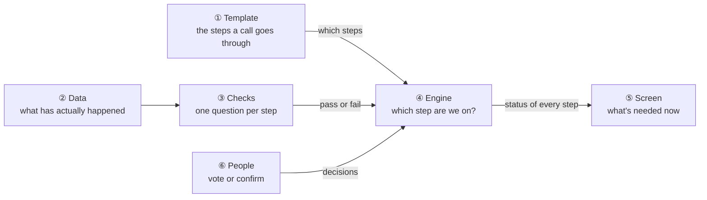
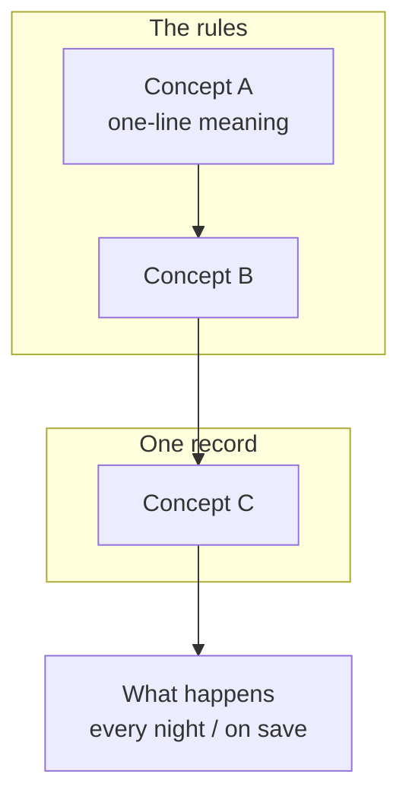
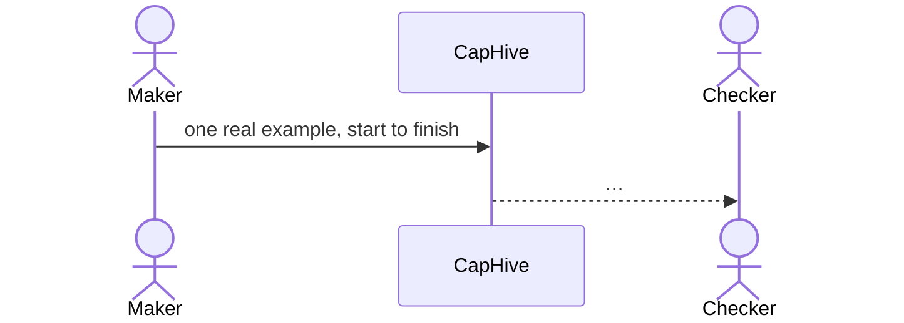
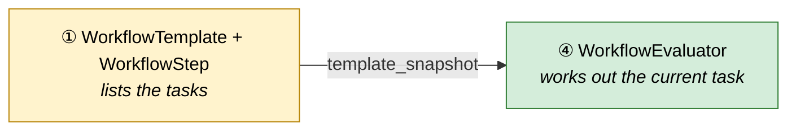
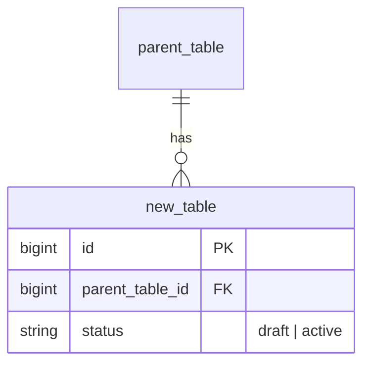

# [Feature Name] — Design

<!-- STYLE: bullets and diagrams, not prose. One idea per bullet; a diagram per concept (model, lifecycle, flow); table cells a phrase each — longer reasoning goes in bullets under the table. -->

> **Audience:** Engineering team.
> **Companion documents:** [Proposal](proposal.md) · [Spec](specs/)

> **Planning phase — no code changes.** This document explains HOW the proposal will be built.
> Do not edit application code while writing it; implementation happens later, in the tasks phase.

> **Design, not code.** Explain the design with mermaid diagrams and tables. Do NOT paste Ruby/JS
> class bodies, migrations, route blocks or policy code. Put real class, method, table and path
> names inside the diagrams and tables instead.

> **Zoom one picture.** The whole design hangs off ONE numbered picture. Part 1 draws it in plain
> words. Part 2 redraws the SAME picture, same shape and same numbers, with real names. Part 3 has
> one card per box, in the same order. Part 4 is reference material that spans several boxes. The
> numbers ①②③ mean the same box everywhere, so a reader always knows where they are.

> **FAQ per section.** Parts 1 and 2, every card in Part 3, and Part 4 each end with a FAQ table of
> the real "why", "why not X" and "what if" questions a reviewer will ask about that section.
> Answer from the design; no filler questions.

> **Scale to the change.** **CORE** sections are always present. **CONDITIONAL** sections say when
> they apply; otherwise keep the heading with `N/A — <reason>`. A small change has fewer boxes and
> shorter cards, not empty ones.

> **No repetition.** Each fact lives in one place. The proposal owns *what users see and the business
> rules*, the spec owns *requirements*, this document owns *how*. Cards link to Part 4 for shared
> tables (schema, class diagram) instead of copying them.

---

## Contents

<!-- CORE. Links to every ## and ### heading (GitHub anchors keep the ①②③ characters). Regenerate
     after the document is finished. -->

---

## 1. The idea

### What this adds

<!-- CORE. 2-3 sentences: what this adds technically and which existing pattern it follows. -->

### The idea in one picture

<!-- CORE. The whole feature as ONE flowchart that someone who reads nothing else can follow.
     - 5-9 boxes, numbered ①②③… in reading order. Each box has a short plain-English name and a
       one-line description. No class names here.
     - The core of the idea (the engine, the record, the decision) in the middle; inputs left,
       what people see or get on the right.
     - Label every arrow with what flows or why.
     - No subgraphs, colours or error paths: those belong in the cards.
     Example (capital call journey): -->

### Key concepts

<!-- CORE — never omitted. Placed right after the picture and BEFORE the walkthrough: every word the
     rest of the design leans on, explained in plain language so a reader new to the domain can
     follow. Rules:
     - **Concept map**: one mermaid flowchart of how the concepts relate (subgraphs allowed here:
       e.g. "the rules" / "one record" / "what happens every night"), with 3 bullets under it.
     - **Glossary** table: Concept | What it is, in one line | Example (from the walkthrough's data)
       | Stored in (table/column, or "Not stored"). Every domain noun, status word and role used
       later appears here — including words the team takes for granted (episode, maker–checker,
       duty, applicability, preview, …).
     - **One #### explainer per concept that has its own rules or lifecycle** (e.g. an approval
       model, a recurring obligation, a grouping like "episode"). Each explainer has:
       - what it is and WHY it exists (the problem it solves), as bullets;
       - a table of its kinds/triggers with a real example per row;
       - what it does NOT cover (e.g. which actions need no approval) — readers ask this first;
       - one diagram (sequenceDiagram or timeline) of one example start to finish;
       - its rules as bullets (who, when, exceptions, what happens on reject/undo).
     - Later sections LINK back here instead of re-explaining (cards add a line "New to X? Read
       [X](#anchor) first").
     - Never introduce a concept first in a card, decision or schema table. -->

**How the concepts fit together**

- <!-- what the top box is -->
- <!-- what the middle is -->
- <!-- what the bottom is -->

**Glossary**

| Concept | What it is, in one line | Example | Stored in |
|---|---|---|---|
| <!-- e.g. Register item --> | <!-- one breach episode: opened by the first failing run, closed by the first passing run --> | <!-- "Concentration — open since 5 Nov, fix by 5 Dec" --> | <!-- `compliance_register_items` --> |

#### <!-- Concept with its own rules, e.g. "Maker–checker — two-person approval" -->

- **What:** <!-- -->
- **Why:** <!-- the problem it solves -->

| Kind / trigger | What it does | Example |
|---|---|---|
| <!-- --> | <!-- --> | <!-- --> |

**What it does NOT cover:** <!-- e.g. actions one person may do alone, and why -->

**Rules**
- <!-- who, when, exceptions, what happens on reject / undo -->

### Walkthrough: one example, start to finish

<!-- CORE. Right after the picture: one realistic example (use the shared-setup data from Part 4) told
     as a story, detailed but easy to follow.
     - A short setup paragraph and a legend for any notation. Name steps/stages as TASKS ("Create
       remittances", "Approve notices"), never as outcomes ("Remittances ready"): next to a "current"
       mark an outcome name reads as a claim that it is already true. The legend must say what the
       current mark means in words ("● we are here: waiting on this, not done yet").
     - Optional: a mermaid `timeline` of the whole story at a glance.
     - Tables grouped by phase: # | When | What happens (plain words) | Behind the scenes (cite the
       picture's ①②③ boxes) | Result (state after).
       In "Behind the scenes" always write the box's name with its number in brackets, e.g. "the tick (⑨)
       asks the evaluator (④)". Never bare numbers like "⑨ asks ④": readers can't decode them.
       Spell the Result out in full: every step/state by name with its mark (✓ ● ○ ↺), one per line
       ( ), current one in bold. Never a compact symbol string like ✓✓●○○ (user found it confusing).
       For a row that changes nothing, write "Same as row N".
       Keep that column wide: join each step name with &nbsp; so it never wraps, and pad the header
       with &nbsp; (markdown has no column-width setting).
     - Include at least one mistake or undo, and one stall or failure, not only the happy path.
     - One small ASCII snapshot of what the user sees at the most important moment.
     - Close with "What to notice": 3-5 bullets naming the design ideas the story demonstrated. -->

### Key ideas

<!-- CORE. 3-7 rows: the ideas a reader must hold to follow the rest, each linking to its card. -->

| # | Idea | In one line | Card |
|---|---|---|---|
| 1 | <!-- --> | <!-- --> | <!-- [④](#④-engine) --> |

**FAQ**

| Question | Answer |
|---|---|
| <!-- e.g. Does anything block users? --> | <!-- --> |

---

## 2. The same picture with real names

### Picture

<!-- CORE. The SAME flowchart as Part 1: same boxes, same numbers, same arrows, same layout. Each box
     now holds the real classes/tables/partials, and each arrow the real thing that flows (a
     method, a result object, a column). Under the class names, add ONE italic line saying what the box
     does ( <i>works out which task the call is on</i>), and a `click X "#card-anchor"` line per
     box linking to its Part 3 card. Colour each box by footprint, which makes this the only
     new / changed / reused list: -->

Colour = footprint: **green** new, **amber** modified, **grey** reused unchanged. Exact files are in
[lld.md File Map](lld.md#file-map).

### What each box does

<!-- CORE. One row per box, same numbers. This is the medium-level description. -->

| # | Box | Real parts | What it does | When it runs | What it decides | Details |
|---|---|---|---|---|---|---|
| ① | <!-- --> | <!-- classes, tables, partials --> | <!-- --> | <!-- request / job / cron --> | <!-- --> | <!-- [card ① →](#①-…) --> |

### One run, end to end

<!-- CORE. ONE sequenceDiagram of the main happy path across the boxes, with real participants.
     Edge and error flows go in the card of the box that owns them. Mermaid gotcha: `Note` is
     reserved, so never use it as a participant id. -->

### Lifecycles

<!-- CORE if any stored or derived status exists, else N/A. One stateDiagram-v2 per lifecycle,
     every transition's trigger labelled. Say whether each state is stored or derived. -->

### What users see

<!-- CONDITIONAL: whenever a screen, email or alert changes. Written for a reader who has never seen
     the feature, as user journeys, not widget states:
     - an "At a glance" table (Where in CapHive | Today | After this change | Who sees it);
     - the main everyday journey here: a small ASCII wireframe with ①②③ callouts plus a
       Step | The user… | They see table.
     Other journeys go in the card of the box they belong to. User-facing messages stay in the
     proposal. Turbo/Stimulus details go in the owning card's build notes.
     - **Screen standards** (REQUIRED whenever a screen is added or changed): one row per screen, so
       every page is DESIGNED to the app's standard instead of being fixed after it is built. Name a
       real existing screen to copy for each one — never "reuse existing styling" in general.
       Defaults to copy: index = capital_calls/_index (h1.h3 header + outline `ti` buttons +
       grid_stats + layouts/filter + SearchComponent + RansackTable + pagy); show = capital_calls/show
       + _show (container-fluid mw-100 p-3, stats, `card shadow-sm border-0` sections, actions row +
       "Actions" dropdown); tabs = funds/_owner_fund_details (data-controller="tabs", nav-pills,
       lazy turbo-frame panes with layouts/loading); journeys = workflow_instances/_journey_panel
       (step popups via journey-step-info); forms = FormCard (forms only). -->

**Screen standards**

| Screen | Kind | Copies | Breadcrumbs | Tabs (lazy pills) | Turbo (frames / streams per action) | Stats cards (= grid totals) | Filter + search | Actions (header + Actions dropdown) | Help (title ⓘ intro, field tooltips, empty state, What's next) | Full width |
|---|---|---|---|---|---|---|---|---|---|---|
| <!-- Register --> | <!-- index --> | <!-- capital_calls/_index --> | <!-- Compliance › Register --> | <!-- Open/Closed/All --> | <!-- grid frame; assign = stream replacing row --> | <!-- Open, Overdue… --> | <!-- layouts/filter: fund, status… --> | <!-- Filter · Download --> | <!-- yes --> | <!-- mw-100 --> |

- Every action that changes one row or card answers `format.turbo_stream` (replace by `dom_id`, refresh cards, flash) with an HTML redirect fallback; a full reload only where the whole page changes — say which.
- Help text is a tooltip, never a grey paragraph under the title; a coloured box only when something needs attention.
- One icon per concept across the feature; badges `bg-X-subtle text-X` with only success/info/danger/secondary.

### Design decisions

<!-- CORE. Written so a reader who was not in the room understands each call. Rules:
     - Open with an **At a glance** table: # | Decision | Why, in one line. Number D1, D2, … in order
       (never out of order, never gaps).
     - Then one #### block per decision, ALWAYS with these five bullets:
       - **Problem:** what had to be decided, in plain words, with a concrete example;
       - **Decision:** what we build (real names);
       - **Why:** 2-4 bullets;
       - **Not chosen:** the alternative, and why not;
       - **Where:** the classes / tables that carry it.
     - Use only concepts already defined in [Key concepts](#key-concepts); link to them.
     - Favour the simpler/DRYer option, and say why when you don't.
     - During apply, add a **Changed during the build** table (Log # | What changed | Why) and update
       any decision the build changed (mark it "Changed during the build: …"), so design.md never
       contradicts the code. -->

**At a glance**

| # | Decision | Why, in one line |
|---|---|---|
| D1 | <!-- --> | <!-- --> |

#### D1. <!-- Decision title -->

- **Problem:** <!-- -->
- **Decision:** <!-- -->
- **Why:** <!-- -->
- **Not chosen:** <!-- alternative — because … -->
- **Where:** <!-- classes / tables -->

**FAQ**

| Question | Answer |
|---|---|
| <!-- --> | <!-- --> |

---

## 3. One card per box

> Same order and numbers as the picture.

<!-- CORE. One ### card per box (a trivial box may share a card with its neighbour, e.g.
     "② Data and ③ Checks"). Every card has the same shape:
     1. One or two sentences: what this box is.
     2. A one-row table: Owns | Reads / receives | Produces.
     3. Its own detail, only what applies:
        - sequence diagrams for its edge/error flows;
        - decision flowcharts for its non-trivial decisions (matching, routing, eligibility,
          fallbacks);
        - its rows of the component responsibility table (queue, retries, idempotency,
          transaction);
        - routes (Verb and path | Action | Does | Responds with) and build notes if it is UI;
        - the role → access table and decision flowchart if it is where access is checked
          (state how entity_id scoping is enforced; no policy code);
        - its secondary user journeys.
        Link to Part 4 for the schema and class diagram rather than copying them.
     4. **Worked examples:** the H/E/X IDs from Part 4 that prove this box.
     5. **FAQ** table. -->

### ① [Box name]

<!-- what it is -->

| Owns | Reads / receives | Produces |
|---|---|---|
| <!-- --> | <!-- --> | <!-- --> |

<!-- detail -->

**Worked examples:** <!-- H1, E3, X2 -->

**FAQ**

| Question | Answer |
|---|---|
| <!-- --> | <!-- --> |

---

## 4. Reference

> Whole-system material that spans several boxes.

### Class diagram

<!-- CORE. classDiagram of every new or changed class, in `namespace` blocks matching the boxes or
     packs, with stereotypes (<<Model>>, <<Service>>, <<Job>>, <<Controller>>, <<Policy>>), public
     methods and the edges between namespaces. -->

### Data model and schema changes

<!-- CONDITIONAL: when tables or columns change. An erDiagram (new tables with every column, columns
     added to existing tables marked NEW, existing tables only with the columns read; PK/FK/UK).
     Indexes on one line. Then "Schema changes": for EVERY new or changed table, one sentence on
     why the table changes, followed by a row per new or changed column and index:
     Column / index | What changed | Why it's needed. Not only the non-obvious ones; a reviewer
     must be able to justify every column from this table alone. Then "Changes to existing
     models" as bullets. -->

**Indexes:** <!-- -->

**Schema changes**

**`new_table`** (new): <!-- why this table exists -->

| Column / index | What changed | Why it's needed |
|---|---|---|
| <!-- `status` --> | <!-- Added: string, "draft" \| "active" --> | <!-- --> |

**Changes to existing models:** <!-- bullets -->

### Component contracts

<!-- CORE. From → To | Contract | Direction rule, one row per arrow in the Part 2 picture. -->

| From → To | Contract | Direction rule |
|---|---|---|
| <!-- ③ → ④ --> | <!-- --> | <!-- --> |

### Cross-cutting concerns

#### Transactions and queries

<!-- CONDITIONAL. Plain language: every read with its N+1 risk, every multi-table write with its
     transaction boundary. -->

#### Exception handling and monitoring

<!-- CONDITIONAL. One row per failure mode: who is alerted, channel (tie to `Noticed`), detail. -->

#### Architecture and design patterns

<!-- CORE — never omitted. One row per item: 1 Pack boundaries (Packwerk), 2 Thin controllers /
     skinny models (Trailblazer operations, services), 3 Single responsibility / deep modules,
     4 Reuse before you add (existing concerns, services, partials; flag existing-model changes),
     5 Configuration as data (global default + entity override, versioned), 6 Explicit state
     machines, 7 Append-only audit records, 8 Background work (idempotent Sidekiq, schedule.rb),
     9 Notifications (Noticed, CustomNotification), 10 UI (Turbo, Stimulus, ViewComponent, Draper,
     existing styling), 11 Queries and data (SQL aggregates, Ransack allowlist, money cents,
     large tables), 12 AI (LlmService, structured output, jobs, never in deterministic paths),
     13 Rollout (per entity, phased), 14 YAGNI / DRY. A row may say "not needed — reason". -->

| # | Pattern | How this design applies it | Existing example reused | Where |
|---|---|---|---|---|
| 1 | Pack boundaries | | | |

#### Performance

<!-- CORE. Bullets: volume, background vs inline, batching, large tables (CLAUDE.md). PLUS a query
     budget for every page, frame and job the change adds, so N+1s are designed out rather than found
     by Prosopite after the code is written. Rules:
     - No query inside a loop over rows: no per-row `exists?`/`count`/`find_by`, no per-row Pundit
       `policy(record).x?` that queries, no per-row association not preloaded. Use `includes`,
       `group(...).count` / `maximum`, one `pluck` into a Hash, or a per-request memo.
     - Access checks used per row (roles, fund visibility) are loaded once per request.
     - Counts shown in nav bars / cards are grouped SQL counts, memoised per request.
     - Jobs that loop over funds/records batch their lookups the same way.
     - Each phase's gate runs its features under Prosopite (`PROSOPITE=1`, see
       config/initializers/prosopite.rb) and fixes every N+1 whose stack is in the change's code. -->

**Query budget**

| Page / frame / job | Rows shown or processed | Queries (budget, independent of rows) | Preloads / grouped queries | Per-row lookups avoided |
|---|---|---|---|---|
| <!-- Register grid --> | <!-- 10–500 items --> | <!-- ≤ 12 --> | <!-- includes(:fund, :assignee); group(:fund_id).count --> | <!-- policy per row → fund_ids memo --> |

#### Security

<!-- CORE — never omitted, never "N/A". One row per item; every new action, job, policy, upload,
     AI call and token appears. Items: 1 Authorization (Pundit, policy_scope then authorize),
     2 Tenant isolation (entity + parent ids same-firm, ForInvestor), 3 Mass assignment,
     4 No code from data (eval/constantize/send allowlists), 5 Injection (SQL, Ransack allowlist,
     XSS, paths), 6 Background jobs (reload + re-check access), 7 Files and documents,
     8 AI/LLM (prompt injection, no write tools, validated structured output, entity-only context,
     minimum PII), 9 Webhooks/tokens/links, 10 Rate limiting and cost, 11 Audit and logging,
     12 Verification (Brakeman, bundler-audit, features/security/ scenarios). See
     docs/security/security_review_2026_10.md "Recurring root causes". -->

| # | Item | How this design meets it | Where | Test |
|---|---|---|---|---|
| 1 | Authorization | | | |

### Worked examples

<!-- CORE. Happy Path (H1..), Edge Cases (E1..) and Error Cases (X1.., X for eXception) tables with
     columns # | Scenario | Given | When | Then | Spec scenario | Feature, using real-ish data from
     a shared-setup table. Every spec scenario must appear in the Spec scenario column of at least
     one row; check and add rows for gaps. Each row becomes exactly one Cucumber scenario. Prose
     Given/When/Then bullets are not acceptable. -->

**ID legend:** **H** = Happy path · **E** = Edge case · **X** = Error (exception) case.

**Shared setup:**

| Record | Name | Key data |
|---|---|---|
| <!-- --> | <!-- --> | <!-- --> |

#### Happy Path

| # | Scenario | Given | When | Then | Spec scenario | Feature |
|---|---|---|---|---|---|---|
| H1 | | | | | | |

#### Edge Cases

| # | Scenario | Given | When | Then | Spec scenario | Feature |
|---|---|---|---|---|---|---|
| E1 | | | | | | |

#### Error Cases

| # | Scenario | Given | When | Then (what the user sees, who is alerted) | Spec scenario | Feature |
|---|---|---|---|---|---|---|
| X1 | | | | | | |

### Testing

<!-- CORE, 2-4 lines. Cucumber only (no RSpec tier). Shared setup (stubs, tags, factories) and
     reused vs new step files. The Feature column above is the mapping; don't repeat it. -->

### Risks and open questions

<!-- CORE. Risks as "risk → mitigation" bullets. Open questions only if genuinely deferrable; a
     question that changes specs, approach or tasks must be resolved with the user now. -->

- [Risk] → Mitigation

| # | Open question | Current thinking | Status |
|---|---|---|---|
| 1 | <!-- --> | <!-- --> | <!-- Deferred --> |

**FAQ**

| Question | Answer |
|---|---|
| <!-- e.g. Where do I start reviewing? --> | <!-- --> |
