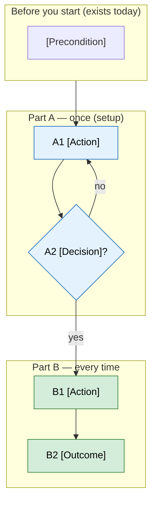

# [Feature Name] — Proposal

> **Audience:** Business team, product, QA, support — non-technical.
> **Companion document:** [Design](design.md)
> **New to this? Start with the [Workflow Journey](#workflow-journey)** — every action, in order, from start to the outcome.

> **Planning phase — no code changes.** This document proposes and explains the change. Do not
> edit application code while writing it; implementation happens later, in the tasks phase.

---

## Why

<!-- 1-2 sentences: what problem does this solve, or what opportunity does it capture? Why now?
     How does it work today (if anything)? -->

## What Changes

<!-- What changes for the user/business, in plain language. If the feature introduces a new
     mental model, explain it with a simple analogy. Bullet the concrete changes; mark breaking
     changes with **BREAKING**. -->

### Flow Diagram

<!-- Show the current flow ("Before") and the new flow ("After") as mermaid flowcharts, not
     ASCII art. One Before + After pair per flow the change alters, each with a one-line caption.
     Use plain-English node labels (no class names), a diamond for each decision, and colour the
     manual steps being removed (red) and the new steps (green) so the difference is visible at a
     glance. Lint with the mermaid command from the design instruction.
     Example:
     ```mermaid
     flowchart LR
         A["User does X"] --> B["Retypes it by hand"] --> C["Result"]
         classDef manual fill:#fdecea,stroke:#c62828,color:#000
         class B manual
     ```
-->


---

## Workflow Journey

<!-- REQUIRED. The section a newcomer reads first: one worked journey from "nothing set up" to the
     outcome the user wants, listing EVERY action a person takes. If a reader can't follow the
     feature end to end from this section alone, it is not done.

     Include, in this order:
     1. **Who is involved** — table: named person (e.g. Meera), role/access, what they do here.
     2. **The journey on one page** — one mermaid flowchart with a subgraph per part
        (e.g. "Before you start (exists today)", "Part A — once (setup)", "Part B — every time",
        "Part C — if something changes later"), steps numbered A1, A2…, B1…, a diamond per
        decision, loops for fix-and-retry, and classDef colours per part. Lint it.
     3. **Before you start** — what must already exist (data, prior runs, settings, access), and
        where it comes from if missing.
     4. **One table per part** with columns:
        | Step | Who | Where (screen › button) | Action | What the system does | What you see |
        Every click, every background step, every refusal message in the right row.
     5. **What the user sees** — ASCII mockups of the key screens/outputs with realistic figures
        for one example (e.g. one fund, one quarter); show the arithmetic for any computed figure
        or check so the numbers visibly add up.
     6. **What goes wrong** — at least one failing path walked through (what is shown, how it is
        fixed).
     7. **Summary: the minimum actions** — table: #, action, who, how often (once / every time).

     Keep it non-technical: screen and button names, not class names. -->

### Who is involved

| Person | Role | What they do in the journey |
|---|---|---|
| [Name] | [Role / access] | [Their part] |

### The journey on one page



### Before you start

| Needed | Why | Where it comes from |
|---|---|---|
| [Data / run / setting] | [Used for] | [Source] |

### Part A — [once / setup]

| Step | Who | Where | Action | What the system does | What you see |
|---|---|---|---|---|---|
| A1 | [Name] | [Screen › button] | [Action] | [System response] | [Visible result] |

### Part B — [every time]

| Step | Who | Where | Action | What the system does | What you see |
|---|---|---|---|---|---|
| B1 | [Name] | [Screen › button] | [Action] | [System response, incl. refusals] | [Visible result] |

### What you see

```
[ASCII mockup of the key screen/output with realistic example figures]
```

### What goes wrong

<!-- One failing path: what is shown, why, and the action that fixes it. -->

### Summary: the minimum actions

| # | Action | Who | How often |
|---|---|---|---|
| 1 | [Action] | [Name] | [Once / every period] |

---

## User Stories

### US-1: [Title]

**As a** [role],
**I want** [goal],
**So that** [benefit].

**Acceptance criteria:**
- <!-- Specific, testable criteria -->
- <!-- Be precise about UI elements, messages, behavior -->

<!-- Add more user stories as needed. Cover main flow AND edge cases. -->

---

## UI Behavior

### [Screen/Entry Point Name]

<!-- ASCII art mockup of the UI with realistic data -->

```
┌─────────────────────────────────────────────────────┐
│  [Screen Title]                                   ✕  │
│                                                     │
│  <!-- UI elements here -->                          │
│                                                     │
└─────────────────────────────────────────────────────┘
```

**Behavior notes:**
- <!-- Toggle behavior, conditional visibility, button states -->
- <!-- Turbo Frame updates, no-reload behavior -->

<!-- Add more screens as needed -->

---

## What This Feature Does NOT Cover

| Excluded | Covered In |
|---|---|
| <!-- Item --> | <!-- Module/Phase --> |

---

## Validation Rules

| Field | Rule | Default |
|---|---|---|
| <!-- field --> | <!-- rule --> | <!-- default --> |

---

## Behavior Rules

| Scenario | What User Sees |
|---|---|
| <!-- scenario --> | <!-- result --> |

---

## Resolved Design Decisions

| # | Decision | Resolution |
|---|---|---|
| 1 | <!-- question --> | <!-- resolution --> |

---

## Capabilities

### New Capabilities

<!-- Capabilities being introduced. Each creates specs/<capability-path>/spec.md. -->
- `<capability-path>`: <brief description>

### Modified Capabilities

<!-- Existing capabilities whose REQUIREMENTS are changing. Leave empty if none. -->

---

## Impact

<!-- Affected code, APIs, dependencies, systems -->

---

## Benefits

1. <!-- Concrete benefit for the end user -->

---

## FAQ

<!-- Anticipate the questions business/product/QA/support will ask. One Q&A per row.
     Keep answers non-technical — link to design.md for "how". -->

| Question | Answer |
|---|---|
| <!-- e.g. Who can use this? --> | <!-- answer --> |
| <!-- e.g. What happens to existing data? --> | <!-- answer --> |
| <!-- e.g. Does this change pricing/billing/notifications? --> | <!-- answer --> |

---

## Design Principle for the Next Phase

<!-- Reminder carried into design.md: keep the design DRY and simple. Prefer reusing existing
     services, components, and patterns over introducing new abstractions. Flag here anything in
     this proposal that risks a complex design, so the design phase can address it head-on. -->
