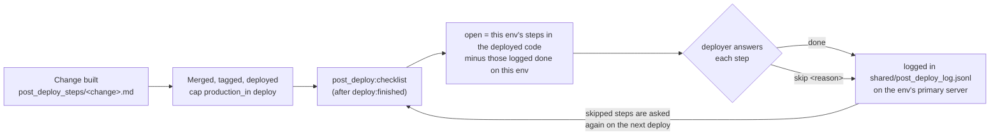

# Post-deploy steps

- **What goes here:** the manual things someone must do **after** a release reaches an environment. For example:
  - switch on an env flag;
  - run a rake task with `EXECUTE=1`;
  - message a group of users;
  - run a QA checklist on staging.
- **One file per change:** `post_deploy_steps/<change-name>.md`, written while the change is built. Every OpenSpec
  change must have one, even when there is nothing to do (then the file says `None — <reason>`).
- **How it's used:** after **every** deploy, Capistrano lists the steps the deployed release has for that environment
  and that it hasn't done yet. The deployer must answer each one.



## The file format

````markdown
# Post-deploy steps — bank-detail-change-controls

Optional intro: why these steps exist, links to the design.

## production

### payout-fields-dry-run — Payout fields: dry run, send each firm its list
```
bin/rails bank_detail_changes:propose_payout_fields
```
Send each listed firm's admin its list. Counts only; nothing is saved.

## staging_in

### qa-checklist — Run the QA checklist
Run `openspec/changes/archive/2026-11-10-bank-detail-change-controls/qa-checklist.md` and record the sign-off.
````

| Part | Rule |
|---|---|
| `# Post-deploy steps — <change>` | Required title |
| `## <section>` | Which environments the steps below apply to: `all`, `production` (both regions), `staging_in`, `production_in`, `production_us` |
| `### <id> — <title>` | One step. The id is lower-case letters, digits and `-`, unique in the file. Never rename an id once deployed, because the log knows steps by `<file>#<id>` |
| Lines under a step | The instructions: commands, who to tell, what "done" means |
| `None — <reason>` | Instead of sections, for a change with nothing to do after deploy |

- **`production` steps:** a step under `production` is asked **separately** in production.in and production.us.
  The two regions are independent environments; never copy values between them.
- **Checking the format:** run `bin/rails post_deploy:lint`. `features/core/post_deploy_steps.feature` runs the same
  check, so a broken file fails the test suite.

## At deploy time

The last thing every `cap <env> deploy` does is `post_deploy:checklist`:

```
──── Post-deploy step 1 of 3 · production_in · owasp-top10-2026-11#revoke-openai-key ────
Revoke the old OpenAI key at OpenAI (H1)

…instructions…

Type "done" once it is done, or "skip <reason>":
```

| Answer | Effect |
|---|---|
| `done` | Logged; never asked again on this environment |
| `skip waiting for the firm admin` | Logged with the reason; asked again on the next deploy |
| anything else, or `skip` with no reason | Asked again |
| Ctrl-C / Ctrl-D | Stops. Answers already given are kept; the rest are asked next time |

- **Without a terminal** (for example, a CI deploy), the checklist prints the open steps and fails. The release is
  already live; run the steps, then `bundle exec cap <env> post_deploy:checklist` to answer them.
- **To see what's open without answering anything:** run `bundle exec cap <env> post_deploy:status`.
- **The log:** `shared/post_deploy_log.jsonl` on the environment's primary server, one JSON line per answer: step,
  env, answer, reason, who, when, the deployed ref (tag or branch) and revision. It lives with the environment, so
  whoever deploys next sees what is still open.

## FAQ

**What if a release is skipped, e.g. V9.3.14 is never deployed to production.us?**
Nothing is lost. The checklist doesn't compare tags: it asks every step in the deployed code that this environment
hasn't logged as done, so V9.3.15's deploy also asks V9.3.14's steps.

**What if a step can't be done yet, e.g. "tune thresholds after a few weeks"?**
Answer `skip <reason>`. It's asked again on each deploy until someone answers `done`.

**Can I delete an old file?**
Only once every environment has answered all its steps `done`. A deleted file's open steps are no longer asked.

**Who writes the file?**
The person or agent building the change. The OpenSpec schemas require it: a design section and a task in
`tasks.md`. `features/core/post_deploy_steps.feature` fails if an archived change has no file.
