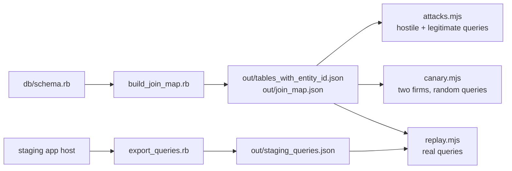

# Support Console tenant probes

Checks that Claude's SQL cannot read another client's data. They test the SQL checker on the
support machine (`support_console/machine/lib/sql_rules.js`) from outside, and are not part of
`npm test` or Cucumber. They live outside `support_console/machine/` so `publish_code` never ships
them to the machine.

Generated files and data exports go to `out/`, which is gitignored. That includes the staging
query export, which holds client ids and SQL.



| Probe | Question it answers | Expected today | Expected after support-console-tenant-scope |
|---|---|---|---|
| `attacks.mjs` | Are ~60 known bypass tricks refused, and do legitimate questions still pass? | 10 leaks: wrong-column joins and AI chat logs; exits 1 | 0 mismatches; exits 0 |
| `canary.mjs` | Across thousands of random queries, does anything return the other firm's rows? | ~1,450 of 4,000 leak, and **none** of the leaking queries uses a real link | 0 leaks; queries that use real links still allowed |
| `replay.mjs` | Do the questions support users actually asked still work? | all allowed | all allowed, or each refusal reviewed |

## Running

```sh
cd /path/to/IRM
# 1. Table list + prototype join map from the schema
bin/rails runner support_console/probes/build_join_map.rb

# 2. Hostile and legitimate queries (no database needed)
node support_console/probes/attacks.mjs

# 3. Two-firm canary: a throwaway MySQL on its own port, never the dev databases
docker run -d --rm --name support-canary -e MYSQL_ROOT_PASSWORD=canary -e MYSQL_DATABASE=canary \
  -p 127.0.0.1:33099:3306 mysql:8.4
until docker exec support-canary mysqladmin -uroot -pcanary ping >/dev/null 2>&1; do sleep 2; done
node support_console/probes/canary.mjs
docker stop support-canary

# 4. Replay real queries: export read-only from an app host, save locally, replay
scp -i ~/.ssh/altxdev.pem support_console/probes/export_queries.rb ubuntu@<staging app>:/tmp/sc_export_queries.rb
ssh -i ~/.ssh/altxdev.pem ubuntu@<staging app> 'bash -lc "cd ~/IRM/current && RAILS_ENV=staging bundle exec rails runner /tmp/sc_export_queries.rb 2>/dev/null; rm -f /tmp/sc_export_queries.rb"' \
  | sed -n '/JSON-START/{n;p}' > support_console/probes/out/staging_queries.json
node support_console/probes/replay.mjs
```

## How the canary works

Client **18** (Golden Angels) and firm **31** (Canary Capital) share every table. Every text value
of firm 31 contains `CANARY`. Tables without `entity_id` number their rows one higher than their
parents, as real tables do, so a wrong `id = id` join lands on the other firm's row. Each random
query joins a client table to a table without `entity_id`, on random id-like columns, sometimes
pinning a polymorphic type, as a JOIN or as `IN (SELECT …)`. Every query the checker allows is run,
and any row containing `CANARY` is a leak. Each query is also judged against the prototype join
map, to show whether option 1 (joins only along real links) would have refused it.

Limits: the random queries are one join deep (chains are covered by `attacks.mjs`), and a table
with no text column cannot carry the marker.
